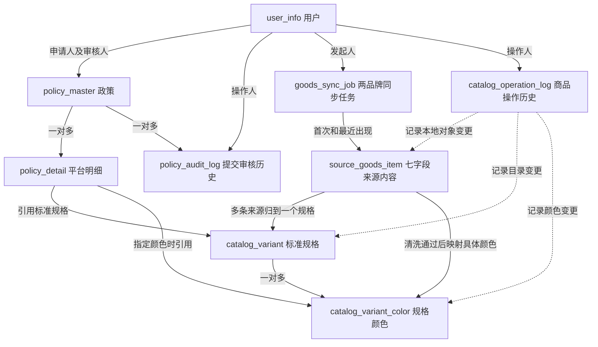

# 商品同步、标准化与管理员后台确认方案

更新日期：2026-11-11。按用户最新确认采用“原始导入 → 自动标准化清洗 → 明确结果自动入标准库 → 异常才人工审核 → 政策选择”的流程。仍为九表，新增清洗字段及系统审计，替代旧的全量人工归类发布流程。功能尚未实现；只更新文档和 SQL，不操作用户目标库。

## 1. 已确认的业务

- 只同步一加手机、OPPO手机，分别查询并维护独立续拉进度。
- 来源商品只保存 goodsName、goodsNo、skuName、cateName、goodsField4、goodsField1、goodsField5 七个业务字段。品牌从任务分区确定；本地 ID、账套、租户、哈希、映射和批次等属于管理元数据。
- skuId 仅在内存中用于 lastMaxId 续拉，任务只保留各品牌最新进度；商品表、日志、快照不保存逐商品外部 SKU ID、完整响应或额外上游属性。
- 本地标准目录按品牌 → 系列 → 型号 → 配置筛选，但合并保存在 catalog_variant，一行表示一个具体型号配置，规格 ID 稳定。
- 颜色同样从已保存七字段清洗得到，明确结果自动创建/复用 catalog_variant_color，不要求用户逐个手工建立；不同型号配置各有独立颜色，同名也不能跨规格共用。人工维护只处理异常、纠正和补充。
- 政策可以按规格不限颜色提交，也可以指定该规格下一个具体颜色。多种指定颜色需分别建明细，数量、补贴分别填写；批量填写仅复制补贴，不自动共享数量。
- 维持逐平台政策、草稿、提交、审核、驳回重提及历史快照；不扩展吉客云回写、库存、结算或多级审批。

## 2. 九张表与关系

完整清洗细则见 [自动清洗与异常审核](../business/catalog-cleaning.md)，规则、候选与 SQL 约束以该文档及数据字典一致维护。

| 表 | 职责 |
| --- | --- |
| user_info | 飞书身份、本地角色、停用状态 |
| catalog_variant | 品牌、系列、型号、配置及发布状态；不再分别建品牌、系列和型号表 |
| catalog_variant_color | 每个具体规格的颜色集合及启停状态 |
| goods_sync_job | 两品牌导入状态/断点、独立清洗阶段及规则包版本 |
| source_goods_item | 原始七字段、清洗候选/证据/异常/租约、人工审核和已生效映射 |
| catalog_operation_log | 区分 SYSTEM 自动处理和 USER 人工审核的全过程历史 |
| policy_master | 政策申请基本信息、租户、状态与版本 |
| policy_detail | 一个具体平台、规格、颜色范围下的数量和补贴 |
| policy_audit_log | 每轮提交完整快照和独立审核意见 |

不单独建立规则表、映射表、批次内容关联表或逐页原始响应表。受控代码/配置维护有版本的规则包；可唯一确定的规则结果自动通过，其他进入异常审核，不执行来源中的脚本或任意 SQL。当前候选保存在来源表，各次完成/异常/纠正的证据写操作日志，不因重跑覆盖旧记录。

所有业务关联须同租户。来源到规格还通过品牌组合外键约束，颜色到规格通过组合外键约束；目录及颜色停用不删除已引用记录。商品日志是多态本地对象引用，entity_type + entity_id 由服务端校验，不能误称每个对象都存在数据库外键。

## 3. 颜色与表单

选品牌、系列、型号、配置后，必须明确颜色范围：

| color_scope | variant_color_id | color 快照 | 含义 |
| --- | --- | --- | --- |
| ALL_COLORS | NULL | NULL | 仅当前型号配置，不限定颜色 |
| SPECIFIC_COLOR | 当前规格下颜色 ID | 服务端读取的颜色名称 | 仅指定颜色 |
| NULL | NULL | NULL | 草稿尚未选择，禁止正式提交 |

草稿选择 SPECIFIC_COLOR 后可暂未选颜色；SQL 允许这类不完整状态，正式提交必须补齐颜色 ID 和快照。已填颜色必须属于已填规格及当前租户；服务端还要检查 ACTIVE 状态及快照一致。

切换型号或配置时清空指定颜色，颜色下拉只返回该规格 ACTIVE 颜色；提交不能接受客户端伪造的颜色或规格归属。不限颜色按规格范围保存，不按当前颜色列表展开，也不使用空值推断范围。空数量仍为 NULL，不自动变成 0。

型号配置优先取结构化字段，颜色可按受控规则从 goodsName 等七字段原文提取；必须验证型号配置及唯一颜色边界。规则唯一且无冲突时自动写入可用规格和颜色，缺失/歧义/冲突进入人工队列，不凭任意拆词猜测。不得从名称额外提取并持久化价格等未授权上游属性。目录身份及已引用颜色不直接挪到另一规格，纠错不改写政策历史。

同一政策同平台的重复范围应拒绝并提示；不限颜色和指定颜色相交时须显式提示、由用户整理，不能最后一条覆盖。不同政策同平台同规格且时间重叠时，不限颜色与任一指定颜色存在交集，但哪条优先、是否替换及时间端点仍待确认，不能默认指定颜色优先或整单失效。

## 4. 来源七字段与同步

依据：[吉客云条件查询货品](https://open.jackyun.com/developer/refactored/apidocinfo.html?id=erp-goods.goods.sku.search&name=true)。已阅读公开说明，未调用真实商品接口。

cols 请求七业务字段并额外获取只供续拉的 skuId。首次 lastMaxId=0，后续取上一批最后一条 skuId；pageIndex 保持 0，不递增，pageSize 首期 50。两个品牌分别维护 oppo_last_max_id 和 oneplus_last_max_id，不共用游标。contextId 是报文上下文编号，不当游标。所有长数字精确处理，禁止 JavaScript Number。

isIncludeBlockup=1 包含停用数据、其他值不包含，任务必须明确记录本次选择；全量盘点建议 1，不能据此把所有导入项判定在用。品牌精确匹配、结束条件、真实 data 数组形态、最大页大小及授权额度仍需联调。

不保存外部商品身份，因此不承诺按 SKU 更新同一行，goodsNo 不设唯一键。按租户、账套、品牌、七字段原文生成固定编码内容哈希，保留 NULL 与空字符串区别；命中后再逐字段精确比较，哈希冲突分配 collision_no，不能静默合并。

七字段完全相同复用本地来源内容 ID；同货号不同配置或任一字段变化形成新候选，不能自动继承旧映射。内容去重不等于真实 SKU 去重。来源原文入库后不可修改，管理员只维护其映射及备注；长度超限报错，不隐式截断。

每页原始来源先落库，首次/最近任务引用、计数和品牌 checkpoint 同事务提交。导入成功后后端自动调度清洗，不需再点全库人工发布。只有当前来源确属完整成功导入范围才触发首次自动标准化；部分失败保留原文待恢复，不将其视作成功全量。清洗状态独立于导入成功，不能把“已导入”显示为“已可选”。

source_goods_item 仅存首次/最近任务及当前 clean_job_id，不保存历史完整批次成员。clean_job_id 固定本次清洗依据的成功任务，启动时核验 last_seen_job_id；执行时遇到来源/目录版本变化应放弃旧结果并重算，不能拿变更后的 last_seen 冒充原批次。已有通过映射在重算期间保留，失败不会自动撤销；旧内容缺席不自动停用或删除。完整历史批次回放、可靠 SKU 身份增量仍不提供。

同租户账套一次仅一个活动任务，QUEUED/RUNNING/PAUSING/PAUSED 都占活动槽；恢复继续同一个任务。取消/失败/完成后可建新任务，新全量从 0 开始。lease + fencing_token 防止接管后的旧执行者继续写入；游标只保留任务内最新位置，审计快照须剔除游标、令牌和上游响应。

## 5. 后台和发布

首期页面：导入与清洗进度、来源原文及清洗结果、异常待审核、标准规格与颜色、操作历史。明确展示“已导入/待清洗/自动通过/待审核/技术失败/人工通过/已排除”，不能让管理员重复处理自动明确的商品。选择器从 ACTIVE 规格生成，不预置示例机型。

来源 mapping_status 表示当前生效关联，clean_status 表示本次处理进度，互不混用。AUTO_PASSED/MANUAL_PASSED 均须具有确定的规格和颜色；缺颜色留候选待审核，不把未知颜色当不限颜色。规则结果唯一且目标无冲突时，自动创建/复用 ACTIVE 规格颜色、写映射及 SYSTEM 日志同一短事务；人工纠正则写审核人/时间/原因和 USER 日志。重算时保留旧映射，人工结果不得自动覆盖，DISABLED 不自动恢复。

目录 DRAFT / ACTIVE / DISABLED；普通申请人只读 ACTIVE 规格和该规格 ACTIVE 颜色。已有引用仍保留稳定 ID 和提交时快照，不因停用而修改历史；草稿正式提交重新校验。

任务创建幂等键由唯一约束保障；页面重复点击返回原任务。目录写操作以版本条件更新，精确重放和批量发布幂等需结合日志及事务另行实现，不能仅有字段就声称已具备。

## 6. 风控与实现边界

页面仅调用本系统后端，密钥、签名和 token 只留后端；操作每次核验有效用户、ADMIN 及租户，不能信登录时角色快照。限流、瞬时故障有限退避，鉴权和参数错误停止；具体 QPS 按授权额度确认，不编造官方安全频率。

后端沿用 Controller → Service 接口/Impl → Mapper，使用现有 Cookie、Origin、X-Policy-Request 和 DTO/VO 规范。新增任务、来源、规格/颜色维护、映射发布接口建议见 [商品管理接口](../api/catalog-api.md)；政策接口同步增加 catalogVariantId、colorScope、variantColorId。

[完整 SQL](../sql/schema.sql) 与 [V1](../sql/V1__create_policy_tables.sql) 是同一份九表空库基线，二选一执行。用户本轮明确未建表，允许更新未部署 V1；已执行旧版的其他库不可直接重跑，须单独增量迁移。项目未启用 Flyway 或自动建表。

开发顺序为少量接口联调 → 两品牌原始导入 → 可版本化清洗与唯一结果自动入标准库 → 异常审核/重试 → 政策选择。无需 Redis、MQ 或完整规则引擎。九表 DDL 完成不等于自动清洗、页面或政策业务已经实现。
