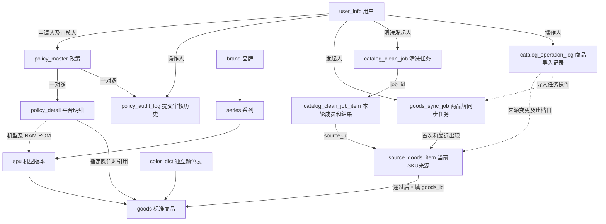

# 商品同步、标准化与管理员后台确认方案

更新日期：2026-11-13。按用户确认采用“原始导入 → 管理员确认清洗范围 → 后台执行 → 明确结果自动入标准库 → 异常才人工审核 → 政策选择”的流程。已实现吉客云只读查询、分品牌导入、SKU 更新、原文分页、手动启动清洗和异常审核。[管理员工作台](admin-workspace.md)

## 1. 已确认的业务

公司内部 ERP 只服务一家飞书企业。所有有效管理员共享源商品、清洗结果和标准目录。导入或清洗发起人用于展示任务归属。

- 只同步一加手机、OPPO手机。请求按吉客云 `brandName` 分别查询，校验返回的 `brandName` 与分区一致，各自维护续拉进度。
- 保留原始七字段和 skuId、cateFullName、gmtModified、goodsGmtModified、isBlockup、isPackageGood。品牌从校验后的任务分区确定。其他上游字段不落库。
- 吉客云 `skuId` 是源商品库唯一键。任务分别记录两品牌当前阶段的游标，导入记录以本地来源 ID 保存变更前后值。
- 新基线按品牌 → 系列 → 机型版本 → RAM 和 ROM → 颜色组织标准目录。清洗通过后创建或复用 `goods`，并在来源行保存 `goods_id`。
- 颜色名称维护在独立颜色表。商品通过颜色 ID 建立关联，各配置实际存在的颜色由商品记录确定。缺失、歧义和冲突继续交人工审核。
- 政策可以按规格不限颜色提交，也可以指定该规格下一个具体颜色。多种指定颜色需分别建明细，数量、补贴分别填写；批量填写仅复制补贴，不自动共享数量。
- 维持逐平台政策、草稿、提交、审核、驳回重提及历史快照；不扩展吉客云回写、库存、结算或多级审批。

## 2. 十四表空库结构与关系

完整清洗细则见 [商品清洗与异常审核](../business/catalog-cleaning.md)，规则、候选与 SQL 约束以该文档及数据字典一致维护。结构重设计遵循 [AGENTS.md 第 13 条](../../AGENTS.md#3-核心技术规则与边界)。

| 表 | 职责 |
| --- | --- |
| user_info | 飞书身份、本地角色、停用状态 |
| brand | 直接采用清洗确认的吉客云品牌名称 |
| series | 品牌下的系列 |
| spu | 标准机型及独立版本 |
| color_dict | 独立颜色表，颜色名称唯一 |
| goods | 机型版本、RAM、ROM 和颜色唯一确定的标准商品 |
| goods_sync_job | 单品牌导入任务、独立断点、状态与冷却时间 |
| catalog_clean_job | 独立清洗任务、品牌日期范围、发起人、状态与租约 |
| catalog_clean_job_item | 确认时的 SKU、记录版本和本轮结果 |
| source_goods_item | 当前 SKU 原文、清洗候选/证据/异常、人工审核和已生效映射 |
| catalog_operation_log | 商品导入记录、建档日证据和来源变更 |
| policy_master | 政策申请基本信息、租户、状态与版本 |
| policy_detail | 一个具体平台、规格、颜色范围下的数量和补贴 |
| policy_audit_log | 每轮提交完整快照和独立审核意见 |

`goods_sync_job` 保存导入任务与续拉断点，导入按 `skuId` 写入 `source_goods_item`。管理员确认清洗后，`catalog_clean_job` 保存任务范围和状态，`catalog_clean_job_item` 通过 `job_id` 和 `source_id` 记录该任务实际选中的本地源商品及本轮结果。清洗通过后创建或复用 `goods`，并回填源商品的 `goods_id`。缺失、歧义和冲突交人工审核，来源内容只作为待识别数据。

`catalog_operation_log` 用于来源变更前后值、导入任务操作及建档日命中证据。清洗进度由任务明细统计，当前异常和映射从源商品读取。[商品表关联示例](../sql/database-design.md#商品表关联示例)

标准目录五表用外键关联品牌、系列、机型和颜色，来源映射另校验品牌一致，商品的颜色 ID 引用独立颜色表。政策明细通过政策主表鉴权。已关联来源 SKU 或被政策引用的商品及配置受删除保护。商品导入记录的对象类型和本地主键由服务端校验。

## 3. 颜色与表单

选品牌、系列、型号、配置后，必须明确颜色范围：

| color_scope | goods_id | color 快照 | 含义 |
| --- | --- | --- | --- |
| ALL_COLORS | NULL | NULL | 仅当前型号配置，不限定颜色 |
| SPECIFIC_COLOR | 当前配置下商品 ID | 服务端读取的颜色名称 | 仅指定颜色 |
| NULL | NULL | NULL | 草稿尚未选择，禁止正式提交 |

草稿选择 SPECIFIC_COLOR 后可暂未选颜色；SQL 允许这类不完整状态，正式提交必须补齐商品 ID 和颜色快照。指定颜色的商品必须属于已填配置，服务端核验记录及规格归属并生成快照。

切换型号或配置时清空指定颜色，颜色下拉只返回该规格下标准商品对应的颜色；提交不能接受客户端伪造的颜色或规格归属。不限颜色按规格范围保存，不按当前颜色列表展开，也不使用空值推断范围。空数量仍为 NULL，不自动变成 0。

型号配置优先取结构化字段，颜色可按受控规则从 goodsName 等七字段原文提取；必须验证型号配置及唯一颜色边界。规则唯一且无冲突时自动创建或复用可用标准商品，缺失/歧义/冲突进入人工队列，不凭任意拆词猜测。不得从名称额外提取并持久化价格等未授权上游属性。目录身份及已引用颜色不直接挪到另一规格，纠错不改写政策历史。

同一政策同平台的重复范围应拒绝并提示；不限颜色和指定颜色相交时须显式提示、由用户整理，不能最后一条覆盖。不同政策同平台同规格且时间重叠时，不限颜色与任一指定颜色存在交集，但哪条优先、是否替换及时间端点仍待确认，不能默认指定颜色优先或整单失效。

## 4. 来源字段与同步

官方文档：[外部系统调用开放平台](https://open.jackyun.com/developer/refactored/document.html?alias=outsystem_openplat)、[如何生成签名](https://open.jackyun.com/developer/document.html?alias=create_testtool)、[条件查询货品](https://open.jackyun.com/developer/refactored/apidocinfo.html?id=erp-goods.goods.sku.search&name=true)。

cols 显式请求原始七字段和上述新增六字段，另请求 brandName 校验分区。首次 lastMaxId=0，后续取上一批最后一条 skuId；pageIndex 保持 0，每页最多 50 条，短页继续查，空页才结束当前阶段。游标只保存在服务端。

固定使用 isIncludeBlockup=1，停用与组合商品一并保留在源商品库，清洗时拦截自动入标准库。

- 全量导入从 0 续拉当前品牌的全部记录。
- 按建档日使用 startDate/endDate，只导入该日建档的商品；响应不保证返回建档时间。
- 按修改日先使用 startDateModifiedGoods/endDateModifiedGoods，再使用 startDateModifiedSku/endDateModifiedSku。第二阶段从 0 开始，两阶段按 SKU 去重，两阶段全部结束后完成导入。

日期使用北京时间整日。按修改日查询的是吉客云当前记录上的最后修改时间，后续又修改过的 SKU 可能不出现在更早日期的结果。

按建档日导入会在同一页事务中把 SKU 命中的日期写入已有商品操作日志，每个 SKU、日期记一次。源商品列表的 `createdDate` 可显示和筛选这个日期。旧数据根据首次、最近关联的建档日导入任务确认日期，后续更新前保留仍可确认的日期。旧关联已被覆盖且无历史记录时，可按原建档日再导入一次补齐。[建档日存储规则](../sql/database-design.md#来源与标准目录)

`gmtModified` 是规格修改时间，`goodsGmtModified` 是货品修改时间。接口分别返回原始 Unix 毫秒，列表各自转换为北京时间，有非零毫秒时显示三位。核对吉客云货品列表的「最后修改时间」时，对照「商品修改时间」列。建档日另有独立的日期列。

### 单页查询联调

同步任务注入 [JackyunGoodsService](../../backend/src/main/java/com/company/policy/service/JackyunGoodsService.java)，按品牌调用 `queryPage`。从字符串游标 `"0"` 开始，服务以数值发送 `lastMaxId`，逐条校验返回品牌及游标顺序。每页提交原文、计数和断点；空页保留当前游标，异常响应只显示脱敏错误类别。

凭证通过环境变量或被忽略的 `backend/.env.local.properties` 配置，变量见 [配置样例](../../backend/.env.example)。自研应用填写 `JACKYUN_APP_KEY` 和 `JACKYUN_APP_SECRET`。ISV 应用另填 `JACKYUN_TOKEN`。查询时检查配置。

2026-11-11 通过迁入后的后端服务实测两个品牌各两页，每页 3 条，四次查询均成功，两个品牌的游标均向前推进。请求显式设置 `isIncludeBlockup=0`。样本中 `goodsField4` 既有系列名，也有归类标签，清洗时需要结合品牌和其他字段校验。后端 Maven `verify` 通过，55 项测试通过，1 项需独立 MySQL 的测试跳过。

本轮在编码导入前，用用户提供的凭证运行 `JackyunGoodsLiveTest`。两次只读请求均为 HTTP 200、业务码 200；OPPO 和一加各 3 条，六条样本的 `goodsName`、`goodsNo`、`skuName`、`cateName`、`goodsField4`、`goodsField1`、`goodsField5` 全部非 NULL。该结果只覆盖首批样本，未跑真实全量、未写目标数据库。凭证仅通过测试进程环境变量传入，普通 `verify` 跳过此实测。

导入按 `skuId` 查找并锁定源记录。新增 SKU 直接插入，现有 SKU 仅在上游数据变化时更新原行。比较 SKU 和货品修改时间及实际字段，旧响应不覆盖当前数据。相同 SKU 的账套或品牌发生冲突时返回异常，避免误覆盖。上游未变时商品内容、更新时间和清洗状态保持原值，任务进度、必要的任务引用和建档日证据仍可更新。来源或清洗结果实际变更时由应用写入来源表的更新时间。仅时间戳变化时更新来源时间，业务字段或状态变化才触发待清洗。已有映射对应的商品变化需要人工确认。

每页原始来源、首次和最近任务引用、建档日证据、计数和断点同事务提交。失败保留之前已提交的原文，等管理员继续。导入成功后，管理员可在清洗页按品牌和建档日期选择来源商品。

清洗时按本地当前 SKU 选取，跨同日的多次导入，默认选最近导入已完成或已结束的待清洗商品。确认后写入独立任务及成员，执行时发现来源记录版本变化则跳过并记录。已有通过映射在重算期间保留，失败不会自动撤销。导入按 SKU 增量更新，历史原文变化通过操作日志查看。

同一账套一次仅一个活动任务，QUEUED/RUNNING/PAUSED 都占活动槽；恢复继续同一个任务。结束或完成后可以发起另一个品牌或同品牌新任务，新任务从 0 开始。租约、执行令牌和版本条件防止接管后的旧执行者写入。审计记录发起、继续、结束的实际管理员及本地任务 ID。

## 5. 后台和发布

源商品库右上角「导入商品」弹窗可选 OPPO 或一加，并发起全量或按建档日期导入。已有按修改日任务可按原阶段续跑，服务端接口支持创建该模式。弹窗显示任务状态、读取和去重计数，提供暂停后继续、结束任务和查看该日商品。列表以紧凑筛选栏支持品牌、建档日、关键词和分页。清洗页提供跨品牌结果、范围预览、手动发起、进度、异常审核和重试。清洗记录展示任务进度和结果统计。[管理员工作台](admin-workspace.md)

来源 mapping_status 表示当前生效关联，clean_status 表示本次处理进度，互不混用。AUTO_PASSED/MANUAL_PASSED 均须具有确定的规格和颜色；缺颜色留候选待审核，不把未知颜色当不限颜色。规则结果唯一且目标无冲突时，在同一事务创建或复用标准商品，更新来源映射及任务成员结果。人工审核在来源行保存审核人、时间和结果。重算时保留旧映射，人工结果不得自动覆盖。

待接入的申请人目录从标准商品派生配置和可选颜色，自动清洗和人工审核通过时将销售状态默认设为在售，复用商品时保留已有明确销售状态。已有引用保留稳定 ID 和提交时快照，草稿正式提交重新校验。

任务创建幂等键由唯一约束保障；页面重复点击返回原任务。清洗重跑按标准商品唯一键复用。商品编辑从当前商品字段及更新时间生成版本标记，保存时在事务内锁定商品并核对版本。来源版本用于防止以旧来源写入清洗结果。

## 6. 风控与实现边界

页面仅调用本系统后端，密钥、签名和 token 只留后端；每次 API 重新核验有效 ADMIN 及公司飞书租户。任务同账套串行，页面重复提交走幂等键。每页间隔默认 5 秒（可配置），默认 2000 页保护上限；这两个值是本系统保护参数，不是吉客云官方额度。HTTP 429 遵守 `Retry-After` 且至少冷却 5 分钟；其他上游和写库异常暂停，至少冷却 60 秒，不自动重试。结束暂停任务也不会跳过剩余冷却。正式全量导入前应核对该应用的配额和末页行为，避免与同一 AppKey 的其他任务叠加使用。

后端沿用 Controller → Service 接口/Impl → Mapper，使用现有 Cookie、Origin、X-Policy-Request 和 DTO/VO 规范。清洗与审核已按十四表基线写入标准目录，商品中心列表、详情、统计和三级分类读取标准目录，已接入手工新增、编辑、删除及品牌、系列和颜色字典维护。删除无引用的商品后释放规格唯一键。标准商品批量导入和申请人目录待接入。政策接口采用 `spuId`、`ram`、`rom`、`colorScope` 和 `goodsId`。[商品管理接口](../api/catalog-api.md)

[完整 SQL](../sql/schema.sql) 与 [V1](../sql/V1__create_policy_tables.sql) 是同一份十四表空库基线，二选一执行。目标库 SQL 由用户在 Navicat 执行。[数据字典](../sql/database-design.md#1-在-navicat-建表)

开发顺序为少量接口联调 → 两品牌原始导入 → 手动发起清洗与唯一结果自动入标准库 → 异常审核/重试 → 政策选择。无需 Redis、MQ 或完整规则引擎。清洗任务和结果通过前后端接口联动。
