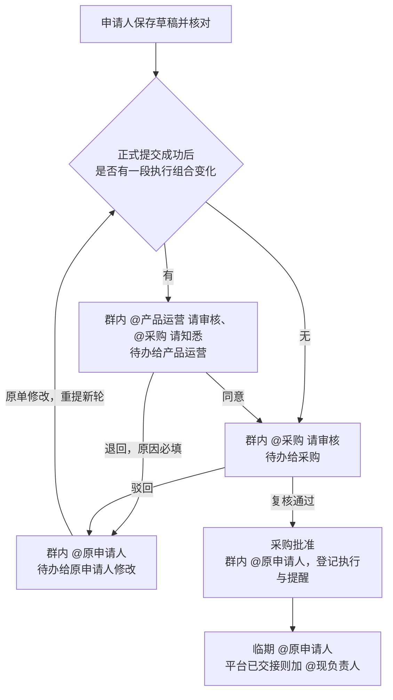

# 政策审核与飞书通知技术设计书（开发版）

面向后端、前端、测试和飞书应用管理员。版本 1.0，基线日期为 2026 年 11 月 23 日。业务方案已确认，新增节点、接口、投递机制和验收用例均为待实施设计。

## 开发目标

申请人正式提交时即通知对应采购。发生叠加、替换或取消已有叠加的申请，加一道产品运营初审。初审人与采购同时在群内被点名，只有当前经办人取得待办。采购终审通过后，补贴才按核准范围与时间执行。

## 复用范围与新增交付

| 范围 | 工程交付 |
| --- | --- |
| 现有系统 | Vue 3、Element Plus、Spring Boot、MyBatis-Plus 和 MySQL。沿用飞书登录、平台分工、逐段选单、按轮快照、采购复核及生效查询。 |
| 本次新增 | 提交时计算初审条件，增加产品运营节点、采购指派、飞书群点名与待办、临期调度、投递核对及配套工作台入口。 |
| 部署参数 | 公司级主审、备选、业务群和提前 3 天提醒作为首版默认。实际人员、群、应用权限及启用时间由目标企业配置。 |

## 阅读导航

- [业务节点与通知矩阵](#nodes)
- [逐段识别叠加与替换](#classification)
- [审核人分配与访问权限](#assignees)
- [状态迁移与事务边界](#state)
- [HTTP 接口与数据契约](#api)
- [工作台页面与飞书办理入口](#pages)
- [飞书接口与可靠投递](#feishu)
- [政策有效期与配套业务](#lifecycle)
- [验收用例与预期结果](#acceptance)
- [开发顺序与切换验收](#rollout)
- [附录 分段摘要与投递示例](#example)

<a id="nodes"></a>

## 01 业务节点与通知矩阵

每次正式提交都点名采购。群内每个被点名的人，都应从同一条消息看出自己是“请办理”还是“请知悉”。

| 业务节点 | 群内提醒 | 待办与 ERP 结果 |
| --- | --- | --- |
| 填报与预览 | 申请页提示本人 | 保存草稿、上传文件、逐段核对。只有正式提交成功才触发群消息。 |
| 普通单提交 | @采购，请审核 | 创建采购待办，进入待采购终审。 |
| 变化单提交 | @产品运营，请审核。@采购，请知悉 | 只创建产品运营待办。限制采购提前终审。 |
| 初审同意 | @采购，请终审 | 结办初审待办，给采购发终审待办。整单仍待审核。 |
| 初审退回 | @原申请人，请修改 | 原因必填，结办初审，给原申请人发修改待办。 |
| 采购通过 | @原申请人，告知结果 | 结办终审待办，显示实际或计划执行时间。交接涉及的执行人也收到对应范围的通知。 |
| 采购驳回 | @原申请人，请修改 | 原因依现有规则选填。结办终审，创建修改待办。 |
| 修改后重提 | 按新轮分流再次点名 | 原单号不变，重算采用名单，结办旧修改待办，创建新轮首个审核待办。 |
| 临期及截止 | @原申请人，已移交则加 @现负责人 | 显示当前实际截止和延期状态。需要申请调整时，提供权限允许的办理入口。 |

### 何时通知下一人

节点迁移与业务提交成功后派发。草稿未完成、提交结果待核实或审核复核失败，页面先反馈给操作人。旧节点关闭后可继续查看当轮结果，群聊回复、表情和任务列表中的勾选均不能直接批准政策。

超时催办仅发当前有效经办人。催办时长作为部署配置，首版可关闭，一单多个商品、多个平台合并成同一轮节点通知。

### 申请与审核流程图



<a id="classification"></a>

## 02 逐段识别叠加与替换

比较同一适用范围、同一时段的两份名单。旧名单是提交前已获批且原定执行的政策，新名单是本轮申请人确认的方案。

### 比较口径

按渠道、实际平台、审核范围及北京时间划段。切点取本轮确认区间与已批实际或未来安排的全部边界。复用已有适用范围及时间轴规则回放各段，比较项以政策身份及获批轮次为准，不把未采用的候选单计入旧名单。

| 原安排 → 拟安排 | 摘要措辞 | 整单路由 |
| --- | --- | --- |
| 无 → B | 新增普通政策 | 无旧单交叉变化，直送采购。 |
| A → A | 沿用原单 | 本段不触发初审。 |
| A → A＋B | 新增叠加 B | 送产品运营。 |
| A → B | B 替换 A | 送产品运营。 |
| A＋B → A | 取消与 B 的叠加 | 送产品运营。 |
| A＋C → B＋C | 以 B 替换 A，继续与 C 叠加 | 送产品运营，保留项单列，避免误报。 |

以上符号表示名单集合。逐项列出加入、退出、保留的单号。只选旧单也可能改变组合。独立新增或纯时间调整走现有采购直审，延期新增段或同批调整后形成叠加、替换时，全单进入初审。

### 范围与文案

零售按具体商品核对，完整场景集合及核销类型同组最多选一张，跨组可叠加，预估政策同样参与。百亿按平台、机型版本、RAM、ROM 的配置口径处理，历史按商品审核的段仍按原范围回放。

仅在平台、范围、时段、原新名单以及补贴条件全相同时合并展示。指定数量 0 与未填写分开。金额使用 `BigDecimal`，固定与比例并列列出，保留基数、上限和数量。只有口径相同且上限不影响结果的固定额才展示算术合计。

### 计算顺序

1. 复用预览及提交校验取得可生效区间、本轮逐段选单和随单调整。
2. 以本轮尚未获批为基线，回放本公司该段已获批的实际或计划执行名单。用本轮确认方案计算新名单。随单延期在批准前用同批稳定标识，批准后关联实际延期单号。
3. 对齐两边所有切点，按集合差计算加入、退出和保留的政策。纯截止变动单列，任一交叉段触发则整轮进入初审。
4. 在服务端冻结判断依据与展示字段，用同一份明细生成审批页、群摘要和待办。旧快照无法可靠回放时提示重新核对，避免将无法核实的单据误送采购直审。

<a id="assignees"></a>

## 03 审核人分配与访问权限

分别解析原申请人、产品运营审核人、采购主办人、当前平台执行人。一个人被群消息点名，本身不会改变其 ERP 权限。

| 身份 | 如何确定 | 允许的操作 |
| --- | --- | --- |
| 原申请人 | 取申请归属，重提仍由原申请人操作。 | 维护本人草稿或驳回单，查看本轮退回原因。 |
| 产品运营 | 首版配置公司级主审及备选，以启用的本企业账号映射飞书身份。 | 仅处理指派给本人的当前初审及所需快照、当轮证明。 |
| 采购主办 | 从本企业有效 `ADMIN` 中指定主办及备选，沿用采购资格核验。 | 查看管理员已有范围，仅主办可决定本轮采购节点。 |
| 平台执行人 | 按当前渠道＋实际平台分工实时查找，零售和百亿分别解析。 | 在本人负责范围内查看已获批安排，移交后原单归属不变。 |

### 解析与改派

首版每个审批节点确定一人，跨平台整单仍用公司级配置。提交时同时解析采购和必要的初审人，避开申请人，并使双审由两位不同人员完成。主审不可用时选合格备选。仍无解则阻止本次提交，保留可编辑草稿或驳回单并指出缺失岗位。

在途人员停用、离岗或失去资格时保留当前节点，提示流程管理员改派。改派需核对当前轮次、记录版本、目标资格并记录原因，关闭原待办，给新经办人发待办并在群内 @。旧人即使持有链接也不能操作。采购若在初审期间改派，同步更新知悉人。

### 授权边界

服务端每次读取和写入均按当前会话核对企业、启用状态、归属或节点指派。产品运营处理权限建议作为独立业务权限，可授予已有账号，只开放必要快照与附件，不连带开放商品、用户管理或整库政策。附件核对所属申请、轮次及文件引用。

群与人分别配置。缺少飞书身份、群不可发言或人员未有效入群时记录待治理的投递问题，经办人可从 ERP 待办处理。人员缺配影响审核授权，渠道故障仅影响通知送达。

原申请人停用后，历史归属保留。退回单不能由接手人代改，管理员处理账号或分工异常，必要时由合格人员另行发起。同一人在群里有多种身份时合并为一次 @，办理责任优先。

<a id="state"></a>

## 04 状态迁移与事务边界

保留 `DRAFT`、`PENDING`、`REJECTED`、`APPROVED` 的整单状态。拟在每轮 `PENDING` 内区分 `PRODUCT_REVIEW` 与 `PURCHASE_REVIEW` 两个阶段。

| 起点与动作 | 整单与阶段结果 | 同一业务事务完成 |
| --- | --- | --- |
| 草稿或驳回单正式提交 | `PENDING`＋所选首节点 | 冻结新轮表单及逐段决定，指派经办人，登记本轮通知。 |
| 产品运营同意 | `PENDING`＋采购终审 | 留初审人、时间、意见及节点结果，记录版本加一。 |
| 产品运营退回 | `REJECTED`，结束本轮 | 拒绝原因去首尾空白后必填，最多 512 字。标记退回来源。 |
| 采购驳回 | `REJECTED`，结束本轮 | 沿用意见选填及长度限制。原政策继续按原安排执行。 |
| 采购批准 | `APPROVED`，结束本轮 | 复核组合，原子落实本轮整批决定及时间调整。 |
| 采购复核失败 | 保留 `PENDING`＋采购终审 | 保留现有 409 结果，采购可退回，不发送通过通知。 |

### 提交与终审写入

接入 `PolicyApplyServiceImpl` 的正式提交事务。按既有机型锁与正式确认依据冻结原安排、拟安排、触发段及指派。`submissionVersion` 只在首提或重提递增，同轮动作推进 `recordVersion`。外部飞书请求在事务提交后执行。

复用 `PolicyReviewServiceImpl` 的锁内终审，继续校验所有涉及机型、原单轮次、有效截止、平台资格和剩余候选。不同申请并发获批时，新增未确认组合返回 `POLICY_RECONFIRM_REQUIRED`，整单无剩余区间返回 `POLICY_NO_EFFECTIVE_PERIOD`。

既有轮次总审核记录只能表达一次最终结果。初审通过保留该轮 `SUBMITTED`，节点轨迹另行留证。两关退回均写本轮终态及退回来源。现有采购入口和新节点入口必须调用同一授权与迁移逻辑，防止绕开初审或重复产生延期单。

### 写入成功的判定

既有 `policy_apply`、`policy_audit_log` 和 `policy_goods_detail` 表达整单及本轮快照。每次决定在事务内核验企业、账号、经办人、阶段和双版本，条件更新必须只命中一条。失败时不产生下一节点、延期明细或通知。响应丢失时读取本轮轨迹确认已有结果，其他过期动作返回冲突。

<a id="api"></a>

## 05 HTTP 接口与数据契约

沿用现有申请提交和采购审核接口。以下列出产品运营办理、统一待办及配置入口的开发契约。

| 接口 | 契约与权限 |
| --- | --- |
| `POST /api/policies/{id}/submit` | 现有。冻结本轮后附加 `reviewStage`，旧客户端可忽略附加字段。 |
| `POST /api/admin/policies/{id}/review` | 现有。所有写操作校验采购阶段和指定采购，保留旧请求格式。 |
| `GET /api/policy-reviews/mine` | 拟新增。按当前账号分页读取经办节点，返回单号、阶段、摘要和版本。 |
| `GET /api/policy-reviews/{id}` | 拟新增。带 `submissionVersion` 定位本轮。按权限返回摘要、逐段明细、指派及 `allowedActions`。 |
| `POST /api/policy-reviews/{id}/product-review` | 拟新增。限当前指定初审人，决策值、版本和意见格式复用采购 DTO。 |
| `GET /api/admin/policy-review-settings`、`PUT /api/admin/policy-review-settings` | 拟新增。管理员读取或更新主审、备选、群及提醒参数。读取返回现值与配置版本。 |
| `POST /api/admin/policy-reviews/{id}/reassign` | 拟新增。请求含节点、双版本、新处理人和原因。完成授权校验、改派并递增记录版本。 |

### 初审请求与成功响应示意

```json
{ "recordVersion": 8, "submissionVersion": 2,
  "decision": "APPROVE", "reviewRemark": null }
```

```json
{ "id": "128", "status": "PENDING", "reviewStage": "PURCHASE_REVIEW",
  "submissionVersion": 2, "recordVersion": 9 }
```

客户端不传审核人身份、可操作标记或路由结论。沿用会话 Cookie、可信 Origin、`X-Policy-Request: 1` 和 `Content-Type: application/json`。ID 为字符串，日期精确到秒并携带 +08:00。参数非法返回 400，未登录 401，无权 403，跨企业或不可见对象按现有边界返回 404，版本、状态或指派冲突返回 409。响应未知时先按本轮读取结果。

### 详情读取与错误反馈

`allowedActions` 按当前登录人计算，写入时重新核验。`reviewStage` 在待审时取两个阶段之一，终态为空，`rejectedAtStage` 返回本轮的退回环节。`reviewable` 表达当前管理员能否终审。群渠道故障在投递视图展示，独立于业务审批状态。

改派请求包含 `expectedStage`、`recordVersion`、`submissionVersion`、`assigneeId` 和 `reason`。读取设置限有管理权限者，更新设置携带 `expectedVersion`，默认只作用于后续新轮，在途节点通过改派明确生效。

<a id="pages"></a>

## 06 工作台页面与飞书办理入口

群消息用于点名，待办打开 ERP 处理页。ERP 核验本轮身份和版本后作出决定，并把结果同步给飞书。

### 页面改动

| 入口 | 开发要求 |
| --- | --- |
| 提交申请与我的提交 | 沿用现有预览、未保存保护和附件。展示“待产品运营确认”或“待采购终审”。退回后在详情及编辑页显示本轮节点、审核人、时间和原因，保留原单号。 |
| 待我审核 | 增加需登录的节点办理入口。初审人只见分配给本人的政策。摘要按平台、商品、时段列出原方案、拟方案、增减项与原因。操作为“同意，转采购”“退回修改”。 |
| 差异化政策 | 复用 AdminPolicyDetail.vue 的快照展示。审批按钮由服务器 `allowedActions` 或 `reviewable` 控制。采购可见初审结果，列表新增阶段筛选，保留原有状态计数。 |
| 配置与异常处理 | 管理员设置人员与群、查看投递结果、核对待办或改派。保存配置时校验人员有效性、备选冲突和版本，展示未成功的具体渠道。 |

### 链接与登录

建议飞书办理链接使用同源业务路由 `/#/reviews/{id}?round=2`。页面将 `round` 映射为接口的 `submissionVersion`。已有守卫按 `ADMIN` 或 `APPLICANT` 分流，节点入口需独立鉴权。客户端免登或浏览器 OAuth 完成后恢复原目标。退回链接先核验原申请人、轮次及驳回状态，再进入 `/#/apply?policyId={id}`，沿用未保存保护。

进入页面先取最新权限、阶段和双版本。过期链接显示“本轮已处理”或“已有新一轮”，不得自动操作新轮。拒绝原因在前后端都校验，409 保留已填意见并刷新详情。手机要能看到完整时段、退回原因及两种操作。

### 群消息示例

【政策叠加待确认｜ZC-000128】@产品运营李华，请审核。@采购张敏，请知悉。京东零售，Reno17 Pro 12GB+256GB 浮光白，12 月 1–5 日拟保留旧单 20 元/台，新增本单 30 元/台。〔查看本单〕

【请采购终审｜ZC-000128】@采购张敏，李华已确认本轮叠加方案。〔去审核〕　退回时改为“@原申请人，请按本轮退回原因修改”，原因及证明文件在授权详情中查看。

登录回跳仅接受本站预定义路由及允许的参数。先完成身份核验，再返回快照与附件。飞书内打开与浏览器另开属于独立会话，分别验收。

<a id="feishu"></a>

## 07 飞书接口与可靠投递

由企业自建应用机器人发送。业务节点是 ERP 的事实来源，消息回执、待办 GUID 和完成时间用于追踪外部送达。

| 动作 | 飞书服务端契约 |
| --- | --- |
| 群内点名 | POST /open-apis/im/v1/messages，`receive_id_type`=chat_id。内容用 at 元素与同一应用下的 `open_id`，保存回执 `message_id`。同一消息一次点名所有需知悉的人。 |
| 创建待办 | POST /open-apis/task/v2/tasks，user_id_type=`open_id`。members 指明 user、assignee 和 `open_id`。写入业务摘要、origin.href 与 PC、iOS、Android 的 `custom_complete` 跳转，保存 task.guid。 |
| 同步结办 | PATCH /open-apis/task/v2/tasks/{guid}，提交 `completed_at` 毫秒字符串并在 `update_fields` 中声明该字段。退回、同意或改派均先在 ERP 落实，再将对应旧任务结办，说明办理结果。 |

### 事务、去重与补偿

在节点事务中登记“需投递的业务事实”。后台分别执行群消息、新待办及旧待办结办，分别保留状态与回执。按申请、轮次、节点到达记录、接收人或群、投递动作生成稳定业务标识。改派产生新的指派记录，群通知按群合并成员。

后台多实例领取时采用带期限的占用机制。重试前核对当前阶段、指派及外部回执。同一单内按节点顺序派发，迟到的建待办请求若节点已结束则跳过，已发出的旧任务补结办。单一渠道失败只重试该渠道。同一单的后续提醒优先回复首条群消息，首条被撤回或发送失败，则在同一配置群独立发出并附单号。

同一 IM 请求复用 `uuid`，同一任务创建请求复用 `client_token`。飞书的去重有时间窗口，业务幂等贯穿完整生命周期。限频、网络错误退避重试，响应未知且超过平台窗口，先核对外部记录，无法确认则交人工核对。无权限或未入群标为需配置处理，修复后补发。

### 上线检查

检查应用已发布、机器人加入目标群并可发言、经办人在可用范围、任务有写权限。token 仅留服务端。群中只给摘要及业务入口，日志保留业务标识、失败码及回执，不写凭证或附件内容。官方文档索引见第 10 节。

### 恢复与环境配置

区分待发送、已取得回执、结果未知、需人工核对及已失效。群消息、建任务、结办各自处理，超出外部幂等窗口时不盲目重建。飞书任务结办延迟不影响新经办人在 ERP 办理。人工补发沿用业务标识并记录处理人、理由与时间。

测试与正式环境分别配置群、应用、人员映射和业务域名。机器人凭证仅在后端注入，消息不得包含用户令牌或带下载授权的附件地址。

[飞书发送消息](https://open.feishu.cn/document/uAjLw4CM/ukTMukTMukTM/reference/im-v1/message/create) · [飞书任务功能与完成方式](https://open.feishu.cn/document/uAjLw4CM/ukTMukTMukTM/task-v2/task/overview)

<a id="lifecycle"></a>

## 08 政策有效期与配套业务

所有提醒按北京时间的实际生效与截止时刻调度。提交了时间变更申请后，原政策仍按最近一次已批准的决定执行。

| 触发事件 | 处理规则及接收人 |
| --- | --- |
| 已批后开始执行 | 批准时已起效，合并进终审结果。未来开始的安排在实际起点复核本段采用名单，通知当前平台执行人，只执行旧单的段不报“本单已生效”。 |
| 临期提醒 | 默认实际截止前 3 天提醒原申请人，移交后加现负责人。已进入窗口才批准或服务恢复时，尚未截止则补提醒一次，已过期转截止事件。 |
| 到达截止 | 截止秒仍有效，下一秒退出。实际结果分为自然结束、有获批延期接续、延期仍待审核。若延期晚批，中间空档按真实时间描述。原单审核状态继续为已通过。 |
| 提前结束 | 独立申请针对本人原单，随单缩短可涉及前任提交的原单。发起人须负责目标至少一个实际平台。获批后整张旧单各平台、商品按实际截止处理，通知发起人、目标单原申请人及受影响现负责人并去重。 |
| 延期 | 限本人且仍负责原单全部平台，新增段从原实际截止的下一秒起。审批晚于起点时取实际批准时刻。同批延期之间也核对交叉，已批关联新单从其获批内容安排后续提醒。 |
| 随单多目标 | 本轮逐项记录目标单、获批轮次、原新截止、原因及证明。同批一项失效则不能批准，整批驳回保持旧安排，整批通过再统一重算受影响提醒。 |

临期按原单、实际截止、提醒档位、目标群防重。发送前再读状态、当前负责人和延期情况。截止已变的旧计划作废，发送后才批准的调整另发“截止已变更”，避免沿用旧提醒。已停用的原申请人无法收取时，通知现负责人并向管理端记录未送达原因。

若拟定提前截止早于批准时刻，依现有规则保留历史至批准前一秒，通知取核准的实际截止。独立缩短不生成新的商品补贴明细。已有直接延期单时按现有资格核验，后续可从已通过的延期单继续申请。

切换时也扫描已通过且尚有效的政策。对已处于临期窗口的政策最多补送一次，已经结束的政策保留历史记录。

### 分工与商品准备

平台移交成功后，在群里 @ 新旧负责人并注明渠道与平台。原申请的修改权限仍归原申请人。在途审核人失去资格按第 03 节改派。源商品导入暂停需续跑，或清洗结束有待人工审核、技术失败时，按批 @ 负责该批的商品管理员，商品目录和日常补贴查询继续在页面反馈。

<a id="acceptance"></a>

## 09 验收用例与预期结果

使用申请人、产品运营、采购主办、备选、接手人和无权限账号建立隔离测试。每例核对政策状态、群内真实 @、待办归属及查询结果。

| 编号 | 输入或操作 | 应观察到的结果 |
| --- | --- | --- |
| T01 | 普通单直提，普通单保存草稿 | 正式提交只 @ 采购且创建一个待办，草稿产生零条外部通知。 |
| T02 | 京东有 A→A＋B，淘宝沿用 A | 整单一个初审待办，群点名产品运营和采购，摘要限定京东，采购写接口拒绝越级。 |
| T03 | A＋B→A，A→A，另有未执行候选 C | 前者进入初审并写“取消叠加 B”，后者直接采购，C 不列作被替换。 |
| T04 | 零售同组互斥，百亿同配置不同色，指定数量 0 | 按各自范围及历史决定出摘要。零售与百亿同名平台分别计算，数量 0 有显示。 |
| T05 | 产品运营先提交空白退回原因，再填写原因，申请人改后重提 | 空白原因返回 400，仍待初审。填妥后退回原申请人，修改待办显示本轮原因。重提重算，旧链接只读。 |
| T06 | 初审同意，采购并发双击通过，其他账号尝试代审 | 初审后仍为 `PENDING`，旧执行安排继续有效。只有指定采购可终审，并发最多成功一次。结果事件及关联延期单各产生一次。 |
| T07 | 另单获批，改变剩余时段组合，或只影响过去 | 前者采购收到 409 且仍待审，可退回重提，后者其余依据一致可通过。 |
| T08 | 多目标调整一项失效，原截止 18:00:00 | 整批无部分生效。合法延期最早从 18:00:01 起，晚批缩短保留历史至批准前一秒。 |
| T09 | 临期后延期待审、已批、提前结束或平台移交 | 消息区分四种情形，按实际截止和最新平台分工发送，旧档位不会重复发送。 |
| T10 | 停用、改派、本人审核、转发链接、跨企业读取 | 新承办人可办，旧人及越权人不可办。附件也核对本轮归属，群成员身份不能扩大权限。 |
| T11 | 飞书限频、超时、服务重启、部分渠道成功 | ERP 节点不回退，只补失败渠道。外部结果不明可核对，任务 GUID 和群回执可追踪。 |
| T12 | 历史待审单、旧版快照、移动端登录和旧页重开 | 旧单按切换策略办理，新轮受新门控，回跳还原正确单号和轮次，旧页不能提交新轮。 |
| T13 | 群内知悉人转发单据，初审人请求其他轮证明 | 链接持有人仍需业务授权，附件核对政策、轮次和访问人。 |
| T14 | 启用通知，清洗任务含多条待人工识别商品 | 历史已结束政策不补发到期群消息，商品异常按批汇总并通知对应商品管理员。 |

前端复测桌面、平板和手机的申请、审核与回跳。真实飞书租户核对群提醒、任务领取、手机登录和回写。目标 MySQL 需验证不同单并发和时间边界，由用户在 Navicat 执行核查。

<a id="rollout"></a>

## 10 开发顺序与切换验收

先验证审核权和生效结果，再开启外部投递。新流程启用以后，关闭通知发送只暂停消息，不得把初审中的申请送回旧的采购直通路径。

| 阶段 | 交付物与启用条件 |
| --- | --- |
| 一 业务与数据 | 用实际政策样例确认第 02 节的基线回放与分流结果。持久化需承载节点指派、操作轨迹、通知及外部回执，涉及结构调整时，先单列范围、原因、旧数据及代码影响，按项目第 13 条取得本次确认后再做物理设计与 SQL。 |
| 二 后端与前端 | 接入现有提交及采购终审，交付双阶段、改派、权限及工作台页面。完成旧入口越权回归，同步接口说明、状态机及按轮读取契约。 |
| 三 飞书联调 | 设置试点人员与群，核对真实 @、各端办理跳回、任务关闭和消息摘要，模拟超时、断网、重复执行与回执缺失。分别配置审核启用、群发送、待办和调度开关。 |
| 四 切换与回退 | 建议切换前已提交且仍待审的轮次继续旧采购路径，重新提交才用新流程。以明确切换标识识别旧轮，新轮缺少节点时阻断并修复。保留历史快照和审核时间，启用、暂停或恢复均不得重放整库历史通知。 |

上线前核对企业群标识、产品运营主备、采购主备、能执行改派的管理员、服务器时区和各端可访问域名。观察待审积压、节点无经办人、最老未送达时长、失败码、待人工核对数量，以及临期任务延迟。

### 项目内核对入口

[状态与轮次](../business/status-machine.md) · [覆盖规则](../business/override-engine.md) · [申请接口](../api/policy-api.md) · [采购接口](../api/admin-api.md) · [分工与用户](../api/user-api.md) · [附件权限](../api/attachment-api.md) · [飞书鉴权](feishu-auth-flow.md) · [环境配置](environment-configuration.md)

| 实现位置 | 现有入口及改动重点 |
| --- | --- |
| 提交与审核 | [提交服务](../../backend/src/main/java/com/company/policy/service/impl/PolicyApplyServiceImpl.java) 冻结轮次。[审核服务](../../backend/src/main/java/com/company/policy/service/impl/PolicyReviewServiceImpl.java) 统一终审资格及机型复核。 |
| 逐段与时间 | [适用性计算](../../backend/src/main/java/com/company/policy/support/policy/PolicyApplicabilityEvaluator.java)、[时间轴构建](../../backend/src/main/java/com/company/policy/support/policy/PolicyTimelineBuilder.java) 和 [批量延期](../../backend/src/main/java/com/company/policy/support/policy/PolicyBatchExtensions.java) 提供范围、历史回放及延期依据。 |
| 页面与守卫 | [工作台路由](../../frontend/src/utils/workspace-route.js)、[采购详情](../../frontend/src/views/admin/policies/AdminPolicyDetail.vue)、[我的提交](../../frontend/src/composables/usePolicySubmissions.js) 分别适配节点权限、当轮结论及退回原因。 |
| 飞书服务端 | [飞书认证请求](../../backend/src/main/java/com/company/policy/service/impl/FeishuApiTransportImpl.java) 现用于认证链路。新增 IM、Task 调用时单独封装，限定目标域名和超时，保留可追踪的结果。 |

### 飞书官方接口参考

[群消息发送与权限](https://open.feishu.cn/document/uAjLw4CM/ukTMukTMukTM/reference/im-v1/message/create) · [消息内容与指定人员](https://open.feishu.cn/document/server-docs/im-v1/message-content-description/create_json?lang=zh-CN) · [任务 V2 与幂等约定](https://open.feishu.cn/document/uAjLw4CM/ukTMukTMukTM/task-v2/overview) · [任务来源及自定义完成](https://open.feishu.cn/document/uAjLw4CM/ukTMukTMukTM/task-v2/task/overview)

<a id="example"></a>

## 附录 分段摘要与投递示例

以下为拟新增详情字段的最小示例。编号、日期与金额均为演示值。审批页与通知模板共用同一份已确认的变化明细。

### 详情读取模型

建议输出 `reviewStage`、`allowedActions`、`changeSummary` 和 `changes`。完整明细留在授权页，摘要只返回必要展示字段，数量较多时群内给出变化数与前几项，并附详情入口。数值、身份和适用范围由服务端生成。

```json
{
  "id": "128", "policyCode": "ZC-000128", "submissionVersion": 2,
  "recordVersion": 8, "reviewStage": "PRODUCT_REVIEW",
  "allowedActions": ["APPROVE", "REJECT"],
  "changeSummary": { "stackSegments": 1, "replaceSegments": 0,
                     "removeStackSegments": 0 },
  "changes": [{
    "platformLabel": "京东零售", "scopeType": "GOODS",
    "goodsIds": ["8001"], "start": "2026-12-01T00:00:00+08:00",
    "end": "2026-12-05T23:59:59+08:00",
    "before": [{"policyId":"96","submissionVersion":1}],
    "after":  [{"policyId":"96","submissionVersion":1},
               {"policyId":"128","submissionVersion":2}]
  }]
}
```

前后名单中的引用均由后台解析为单号、固定或比例参数、基数、上限和指定数量。百亿配置级给出机型、RAM、ROM 及实际申报商品，零售同时展示完整场景和核销类型。混合变化可同时计入多个分类，总段数按实际范围及时段单独去重。

### 同一轮的投递与审计

上例提交后，飞书群收一条消息并 @ 产品运营及采购，初审人收一条任务。初审通过后，系统记下初审结论、操作者和时间，结办该任务，再 @ 采购并创建采购任务。旧轮消息被点开时仅向仍有读取权限者展示旧轮结果。

核对时从申请 ID、轮次、节点、操作者、业务决定、前后阶段及时间，追到每条群消息回执或任务 GUID。批准与拒绝来自 ERP 审核记录，群消息已发送、任务已完成和业务已批准可分别查询。
