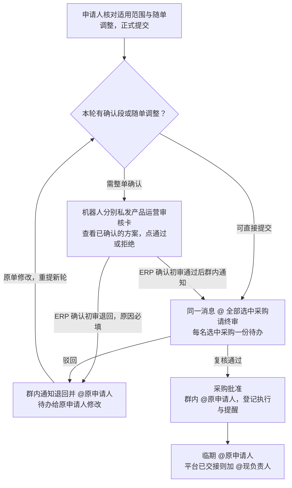

# 政策审核与飞书通知技术设计书（开发版）

面向后端、前端、测试和飞书应用管理员。基线日期为 2026 年 11 月 23 日。A、B 已交付分流依据、审核名单、事务登记和采购权限。C 已交付站内两级审核、退回重提、经办详情和改派 API。D 已交付工作台及按轮登录回跳。按申请页正式提交方式分流的调整已归入 E 阶段前置工作。后续从 P23 接入外部投递。[C 阶段 API](policy-workflow-phase-c.md) · [D 阶段工作台与验收](policy-workflow-phase-d.md) · [E 阶段提示词](policy-workflow-development-prompts.md#phase-e)

## 开发目标

正式提交按申请页「确认政策适用范围」的办理方式分流。存在需要确认的交叉时段，或本轮保留了随单时间调整时，申请人确认整单后提交，由产品运营先审核。没有确认段且没有随单调整时，申请人可直接提交，进入采购终审。E 阶段由应用机器人给每名本轮初审人单独发送交互式审核卡。首个有效决定在 ERP 提交成功后，机器人在业务群通知结果。初审通过转采购，拒绝则退回原申请人修改。采购终审通过后，补贴按核准范围与时间执行。

## 复用范围与新增交付

| 范围 | 工程交付 |
| --- | --- |
| 现有系统 | Vue 3、Element Plus、Spring Boot、MyBatis-Plus 和 MySQL。沿用飞书登录、平台分工、逐段选单、按轮快照、采购复核及生效查询。 |
| 分阶段交付 | A–D 已交付初审分流、按轮指派、站内审核与工作台。产品运营私聊审核卡、卡片回调、群结果通知、采购和申请人待办的实际投递在 E 阶段接入，临期调度按后续阶段实施。 |
| 部署参数 | 后端从环境变量 `FEISHU_POLICY_CHAT_ID` 读取唯一业务群。测试、正式环境分别设置。提前 3 天为首版临期提醒默认值。产品运营与采购两份名单通过人员选择器维护。 |

## 阅读导航

- [逐步开发提示词与验收顺序](policy-workflow-development-prompts.md)
- [业务节点与通知矩阵](#nodes)
- [逐段识别叠加与替换](#classification)
- [审核人分配与访问权限](#assignees)
- [状态迁移与事务边界](#state)
- [HTTP 接口与数据契约](#api)
- [工作台页面与飞书办理入口](#pages)
- [飞书接口与可靠投递](#feishu)
- [政策有效期与配套业务](#lifecycle)
- [验收用例与预期结果](#acceptance)
- [开发顺序与切换验收](#rollout)
- [附录 分段摘要与投递示例](#example)

<a id="nodes"></a>

## 01 业务节点与通知矩阵

以下为 E 阶段的默认投递顺序。对需初审的申请，机器人先给每名产品运营私发审核卡，等 ERP 确认初审结果后再通知业务群。B、C 阶段已在 ERP 内登记提交知悉和初审任务。接入外部投递时须按本矩阵解释已有登记，初审的默认办理入口为私聊卡。

| 业务节点 | 群内提醒 | 个人办理与 ERP 结果 |
| --- | --- | --- |
| 填报与预览 | 无 | 申请人保存草稿、上传文件，在现有页面逐段选择采用名单，确认后正式提交。 |
| 直接提交（无确认段、无随单调整） | 同一消息 @ 本轮全部选中采购，请审核 | 每名选中采购一份待办，进入待采购终审。 |
| 需整单确认后提交 | 初审结果在决定提交成功后通知 | 给本轮每名有效初审人各私发一张卡，列出申请人已确认的逐段方案或随单调整，提供「通过」「拒绝」操作。采购在此阶段没有终审办理权。 |
| 初审节点通过 | 通知初审通过，@ 本轮全部合格采购，请终审 | 首个有效决定提交后，初审卡更新为只读，显示实际办理人。每名选中且具资格的采购各收一份终审待办。整单仍待审核。 |
| 初审节点退回 | 通知初审退回，@ 原申请人，请修改 | 拒绝时必填原因。决定提交后，初审卡更新为只读，原申请人收一份修改待办并可查看原因。 |
| 采购节点通过 | @原申请人，告知结果 | 关闭本阶段全部个人待办，显示实际或计划执行时间。交接涉及的执行人也收到对应范围的通知。 |
| 采购节点驳回 | @原申请人，请修改 | 原因依现有规则选填。关闭本阶段全部个人待办，创建一份修改待办。 |
| 修改后重提 | 按新轮分流通知 | 原单号不变，重算采用名单并结办旧修改待办。需初审时逐人私发新轮卡片，直接终审时逐人创建采购待办。 |
| 临期及截止 | @原申请人，已移交则加 @现负责人 | 显示当前实际截止和延期状态。需要申请调整时，提供权限允许的办理入口。 |

### 何时通知下一环节

节点迁移与业务提交成功后派发。草稿未完成、提交结果待核实或审核复核失败，页面先反馈给操作人。旧节点关闭后可继续查看当轮结果，群聊回复、表情和任务列表中的勾选均不能直接批准政策。

超时催办仅针对当前阶段尚需办理的有效成员。催办时长作为部署配置，首版可关闭，一单多个商品、多个平台合并成同一轮节点通知。

### 申请与审核流程图



<a id="classification"></a>

## 02 逐段识别叠加与替换

A 阶段交付时按执行组合变化分流并生成中文摘要。最新业务口径取正式提交时服务端核对的确认段及随单调整，原有变化类型继续用于说明申请人作出的选择。[P01–P05 历史交付记录](policy-workflow-phase-a.md)

比较同一适用范围、同一时段的两份名单。旧名单是提交前已获批且原定执行的政策，新名单是本轮申请人确认的方案。

### 比较口径

按渠道、实际平台、审核范围及北京时间划段。切点取本轮确认区间与已批实际或未来安排的全部边界。复用已有适用范围及时间轴规则回放各段，比较项以政策身份及获批轮次为准，不把未采用的候选单计入旧名单。

| 原安排 → 拟安排 | 摘要措辞 | 整单路由 |
| --- | --- | --- |
| 无 → B，全单无确认段、无随单调整 | 新增普通政策 | 直接送采购。 |
| 无 → C，百亿交叉段按历史决定排除旧单后，仅 C 可选 | 确认该段采用 C | 仍须整单确认，送产品运营。 |
| A → A，同段还有本单或其他候选 | 重叠段沿用 A | 送产品运营确认。 |
| A → A＋B | 新增叠加 B | 送产品运营。 |
| A → B | B 替换 A | 送产品运营。 |
| A＋B → A | 取消与 B 的叠加 | 送产品运营。 |
| A＋C → B＋C | 以 B 替换 A，继续与 C 叠加 | 送产品运营，保留项单列，避免误报。 |
| 随单调整旧单截止，重算后没有交叉段 | 按目标单列出调整前后截止、原因 | 本轮仍要确认随单调整，送产品运营。 |

以上符号表示采用名单集合。申请人在「我的提交」发起独立时间调整时，调整本单的截止与原因属于该独立申请自身。独立调整可直接提交时走采购，延期新增时段要求逐段确认时走产品运营。打开预览、取消编辑或清空随单调整均以实际提交时重新核定的内容为准。清空后无确认段且无随单调整时直接送采购。未提交时不启动审批。

### 范围与文案

零售按具体商品核对，完整场景集合及核销类型同组最多选一张，跨组可叠加，预估政策同样参与。百亿按平台、机型版本、RAM、ROM 的配置口径处理，历史按商品审核的段仍按原范围回放。

仅在平台、范围、时段、完整候选、原新采用名单以及补贴条件全相同时合并展示。指定数量 0 与未填写分开。金额使用 `BigDecimal`，固定与比例并列列出，保留基数、上限和数量。只有口径相同且上限不影响结果的固定额才展示算术合计。

### 计算顺序

1. 复用预览及提交校验取得可生效区间、本轮逐段选单和随单调整。
2. 以本轮尚未获批为基线，回放本公司该段已获批的实际或计划执行名单。用本轮确认方案计算新名单。随单延期在批准前用同批稳定标识，批准后关联实际延期单号。
3. 按本轮实际须确认的交叉段和随单调整判断整单首节点，口径与页面 `direct = !current.ranges.length && !changes.length` 一致。对齐时间切点，列出各段可选政策、实际选择与前后采用名单，纯截止变动单列。候选数量和变化分类用于展示。
4. 在服务端冻结判断依据与展示字段。审核页、初审私聊卡、群摘要及待办都从同一轮明细取数。旧快照无法可靠回放时提示重新核对，避免将无法核实的单据误送采购直审。

<a id="assignees"></a>

## 03 审核人分配与访问权限

B 阶段已接入统一名单、按轮指派、事务内通知登记和采购权限，切换开关默认关闭。实施与验证范围见 [P06–P11 交付记录](policy-workflow-phase-b.md)。

在管理后台由具备设置权限的管理员亲自维护“产品运营审核人”“采购审核人”两组公司名单。两组都支持按姓名、部门查询和多选具体人员，同名人员显示部门供核对。申请人提交或重提时系统直接取该轮生效的配置。

| 身份 | 如何确定 | 允许的操作 |
| --- | --- | --- |
| 原申请人 | 取申请归属，重提仍由原申请人操作。 | 维护本人草稿或驳回单，查看本轮退回原因。 |
| 产品运营 | 在本企业启用账号中多选，将所选本地用户 ID 保存到产品运营名单。 | 本轮符合资格且指派到初审的人可打开本轮快照和证明并作决定。 |
| 采购 | 从本企业启用且角色为 `ADMIN` 的账号中多选，将所选本地用户 ID 保存到采购名单。 | 管理员原有查阅范围按既有权限判断。本轮被选中的有效采购才能在终审阶段办理；其他管理员不因角色自动成为收件人。 |
| 平台执行人 | 按当前渠道＋实际平台分工实时查找，零售和百亿分别解析。 | 在本人负责范围内查看已获批安排，移交后原单归属不变。 |

### 全局设置、本轮名单与改派

设置保存本地用户 ID，后端按本企业和当前飞书应用下已核验的账号关系解析 `open_id`。申请人无需逐单选人。首提和重提读取最新全局配置，过滤不符合企业、启用、岗位或自审条件的成员，按本地用户去重。需初审时，确保最终采购签署人不同于实际初审签署人。所需阶段无合格人选或无法由两人分别签署时，给出缺失岗位并保留可编辑单据。冻结本轮两组实际指派和配置版本。改动全局名单从下一次提交的新轮起生效。

在途节点需调整名单时，流程管理员核对阶段、轮次、记录版本和目标资格后增减成员，填写原因。移除成员立即失去办理权。在 E 阶段，保留的初审成员沿用原卡，新增初审成员各收一张私聊卡，移除者的卡转为只读。采购侧保留成员的待办，结办移除者的任务，给当前节点新增采购逐人建待办。群里点名变更人员。初审期间调整未来采购名单只更新该轮知悉对象，采购待办在转入终审后创建。在途人员停用、离岗或失去资格时阻止其操作。节点缺少合格成员时提示改派。

### 同一阶段由谁决定

同一环节采用 ERP 首个有效且成功落库的决定。任一当前成员先同意即通过本环节，先退回即退回原申请人。仅记录实际决定人的姓名、时间、结果及原因。初审完成后，私聊卡显示结果并移除办理操作，同组其他人的卡标明「同组他人已处理」。采购阶段将实际办理人的个人待办记为已办理，其余待办统一结办。采购同意还须通过最终复核才能结束该节点。复核失败后，所有仍具资格的采购继续可办。

### 授权边界

服务端每次读取和写入均按当前会话核对企业、启用状态、归属或节点指派。产品运营处理权限建议作为独立业务权限，可授予已有账号，只开放必要快照与附件，不连带开放商品、用户管理或整库政策。附件核对所属申请、轮次及文件引用。

后端只从环境变量 `FEISHU_POLICY_CHAT_ID` 读取群 `chat_id`。管理后台只选择人员，不提供群地址写入入口。群缺配、无法发言、人员未入群或飞书身份无法解析时，在相应群投递或个人投递上记录具体故障，已获指派的有效账号可从 ERP 办理。群内被点名仅表示收到提醒。

原申请人停用后，历史归属保留。退回单不能由接手人代改，管理员处理账号或分工异常，必要时由合格人员另行发起。同一人在群里有多种身份时合并为一次 @，办理责任优先。

<a id="state"></a>

## 04 状态迁移与事务边界

保留 `DRAFT`、`PENDING`、`REJECTED`、`APPROVED` 的整单状态。启用新流程后，每轮 `PENDING` 区分 `PRODUCT_REVIEW` 与 `PURCHASE_REVIEW` 两个阶段。

| 起点与动作 | 整单与阶段结果 | 同一业务事务完成 |
| --- | --- | --- |
| 草稿或驳回单正式提交 | `PENDING`＋所选首节点 | 冻结新轮表单、逐段决定及两组本轮指派。E 阶段按首节点登记发初审私聊卡或通知采购终审。 |
| 产品运营首个有效同意 | `PENDING`＋采购终审 | 留实际初审人、时间、意见及节点结果，记录版本加一。E 阶段登记初审卡更新、群结果通知与逐人采购待办。 |
| 产品运营退回 | `REJECTED`，结束本轮 | 拒绝原因去首尾空白后必填，最多 512 字。标记退回来源。E 阶段登记初审卡更新、群结果通知和原申请人修改待办。 |
| 采购驳回 | `REJECTED`，结束本轮 | 沿用意见选填及长度限制。原政策继续按原安排执行。 |
| 采购批准 | `APPROVED`，结束本轮 | 复核组合，原子落实本轮整批决定及时间调整。 |
| 采购复核失败 | 保留 `PENDING`＋采购终审 | 保留现有 409 结果，采购可退回，不发送通过通知。 |

### 提交与终审写入

接入 `PolicyApplyServiceImpl` 的正式提交事务。按既有机型锁与正式确认依据冻结原安排、拟安排、触发段及指派。`submissionVersion` 只在首提或重提递增，同轮动作推进 `recordVersion`。外部飞书请求在事务提交后执行。

复用 `PolicyReviewServiceImpl` 的锁内终审，继续校验所有涉及机型、原单轮次、有效截止、平台资格和剩余候选。不同申请并发获批时，新增未确认组合返回 `POLICY_RECONFIRM_REQUIRED`，整单无剩余区间返回 `POLICY_NO_EFFECTIVE_PERIOD`。

既有轮次总审核记录只能表达一次最终结果。初审通过保留该轮 `SUBMITTED`，节点轨迹另行留证。两关退回均写本轮终态及退回来源。现有采购入口和新节点入口必须调用同一授权与迁移逻辑，防止绕开初审或重复产生延期单。

### 写入成功的判定

既有 `policy_apply`、`policy_audit_log` 和 `policy_goods_detail` 表达整单及本轮快照。每次决定在事务内核验企业、有效账号、该轮成员、阶段和双版本，条件更新必须只命中一条。同组同时同意或同意与退回竞速时，只有第一个有效提交成功的决定推进节点，其余请求返回已处理并提供实际办理人。采购复核返回 409 时，当前节点、个人待办和办理权保留。飞书结办以实际结果关联各自 GUID。响应丢失时按轮次核对已提交结果，重试不能再创建节点、延期单或待办。

<a id="api"></a>

## 05 HTTP 接口与数据契约

沿用现有申请提交和采购审核接口。以下接口已接入后端，字段、轮次附件及错误处理见 [C 阶段 API 契约](policy-workflow-phase-c.md#api-与字段)。

| 接口 | 契约与权限 |
| --- | --- |
| `POST /api/policies/{id}/submit` | 现有。冻结本轮后附加 `reviewStage`，旧客户端可忽略附加字段。 |
| `POST /api/admin/policies/{id}/review` | 现有。所有写操作校验采购阶段和指定采购，保留旧请求格式。 |
| `GET /api/policy-reviews/mine` | 按当前账号分页读取可办理的指派，返回单号、阶段、摘要和版本。 |
| `GET /api/policy-reviews/{id}` | 带 `submissionVersion` 定位本轮。按权限返回摘要、逐段明细、指派及 `allowedActions`。 |
| `POST /api/policy-reviews/{id}/product-review` | 限当前指定初审人，决策值、版本和意见格式复用采购 DTO。 |
| `GET /api/admin/policy-review-settings`、`PUT /api/admin/policy-review-settings` | 管理员读取或保存两组全局审核人，读取返回现值与版本。[设置接口](../api/policy-review-settings.md)请求含 `productReviewerUserIds[]`、`purchaseReviewerUserIds[]`、`expectedVersion`；人员为本地 ID。后端校验候选资格、重复值与旧版本。 |
| `GET /api/admin/policy-review-settings/candidates` | 限本企业有效管理员。按岗位、姓名、部门和分页查本企业的启用账号，返回本地 ID、姓名、部门。采购候选在服务端限定为有效管理员。 |
| `POST /api/admin/policy-reviews/{id}/reassign` | 请求含当前阶段、目标阶段、双版本、更新后的本轮人员名单及原因。按成员差集更新指派，名单有变动时递增记录版本。 |

### 初审请求与成功响应示意

```json
{ "recordVersion": 8, "submissionVersion": 2,
  "decision": "APPROVE", "reviewRemark": null }
```

```json
{ "id": "128", "status": "PENDING", "reviewStage": "PURCHASE_REVIEW",
  "submissionVersion": 2, "recordVersion": 9 }
```

客户端不传审核人身份、可操作标记或路由结论。沿用会话 Cookie、可信 Origin、`X-Policy-Request: 1` 和 `Content-Type: application/json`。ID 为字符串，日期精确到秒并携带 +08:00。参数非法返回 400，未登录 401，无权 403，跨企业或不可见对象按现有边界返回 404，版本、状态或指派冲突返回 409。响应未知时先按本轮读取结果。

### 详情读取与错误反馈

`allowedActions` 按当前登录人计算，写入时重新核验。`reviewStage` 在待审时取两个阶段之一，终态为空，`rejectedAtStage` 返回本轮的退回环节。`reviewable` 表达当前管理员能否终审。群渠道故障在投递视图展示，独立于业务审批状态。

改派请求包含 `expectedStage`、`targetStage`、`recordVersion`、`submissionVersion`、`assigneeUserIds[]` 和 `reason`。读取设置限有管理权限者，全局修改只作用于后续新轮，在途名单通过改派明确生效。

<a id="pages"></a>

## 06 工作台页面与飞书办理入口

D 阶段提供站内办理与按轮回跳。E 阶段接入后，产品运营也可在机器人私聊卡直接办理。卡片和站内页共用 ERP 节点决定，采购和原申请人仍可从个人待办打开对应 ERP 页面。

### 页面改动

| 入口 | 开发要求 |
| --- | --- |
| 提交申请与我的提交 | 沿用现有预览、未保存保护和附件。展示“待产品运营确认”或“待采购终审”。退回后在详情及编辑页显示本轮节点、审核人、时间和原因，保留原单号。 |
| 待我审核 | 增加需登录的节点办理入口。初审人只见分配给本人的政策。摘要按平台、商品、时段列出原方案、拟方案、增减项与原因。操作为“同意，转采购”“退回修改”。 |
| 差异化政策 | 复用 AdminPolicyDetail.vue 的快照展示。审批按钮由服务器 `allowedActions` 或 `reviewable` 控制。采购可见初审结果，列表新增阶段筛选，保留原有状态计数。 |
| 管理后台 → 政策审核设置 | 管理员在“产品运营审核人”“采购审核人”两个多选框内按姓名、部门查找，确认人员后保存。显示已选姓名、部门及配置版本；部门条件用于找到具体人员。可查看投递结果、逐人核对待办或改派，缺少群配置时提示部署人员核对环境变量。 |

### 链接与登录

飞书办理链接使用同源路由 `/#/reviews/{id}?round=2`，可加 `node=PRODUCT_REVIEW`、`PURCHASE_REVIEW` 或 `REVISION`。页面将 `round` 映射为接口的 `submissionVersion`。两种工作台均可按轮进入审核详情，服务器核对读写权限。退回修改入口保留 `/#/apply?policyId={id}&round=2`，确认原申请人、本轮驳回状态及未保存保护后回填。[办理链接约定](policy-workflow-phase-d.md#办理链接约定)

进入页面先取最新权限、阶段和双版本。旧轮链接显示“本轮已处理”或“已有新一轮”，同组其他成员已办理时展示实际办理人。初审退回原因在前后端都校验必填，采购驳回意见沿用选填。409 保留已填意见并刷新详情。手机要能看到完整时段、退回原因及两种操作。

### 初审私聊卡与群结果示例（E 阶段）

李华、王宁各收到一张机器人私聊卡。示例卡为「政策叠加待初审｜ZC-000128 · 第 2 轮」，列出京东零售、Reno17 Pro 12GB+256GB 浮光白、12 月 1–5 日，以及申请人已选的「保留旧单 20 元/台，叠加本单 30 元/台」。本人可点「查看逐段明细」「通过」或「拒绝」。选择拒绝须填写原因并提交。

【请采购终审｜ZC-000128】采购 @张敏 @赵然，产品运营李华已确认本轮叠加方案，请审核。〔去审核〕　如产品运营王宁先退回，群消息为“@原申请人，本轮由王宁退回，请查看原因并修改”。原因及证明文件在授权详情中查看。

登录回跳仅接受本站预定义路由及允许的参数。先完成身份核验，再返回快照与附件。飞书内打开与浏览器另开属于独立会话，分别验收。

<a id="feishu"></a>

## 07 飞书接口与可靠投递

E 阶段由企业自建应用机器人投递。以 ERP 中本轮节点的实际决定为准，分别追踪个人卡、群消息和任务的投递回执。

| 动作 | 飞书服务端契约 |
| --- | --- |
| 产品运营私聊审核卡 | 按本轮有效指派，使用同应用的 `open_id` 给每人发送一条 `interactive` 消息，逐卡保存 `message_id`。卡片展示逐段选择摘要、按轮详情入口及「通过」「拒绝」操作。 |
| 初审卡操作回调 | 在飞书应用订阅 `card.action.trigger`。服务端验证回调来源，将实际点击人映射为本企业启用账号，核对卡片消息、收件人、当前指派、节点及版本，再调用站内初审逻辑。拒绝原因去除首尾空白后必填。[配置卡片交互](https://open.feishu.cn/document/feishu-cards/configuring-card-interactions) · [飞书回调接收与校验](https://open.feishu.cn/document/event-subscription-guide/callback-subscription/receive-and-handle-callbacks) |
| 群内点名 | POST /open-apis/im/v1/messages，`receive_id_type=chat_id`，`receive_id` 取环境变量 `FEISHU_POLICY_CHAT_ID`。服务端把每名本轮收件人的本地 ID 解析成同应用 `open_id`，按人去重，在同一条消息插入对应的 at 元素。保存 `message_id`。 |
| 采购终审和原申请人修改待办 | POST /open-apis/task/v2/tasks，`user_id_type=open_id`。对每名当前采购或需修改的原申请人创建独立任务，在各自任务 members 中指定该人 user、assignee、`open_id`。写入业务摘要、origin.href 与 PC、iOS、Android 的 `custom_complete` 跳转，按人保存 task.guid。 |
| 同步结办 | PATCH /open-apis/task/v2/tasks/{guid}，提交 `completed_at` 毫秒字符串并在 `update_fields` 中声明该字段。退回、同意或改派均先在 ERP 落实，再将对应旧任务结办，说明办理结果。 |

### 事务、去重与补偿

初审节点建立时按当前指派逐人登记私聊卡。首个有效初审决定提交时，登记该轮节点唯一的群结果通知、各已发卡的只读更新，以及采购终审或原申请人修改待办。重复回调、重复点击、其他人抢先办理或站内页已办时，读取 ERP 现有结果，同一决定只迁移一次、只通知群一次。

按申请、轮次、节点到达记录、指派记录或群、投递动作生成稳定业务标识。结办动作区分「本人办理」「同组他人已处理」「已改派」。同一人先被移除再加回时使用新指派记录。重投时分别核对私聊卡、群消息和任务回执。

当前基线的 `ck_review_delivery_recipient` 仅允许群级 `GROUP_MESSAGE` 和个人 `CREATE_TASK`、`CLOSE_TASK`。如需增加独立的个人卡片动作，E 阶段应先说明约束改动、既有登记与代码影响，按项目第 13 条取得本次结构调整确认后实施。[现有投递表约束](../sql/schema.sql)

后台多实例领取时采用带期限的占用机制。重试前核对当前阶段、指派及外部回执。同一单内按节点顺序派发，节点结束后跳过迟到的可办卡及待办创建，已发送的卡补更新为只读，旧任务按实际结果补结办。单一渠道失败只重试该渠道。同一单已有群通知时，后续提醒可回复原消息。没有可用的原消息时在同一配置群发出并附单号。

同一 IM 请求复用 `uuid`，同一任务创建请求复用 `client_token`。飞书的去重有时间窗口，业务幂等贯穿完整生命周期。限频、网络错误退避重试，响应未知且超过平台窗口，先核对外部记录，无法确认则交人工核对。无权限或未入群标为需配置处理，修复后补发。

### 上线检查

检查应用已发布、机器人可向初审人私发卡片并接收已验证的卡片操作回调、机器人加入目标群且可发言、经办人在可用范围、任务有写权限。token 仅留服务端。群中只给摘要及业务入口，日志保留业务标识、失败码及回执，不写凭证或附件内容。官方文档索引见第 10 节。

### 恢复与环境配置

区分待发送、已取得回执、结果未知、需人工核对及已失效。发卡与更新卡、群消息、建任务、结办各自处理，超出外部幂等窗口时先核对。即便外部卡面更新或任务结办延迟，旧指派也不能再次提交决定。人工补发沿用业务标识并记录处理人、理由与时间。

测试与正式环境分别为 `FEISHU_POLICY_CHAT_ID` 设置各自的群 `chat_id`，并使用各自的应用、人员映射及业务域名。机器人凭证仅在后端注入，消息不得包含用户令牌或带下载授权的附件地址。

[飞书发送消息](https://open.feishu.cn/document/uAjLw4CM/ukTMukTMukTM/reference/im-v1/message/create) · [飞书任务功能与完成方式](https://open.feishu.cn/document/uAjLw4CM/ukTMukTMukTM/task-v2/task/overview)

<a id="lifecycle"></a>

## 08 政策有效期与配套业务

所有提醒按北京时间的实际生效与截止时刻调度。提交了时间变更申请后，原政策仍按最近一次已批准的决定执行。

| 触发事件 | 处理规则及接收人 |
| --- | --- |
| 已批后开始执行 | 批准时已起效，合并进终审结果。未来开始的安排在实际起点复核本段采用名单，通知当前平台执行人，只执行旧单的段不报“本单已生效”。 |
| 临期提醒 | 默认实际截止前 3 天提醒原申请人，移交后加现负责人。已进入窗口才批准或服务恢复时，尚未截止则补提醒一次，已过期转截止事件。 |
| 到达截止 | 截止秒仍有效，下一秒退出。实际结果分为自然结束、有获批延期接续、延期仍待审核。若延期晚批，中间空档按真实时间描述。原单审核状态继续为已通过。 |
| 提前结束 | 独立申请针对本人原单，随单缩短可涉及前任提交的原单。发起人须负责目标至少一个实际平台。获批后整张旧单各平台、商品按实际截止处理，通知发起人、目标单原申请人及受影响现负责人并去重。 |
| 延期 | 限本人且仍负责原单全部平台，新增段从原实际截止的下一秒起。审批晚于起点时取实际批准时刻。同批延期之间也核对交叉，已批关联新单从其获批内容安排后续提醒。 |
| 随单多目标 | 本轮逐项记录目标单、获批轮次、原新截止、原因及证明。同批一项失效则不能批准，整批驳回保持旧安排，整批通过再统一重算受影响提醒。 |

临期按原单、实际截止、提醒档位、目标群防重。发送前再读状态、当前负责人和延期情况。截止已变的旧计划作废，发送后才批准的调整另发“截止已变更”，避免沿用旧提醒。已停用的原申请人无法收取时，通知现负责人并向管理端记录未送达原因。

若拟定提前截止早于批准时刻，依现有规则保留历史至批准前一秒，通知取核准的实际截止。独立缩短不生成新的商品补贴明细。已有直接延期单时按现有资格核验，后续可从已通过的延期单继续申请。

切换时也扫描已通过且尚有效的政策。对已处于临期窗口的政策最多补送一次，已经结束的政策保留历史记录。

### 分工与商品准备

平台移交成功后，在群里 @ 新旧负责人并注明渠道与平台。原申请的修改权限仍归原申请人。在途审核人失去资格按第 03 节改派。源商品导入暂停需续跑，或清洗结束有待人工审核、技术失败时，按批 @ 负责该批的商品管理员，商品目录和日常补贴查询继续在页面反馈。

<a id="acceptance"></a>

## 09 验收用例与预期结果

使用申请人、两名产品运营、两名采购、未选中的有效管理员、平台接手人和无权限账号建立隔离测试。按各例核对政策状态、个人卡收件人与操作、群内真实 @、任务归属及查询结果。以下飞书投递项为 E 阶段待验收行为。

| 编号 | 输入或操作 | 应观察到的结果 |
| --- | --- | --- |
| T01 | 普通单直提，普通单保存草稿 | 一条群消息 @ 两名选中采购，二人各一份待办；未选中的管理员无通知且不能代审。草稿产生零条外部通知。 |
| T02 | 京东有 A→A＋B，淘宝无重叠 | 两名产品运营各收一张私聊审核卡。卡面展示京东段候选与申请人选定的叠加方案，采购写接口拒绝越级。 |
| T03 | 分别提交 A＋B→A、A→A（同段另有候选 C）、A→B，以及无交叉且无随单调整的新增 | 前三者均进初审，分别写「取消叠加 B」「从候选 A、C 中沿用 A」「用 B 替换 A」。C 不列作被替换。后一例直接进采购。 |
| T04 | 零售同组互斥，百亿同配置不同色，指定数量 0 | 按各自范围及历史决定出摘要。零售与百亿同名平台分别计算，数量 0 有显示。 |
| T05 | 产品运营在私聊卡点拒绝，先提交空白原因，再填写原因，申请人修改后重提 | 空白原因保留在初审并提示填写，群中没有退回结果。有效拒绝提交后，群内获得一条退回通知，原申请人获修改待办并能查看原因。重提重算，旧卡只读。 |
| T06 | 两名初审人并发点击，通过与拒绝竞速，重复投递同一回调，或 ERP 页面先完成审核。两名采购并发办理 | 每个节点仅首个有效的业务决定生效。所有初审卡只读并显示实际办理人，初审结果在群中只通知一次。通过后两名合格采购各一份终审待办，拒绝后原申请人一份修改待办。终审结果及关联延期单各产生一次。 |
| T07 | 采购提交同意时，另单获批改变剩余组合，或只影响过去 | 前者返回 409，本轮采购节点和个人待办仍可办理，另一名采购仍可退回。后者其余依据一致可通过。 |
| T08 | 多目标调整一项失效，原截止 18:00:00 | 整批无部分生效。合法延期最早从 18:00:01 起，晚批缩短保留历史至批准前一秒。 |
| T09 | 临期后延期待审、已批、提前结束或平台移交 | 消息区分四种情形，按实际截止和最新平台分工发送，旧档位不会重复发送。 |
| T10 | 停用、改派、本人审核、转发链接、跨企业读取 | 新承办人可办，旧人及越权人不可办。附件也核对本轮归属，群成员身份不能扩大权限。 |
| T11 | 飞书限频、超时、服务重启、部分渠道成功 | ERP 节点不回退，只补失败渠道。外部结果不明可核对，任务 GUID 和群回执可追踪。 |
| T12 | 历史待审单、旧版快照、移动端登录和旧页重开 | 旧单按切换策略办理，新轮受新门控，回跳还原正确单号和轮次，旧页不能提交新轮。 |
| T13 | 群内知悉人转发单据，初审人请求其他轮证明 | 链接持有人仍需业务授权，附件核对政策、轮次和访问人。 |
| T14 | 启用通知，清洗任务含多条待人工识别商品 | 历史已结束政策不补发到期群消息，商品异常按批汇总并通知对应商品管理员。 |
| T15 | 管理员按姓名、部门分别多选两组，保存后变更全局名单 | 同名可区分部门，采购候选限本企业启用管理员，未选管理员不自动加入。申请人提交页无需选人。新轮使用新配置，在途沿用快照。 |
| T16 | 在途初审名单从李华、王宁改为王宁、陈平 | 李华失去办理权，旧卡只读。王宁沿用原卡，陈平收到一张新私聊卡。改派日志有操作人、原因、时间及增减名单。 |
| T17 | 测试、正式各指定一个群，一人的建待办超时 | 消息只发往当前环境 `FEISHU_POLICY_CHAT_ID`，真实 @ 匹配每名选中成员。仅核对、重试该人的待办，群消息和其他人员已成功任务均不重复。 |
| T18 | 分别提交百亿交叉段仅 C 可选的申请、随单调整重算后无交叉的申请、可直接提交的独立调整与普通单 | 前两例仍需整单确认，提交后进入初审。后两例无确认段且无随单调整，直接进采购。 |
| T19 | 手动打开预览后取消，或清空随单调整后重新提交 | 取消且未提交时没有节点和投递。清空后按最终预览分流，仍有确认段则初审，两项都为空则直接采购。 |

前端复测桌面、平板和手机的申请、审核与回跳。真实飞书租户核对机器人逐人私发、卡上通过与拒绝、决定后的群结果、任务领取、手机登录和回写。目标 MySQL 需验证不同单并发和时间边界，由用户在 Navicat 执行核查。

<a id="rollout"></a>

## 10 开发顺序与切换验收

先验证审核权和生效结果，再开启外部投递。`POLICY_REVIEW_WORKFLOW_ENABLED` 控制新提交的 ERP 审核流程。飞书私聊卡、回调和群通知另需完成 E 阶段开发及 F 阶段联调。P33 根据届时实际交付的投递与恢复能力编制切换手册，暂停外部发送时已建节点继续在 ERP 按轮办理。

| 阶段 | 交付物与启用条件 |
| --- | --- |
| 一 业务与数据 | 用实际政策样例确认第 02 节的基线回放与分流结果。持久化需承载全局两组人员、本轮成员快照和改派记录、节点唯一实际办理人、逐人任务回执及群回执。涉及结构调整时，先单列范围、原因、旧数据及代码影响，按项目第 13 条取得本次确认后再做物理设计与 SQL。 |
| 二 后端与前端 | 接入现有提交及采购终审，交付双阶段、改派、权限及工作台页面。完成旧入口越权回归，同步接口说明、状态机及按轮读取契约。 |
| 三 飞书投递与联调 | E 阶段（P23–P26）用模拟飞书核对逐人私聊发卡、卡片回调、全组卡片只读、决定后的唯一群结果，以及采购、申请人待办。覆盖超时、断网、重复回调与回执缺失。F 阶段 P32 在指定测试企业核对真实送达、操作与回跳。 |
| 四 切换与回退 | 建议切换前已提交且仍待审的轮次继续旧采购路径，重新提交才用新流程。以明确切换标识识别旧轮，新轮缺少节点时阻断并修复。保留历史快照和审核时间，启用、暂停或恢复均不得重放整库历史通知。 |

上线前核对 `FEISHU_POLICY_CHAT_ID`、后台选定的产品运营和采购名单、能执行改派的管理员、服务器时区和各端可访问域名。观察待审积压、节点无合格成员、最老未送达时长、失败码、待人工核对数量，以及临期任务延迟。

### 项目内核对入口

[状态与轮次](../business/status-machine.md) · [覆盖规则](../business/override-engine.md) · [申请接口](../api/policy-api.md) · [采购接口](../api/admin-api.md) · [分工与用户](../api/user-api.md) · [附件权限](../api/attachment-api.md) · [飞书鉴权](feishu-auth-flow.md) · [环境配置](environment-configuration.md)

| 实现位置 | 现有入口及改动重点 |
| --- | --- |
| 提交与审核 | [提交服务](../../backend/src/main/java/com/company/policy/service/impl/PolicyApplyServiceImpl.java) 冻结轮次。[审核服务](../../backend/src/main/java/com/company/policy/service/impl/PolicyReviewServiceImpl.java) 统一终审资格及机型复核。 |
| 逐段与时间 | [适用性计算](../../backend/src/main/java/com/company/policy/support/policy/PolicyApplicabilityEvaluator.java)、[时间轴构建](../../backend/src/main/java/com/company/policy/support/policy/PolicyTimelineBuilder.java) 和 [批量延期](../../backend/src/main/java/com/company/policy/support/policy/PolicyBatchExtensions.java) 提供范围、历史回放及延期依据。 |
| 页面与守卫 | [工作台路由](../../frontend/src/utils/workspace-route.js)、[采购详情](../../frontend/src/views/admin/policies/AdminPolicyDetail.vue)、[我的提交](../../frontend/src/composables/usePolicySubmissions.js) 分别适配节点权限、当轮结论及退回原因。 |
| 飞书服务端 | [飞书认证请求](../../backend/src/main/java/com/company/policy/service/impl/FeishuApiTransportImpl.java) 现用于认证链路。新增 IM、Task 调用时单独封装，限定目标域名和超时，保留可追踪的结果。 |

### 飞书官方接口参考

[群消息发送与权限](https://open.feishu.cn/document/uAjLw4CM/ukTMukTMukTM/reference/im-v1/message/create) · [消息内容与指定人员](https://open.feishu.cn/document/server-docs/im-v1/message-content-description/create_json?lang=zh-CN) · [任务 V2 与幂等约定](https://open.feishu.cn/document/uAjLw4CM/ukTMukTMukTM/task-v2/overview) · [任务来源及自定义完成](https://open.feishu.cn/document/uAjLw4CM/ukTMukTMukTM/task-v2/task/overview)

<a id="example"></a>

## 附录 分段摘要与投递示例

以下示例说明设计时使用的展示口径。编号、日期与金额均为演示值。前端可从已冻结的范围与政策名单生成展示内容，当前响应字段以 [C 阶段接口](policy-workflow-phase-c.md#api-与字段)为准。

### 详情读取模型

建议输出 `reviewStage`、`allowedActions`、本轮两组指派、`changeSummary` 和 `changes`。示例中的 `userId` 是 ERP 本地用户 ID。节点完成后另返回实际办理人、结果和时间。完整明细留在授权页，群内给出变化数与前几项，并附详情入口。数值、身份和适用范围由服务端生成。

```json
{
  "id": "128", "policyCode": "ZC-000128", "submissionVersion": 2,
  "recordVersion": 8, "reviewStage": "PRODUCT_REVIEW",
  "settingsVersion": 3,
  "productReviewers": [{"userId":"11","name":"李华"},{"userId":"12","name":"王宁"}],
  "purchaseReviewers": [{"userId":"21","name":"张敏"},{"userId":"22","name":"赵然"}],
  "allowedActions": ["APPROVE", "REJECT"],
  "changeSummary": { "stackSegments": 1, "replaceSegments": 0,
                     "removeStackSegments": 0 },
  "changes": [{
    "perspective": "RETAIL", "scope": {"platformCode":"JD","goodsId":"8001"},
    "from": "2026-12-01T00:00:00+08:00", "through": "2026-12-05T23:59:59+08:00",
    "kind": "STACK",
    "candidates": [{"policyId":"96","submissionVersion":1},
                   {"policyId":"128","submissionVersion":2}],
    "before": [{"policyId":"96","submissionVersion":1}],
    "after":  [{"policyId":"96","submissionVersion":1},
               {"policyId":"128","submissionVersion":2}]
  }]
}
```

前后名单中的引用均由后台解析为单号、固定或比例参数、基数、上限和指定数量。百亿配置级给出机型、RAM、ROM 及实际申报商品，零售同时展示完整场景和核销类型。混合变化可同时计入多个分类，总段数按实际范围及时段单独去重。

### 同一轮的投递与审计

上例提交后，李华和王宁各收到一张私聊审核卡。若李华先通过且 ERP 成功落库，系统记录李华和办理时间，两张卡转为只读，王宁的卡显示「同组他人已处理」。机器人在业务群通知初审通过，@ 张敏、赵然，二人各收到一份采购待办。若王宁填写原因并先拒绝成功，则群内通知退回并 @ 原申请人，原申请人收到一份修改待办。重复回调时沿用已记录的决定，群内结果只发一次。旧轮详情仅向仍有读取权限者展示。

核对时从申请 ID、轮次、节点、操作者、业务决定、前后阶段及时间，追到每张私聊卡和群结果消息的回执、各任务的 GUID。批准与拒绝来自 ERP 审核记录，可分别查询业务结果与飞书投递情况。
