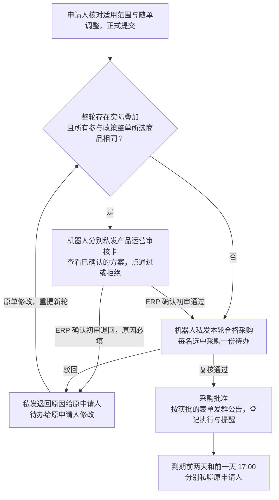

# 政策审核与飞书通知技术设计书（开发版）

面向后端、前端、测试和飞书应用管理员。A、B 已交付分流依据、审核名单、事务登记和采购权限。C 已交付两级审核事务、退回重提、按轮详情和改派 API。D 已交付工作台及按轮登录回跳。2026-11-24 E 阶段接通飞书私聊卡、按钮、终审批准群公告、Task V2 及投递核对。测试企业实发和目标 MySQL 验收归入 P32。[C 阶段 API](policy-workflow-phase-c.md) · [D 阶段工作台](policy-workflow-phase-d.md) · [E 阶段交付与验证](policy-workflow-phase-e.md)

## 开发目标

申请人在「确认政策适用范围」逐段选择采用的政策。正式提交时，服务端汇总本轮各确认段实际叠加采用的全部政策。存在叠加且所有参与政策整单所选的具体商品完全相同，整轮才进入产品运营初审。其余轮次直接进入采购终审。机器人给每名本轮运营私发交互式审核卡。初审通过后私发采购办理，初审退回或采购驳回后私发原申请人修改。采购终审通过后按获批轮次的提交表单发群公告。

## 复用范围与新增交付

| 范围 | 工程交付 |
| --- | --- |
| 现有系统 | Vue 3、Element Plus、Spring Boot、MyBatis-Plus 和 MySQL。沿用飞书登录、平台分工、逐段选单、按轮快照、采购复核及生效查询。 |
| 分阶段交付 | A–D 已交付初审分流、按轮指派、ERP 审核事务、采购办理与按轮详情。E 阶段 P23–P26 已完成运营私聊卡、回调、群公告及个人待办的本地投递验证。F 阶段已完成执行期调度、配套提醒和测试群连通性验证。[F 阶段交付及现场边界](policy-workflow-phase-f.md) · [分阶段开发清单](policy-workflow-development-prompts.md) |
| 部署参数 | 后端从环境变量 `FEISHU_POLICY_CHAT_ID` 读取唯一业务群。测试、正式环境分别设置。临期私聊按北京时间在实际到期前两天和前一天的 17:00 调度。产品运营与采购两份名单通过人员选择器维护。 |

## 阅读导航

- [逐步开发提示词与验收顺序](policy-workflow-development-prompts.md)
- [业务节点与通知矩阵](#nodes)
- [逐段识别叠加与替换](#classification)
- [审核人分配与访问权限](#assignees)
- [状态迁移与事务边界](#state)
- [HTTP 接口与数据契约](#api)
- [工作台页面与飞书办理入口](#pages)
- [飞书接口与可靠投递](#feishu)
- [政策有效期与配套业务](#lifecycle)
- [验收用例与预期结果](#acceptance)
- [开发顺序与切换验收](#rollout)
- [附录 分段摘要与投递示例](#example)

<a id="nodes"></a>

## 01 业务节点与通知矩阵

现行规则按指派私发初审、终审办理及退回修改卡，采购批准时登记该轮唯一的群公告。下表列出现行通知顺序。[C 阶段站内验收](policy-workflow-phase-c.md) · [E 阶段动作与旧登记处理](policy-workflow-phase-e.md#投递与恢复)

| 业务节点 | 群内提醒 | 个人办理与 ERP 结果 |
| --- | --- | --- |
| 填报与预览 | 无 | 申请人保存草稿、上传文件，在现有页面逐段选择采用名单，确认后正式提交。 |
| 本轮没有叠加，或参与叠加的政策商品集合有差异 | 无 | 每名选中采购收到私聊办理卡和一份待办，进入待采购终审。 |
| 本轮存在叠加且所有参与单整单所选的商品 ID 集合相同 | 无 | 每名本轮有效运营各收一张「政策叠加初审」私聊卡。按手机配置、平台和适用时段列出组合单号，再逐单列补贴。整组有依据时优先显示整组配置。零售逐单注明场景与核销类型。底部填写拒绝原因，下方并排放置「通过」「拒绝」。 |
| 初审节点通过 | 无 | 首个有效决定提交后，初审卡更新为只读，显示实际办理人。每名选中且具资格的采购各收一张私聊办理卡和一份终审待办。整单仍待审核。 |
| 初审节点退回 | 无 | 拒绝时必填原因。决定提交后，初审卡更新为只读，原申请人收到载有退回原因的私聊卡及一份修改待办。 |
| 采购节点通过 | 该轮发一条审核公告，末尾点名原申请人及批准当秒实际采用本单的平台现负责人。按获批轮次展示本单表单、申请人、终审人，有运营签署时加列实际初审人。存在确认叠加的时段时，在点名前追加【叠加政策】，逐单列原政策补贴。 | 结办该轮采购待办。生效与交接提醒按 F 阶段实施。 |
| 采购节点驳回 | 无 | 机器人私发原申请人退回环节、原因，采购意见选填。关闭本阶段全部个人待办，创建一份修改待办。 |
| 修改后重提 | 无 | 原单号不变，重算采用名单并结办旧修改待办。需初审时逐人私发新轮卡片，直接终审时给每名合格采购私发办理卡并创建终审待办。 |
| 到期前两天及前一天（F 阶段） | 无 | 北京时间两个提醒日的 17:00 各私发原申请人一次。 |
| 到达截止（F 阶段） | @ 原申请人及相应平台现负责人，按人去重 | 显示实际截止和延期状态。 |

### 何时通知下一环节

节点迁移与业务提交成功后派发。草稿未完成、提交结果待核实或审核复核失败，页面先反馈给操作人。旧节点关闭后可继续查看当轮结果，群聊回复、表情和任务列表中的勾选均不能直接批准政策。

超时催办属于设计预留。拟按当前阶段仍有效的指派通知，同一申请的多个商品和平台合并提醒。

### 申请与审核流程图



<a id="classification"></a>

## 02 逐段识别叠加与替换

申请人在现有页面逐段确认。正式提交时，服务端用本轮最终采用名单和每张政策的提交快照决定整轮首节点。已提交轮次沿用原先冻结的分流依据、指派和审核结果，退回重提时按新一轮的选择重新判断。[A 阶段历史摘要及样例](policy-workflow-phase-a.md)

1. 按现有渠道、平台、审核范围和时段读取每个确认段。只要该段同时采用至少两张不同政策，就把这些单全部纳入本轮比较，跨段去重。未选的候选政策以及整轮只在单选段出现的政策不参与。没有任何叠加段，直接交采购。
2. 对每一张参与政策，取其所有平台上普通商品卡和指定商品卡实际勾选的标准商品 ID（`goodsId`），合并去重。卡片类型、卡片拆分、平台分配、勾选次序及申报数量均不改变同一批商品的身份。相同机型版本、RAM、ROM 或相同件数仍可能对应不同商品。换了颜色或同色同配置的另一 SKU，只要商品 ID 不同，就计为差异。
3. 所有参与政策的整单商品集合逐项相等，整轮才先给运营。任一单多一件、少一件或换一件商品，整轮直接交采购，即使另一段采用的两单商品完全相同。涉及三张、四张及更多政策时都比较所有参与单。

### 分流示例

下表是规则示例。A、B、C、D 各代表一张政策，X、Y、Z 各代表一个不同的标准商品 ID。

| 本轮各确认段最终采用的政策 | 参与单整单所选商品 | 整轮首节点 |
| --- | --- | --- |
| 一段同时采用 A＋B | A 和 B 都选 X、Y，分在不同商品卡，顺序不同 | 产品运营 |
| 一段仍采用已批 A＋B，提交的 C 未选或仅在另一段单独采用 | A、B 都选 X、Y，C 只选 X | 产品运营 |
| 第一段选 A＋B，另一段选 B＋C | A、B 都选 X、Y，C 仅选 X | 采购 |
| 两段分别选 A＋B、C＋D | A、B 都只选 X，C、D 都只选 Y。两段各自一致，四张参与单的集合有差异 | 采购 |
| 同段采用 A＋B＋C＋D | 四张整单都选 X、Y | 产品运营 |
| 同段采用 A＋B＋C＋D | A、B、C 都选 X、Y，D 把 Y 换成 Z。Y 与 Z 即使同型号、同容量，也对应不同商品 | 采购 |
| 每段只选一张、无交叉或仅核对截止调整 | 没有同时采用两张政策的确认段 | 采购 |

### 快手零售的三单示例

截图中三单的申报机型都是 Reno17 Pro，申报时段同为 12 月 10 日 00:00 至 12 月 11 日 00:00。

| 政策单 | 12GB+256GB | 12GB+512GB |
| --- | --- | --- |
| ZC-000015 | 普通卡，3 色 | 普通卡，3 色 |
| ZC-000014 | 普通卡，3 色 | 未选 |
| ZC-000016 | 普通卡，3 色 | 指定卡，仅初雪白 |

截图中的 ZC-000016 已由 Becca 初审退回，该轮保留原审核记录。新版后端启用后，若按图中选择重提，且三单都实际参与叠加，整轮直接交采购终审，不发产品运营卡。ZC-000014 只选了 256GB。即使本轮只有 ZC-000015 与 ZC-000016 叠加，两单的 512GB 也分别选了三种颜色和仅初雪白，整单商品 ID 集合已有差异。逐段采用名单和具体 `goodsId` 以提交快照为准。

随单改期会重算本轮交叉时段，正式提交时按全部确认段判断审核首节点。「我的提交」独立办理的提前结束和延期在整批确认后直接生效，逐单记录办理结果。

### 范围与文案

零售按具体商品核对，完整场景集合及核销类型同组最多选一张，跨组可叠加，预估政策同样参与。百亿按平台、机型版本、RAM、ROM 回放本段决定，同配置各颜色共用审批结果，原单保留实际申报商品和数量。

仅在平台、范围、时段、完整候选、原新采用名单以及补贴条件全相同时合并展示。指定数量 0 与未填写分开。金额使用 `BigDecimal`，固定与比例并列列出，保留基数、上限和数量。只有口径相同且上限不影响结果的固定额才展示算术合计。

### 计算顺序

1. 复用预览及提交校验取得可生效区间、本轮逐段选单和随单调整。
2. 以本轮尚未获批为基线，回放本公司该段已获批的实际或计划执行名单。用本轮确认方案计算新名单。随单延期的试算标识用于逐段校验。提交确认、飞书初审卡、采购审核与按轮详情均按原政策编号展示。跨原截止的相邻段若商品、候选、采用名单和补贴均连续相同，合并展示一次。真实变化或空档分别成段。
3. 从同时采用两单及以上的确认段收集全部参与政策，比较它们在各自快照里的整单商品 ID 集合，再确定本轮审核首节点。各段完整候选、采用名单和纯截止变动供详情核对。申请页另以确认段及随单调整控制确认窗口。
4. 在服务端冻结判断依据与展示字段。审核页、初审私聊卡、群摘要及待办都从同一轮明细取数。参与计算的已批准快照缺少必要依据时，提示重新核对。

<a id="assignees"></a>

## 03 审核人分配与访问权限

B 阶段已接入统一名单、按轮指派、事务内通知登记和采购权限。实施与验证范围见 [P06–P11 交付记录](policy-workflow-phase-b.md)。

在管理后台由具备设置权限的管理员亲自维护“产品运营审核人”“采购审核人”两组公司名单。两组都支持按姓名、部门查询和多选具体人员，同名人员显示部门供核对。申请人提交或重提时系统直接取该轮生效的配置。

| 身份 | 如何确定 | 允许的操作 |
| --- | --- | --- |
| 原申请人 | 取申请归属，重提仍由原申请人操作。 | 维护本人草稿或驳回单，查看本轮退回原因。 |
| 产品运营 | 在本企业启用账号中多选，将所选本地用户 ID 保存到产品运营名单。 | 本轮符合资格且指派到初审的人可打开本轮快照和证明并作决定。 |
| 采购 | 从本企业启用且角色为 `ADMIN` 的账号中多选，将所选本地用户 ID 保存到采购名单。 | 管理员原有查阅范围按既有权限判断。本轮被选中的有效采购才能在终审阶段办理；其他管理员不因角色自动成为收件人。 |
| 平台执行人 | 按当前渠道＋实际平台分工实时查找，零售和百亿分别解析。 | 在本人负责范围内查看已获批安排，移交后原单归属不变。 |

### 全局设置、本轮名单与改派

设置保存本地用户 ID，后端按本企业和当前飞书应用下已核验的账号关系解析 `open_id`。申请人无需逐单选人。首提和重提读取最新全局配置，过滤不符合企业、启用、岗位或自审条件的成员，按本地用户去重。需初审时，确保最终采购签署人不同于实际初审签署人。所需阶段无合格人选或无法由两人分别签署时，给出缺失岗位并保留可编辑单据。冻结本轮两组实际指派和配置版本。改动全局名单从下一次提交的新轮起生效。

在途改派时，管理员核对当前阶段、轮次、记录版本及目标人员资格，提交新名单和原因。ERP 保存改派前后的指派，移除者立即失去该指派的办理权。通知取决于当前阶段和本次调整的岗位。

| 当前阶段 | 调整岗位 | 指派与通知 |
| --- | --- | --- |
| 产品运营初审 | 产品运营 | 保留者沿用原卡，新增成员各收一张私聊卡，移除者已送达的卡更新为「已改派」。 |
| 产品运营初审 | 后续采购 | 此时仅更新本轮采购指派并保存改派记录。初审通过后，机器人给每名合格采购私发办理卡并登记待办。 |
| 采购终审 | 采购 | 分别私聊本次增减人员。保留者沿用原待办，新增者各建一份待办，移除者原待办结办。 |

在途人员停用或失去岗位资格时，ERP 拒绝其办理。节点缺少合格成员时提示改派。[站内改派接口](policy-workflow-phase-c.md#api-与字段) · [各节点的收件人与回执](policy-workflow-phase-e.md#各节点的收件人与回执)

### 同一阶段由谁决定

同一环节采用 ERP 首个有效且成功落库的决定。任一当前成员先同意即通过本环节，先退回即退回原申请人。仅记录实际决定人的姓名、时间、结果及原因。初审完成后，私聊卡显示结果并移除办理操作，同组其他人的卡标明「同组他人已处理」。采购阶段将实际办理人的个人待办记为已办理，其余待办统一结办。采购同意还须通过最终复核才能结束该节点。复核失败后，所有仍具资格的采购继续可办。

### 授权边界

服务端每次读取和写入均按当前会话核对企业、启用状态、归属或节点指派。产品运营处理权限建议作为独立业务权限，可授予已有账号，只开放必要快照与附件，不连带开放商品、用户管理或整库政策。附件核对所属申请、轮次及文件引用。

后端只从环境变量 `FEISHU_POLICY_CHAT_ID` 读取群 `chat_id`。管理后台只选择人员，不提供群地址写入入口。群缺配、无法发言或待点名人员未入群时，记录该条群投递的故障。个人私聊使用收件人的飞书身份，单独记录回执或故障。运营在私聊审核卡上办理，采购在 ERP「差异化政策」按本轮指派办理。

原申请人停用后，历史归属保留。退回单不能由接手人代改，管理员处理账号或分工异常，必要时由合格人员另行发起。同一人以多种身份收到群内提醒时，只点名一次。

<a id="state"></a>

## 04 状态迁移与事务边界

保留 `DRAFT`、`PENDING`、`REJECTED`、`APPROVED` 的整单状态。启用新流程后，每轮 `PENDING` 区分 `PRODUCT_REVIEW` 与 `PURCHASE_REVIEW` 两个阶段。

| 起点与动作 | 整单与阶段结果 | 同一业务事务完成 |
| --- | --- | --- |
| 草稿或驳回单正式提交 | `PENDING`＋所选首节点 | 冻结新轮表单、逐段决定及两组本轮指派。E 阶段按首节点登记发初审私聊卡或通知采购终审。 |
| 产品运营首个有效同意 | `PENDING`＋采购终审 | 留实际初审人、时间、意见及节点结果，记录版本加一。E 阶段登记初审卡更新、采购私聊办理卡与逐人采购待办。 |
| 产品运营退回 | `REJECTED`，结束本轮 | 拒绝原因去首尾空白后必填，最多 512 字。标记退回来源。E 阶段登记初审卡更新、申请人私聊退回卡和原申请人修改待办。 |
| 采购驳回 | `REJECTED`，结束本轮 | 沿用意见选填及长度限制。原政策继续按原安排执行。 |
| 采购批准 | `APPROVED`，结束本轮 | 复核组合，原子落实本轮整批决定及时间调整。 |
| 采购复核失败 | 保留 `PENDING`＋采购终审 | 保留现有 409 结果，采购可退回，不发送通过通知。 |

### 提交与终审写入

接入 `PolicyApplyServiceImpl` 的正式提交事务。按既有机型锁与正式确认依据冻结原安排、拟安排、触发段及指派。`submissionVersion` 只在首提或重提递增，同轮动作推进 `recordVersion`。外部飞书请求在事务提交后执行。

复用 `PolicyReviewServiceImpl` 的锁内终审，继续校验所有涉及机型、原单轮次、有效截止、平台资格和剩余候选。不同申请并发获批时，新增未确认组合返回 `POLICY_RECONFIRM_REQUIRED`，整单无剩余区间返回 `POLICY_NO_EFFECTIVE_PERIOD`。

既有轮次总审核记录只能表达一次最终结果。初审通过保留该轮 `SUBMITTED`，节点轨迹另行留证。两关退回均写本轮终态及退回来源。现有采购入口和新节点入口必须调用同一授权与迁移逻辑，保证仅首个有效决定推进节点并登记原单改期。

### 写入成功的判定

既有 `policy_apply`、`policy_audit_log` 和 `policy_goods_detail` 表达整单及本轮快照。每次决定在事务内核验企业、有效账号、该轮成员、阶段和双版本，条件更新必须只命中一条。同组同时同意或同意与退回竞速时，只有第一个有效提交成功的决定推进节点，其余请求返回已处理并提供实际办理人。采购复核返回 409 时，当前节点、个人待办和办理权保留。飞书结办以实际结果关联各自 GUID。响应丢失时按轮次核对已提交结果，重复请求沿用已登记的节点、原单调整记录和待办。

<a id="api"></a>

## 05 HTTP 接口与数据契约

沿用现有申请提交和采购审核接口。以下接口已接入后端，字段、轮次附件及错误处理见 [C 阶段 API 契约](policy-workflow-phase-c.md#api-与字段)。

| 接口 | 契约与权限 |
| --- | --- |
| `POST /api/policies/{id}/submit` | 冻结本轮指派和依据，返回 `reviewStage` 表示进入运营初审或采购终审。 |
| `POST /api/admin/policies/{id}/review` | 现有。所有写操作校验采购阶段和指定采购。 |
| `GET /api/policy-reviews/{id}` | 带 `submissionVersion` 定位本轮。按权限返回摘要、逐段明细、指派及 `allowedActions`。 |
| 飞书 `card.action.trigger` | 核对企业、消息回执、实际操作者和本轮指派。运营点「通过」或填写原因退回。 |
| `GET /api/admin/policy-review-settings`、`PUT /api/admin/policy-review-settings` | 管理员读取或保存两组全局审核人，读取返回现值与版本。[设置接口](../api/policy-review-settings.md)请求含 `productReviewerUserIds[]`、`purchaseReviewerUserIds[]`、`expectedVersion`；人员为本地 ID。后端校验候选资格、重复值与旧版本。 |
| `GET /api/admin/policy-review-settings/candidates` | 限本企业有效管理员。按岗位、姓名、部门和分页查本企业的启用账号，返回本地 ID、姓名、部门。采购候选在服务端限定为有效管理员。 |
| `POST /api/admin/policy-reviews/{id}/reassign` | 请求含当前阶段、目标阶段、双版本、更新后的本轮人员名单及原因。按成员差集更新指派，名单有变动时递增记录版本。 |

### 飞书初审与 ERP 网页请求

飞书 `card.action.trigger` 带入实际点击人、卡片消息 ID，以及按钮中的申请 ID、轮次、指派、节点与版本。ERP 根据已发卡回执核对本人身份和指派后提交决定。通过后本单仍为 `PENDING`，进入 `PURCHASE_REVIEW`，飞书显示「初审已通过」。拒绝时读取退回原因，成功后飞书显示「已退回原申请人」。

ERP 网页接口沿用会话 Cookie。写入校验可信 Origin、`X-Policy-Request: 1` 和 `Content-Type: application/json`。ID 为字符串，日期精确到秒并携带 +08:00。参数非法返回 400，未登录 401，无权 403，跨企业或不可见对象按现有边界返回 404，版本、状态或指派冲突返回 409。响应未知时先按本轮读取结果。

### 详情读取与错误反馈

`allowedActions` 按当前登录人计算，写入时重新核验。`reviewStage` 在待审时取两个阶段之一，终态为空，`rejectedAtStage` 返回本轮的退回环节。`reviewable` 表达当前管理员能否终审。群渠道故障在投递视图展示，独立于业务审批状态。

改派请求包含 `expectedStage`、`targetStage`、`recordVersion`、`submissionVersion`、`assigneeUserIds[]` 和 `reason`。读取设置限有管理权限者，全局修改只作用于后续新轮，在途名单通过改派明确生效。

<a id="pages"></a>

## 06 工作台页面与飞书办理入口

产品运营通过飞书私聊卡办理初审，卡上展示叠加依据。采购从工作台管理员「差异化政策」终审，原申请人从「我的提交」继续编辑退回的原单。

### 页面改动

| 入口 | 开发要求 |
| --- | --- |
| 提交申请与我的提交 | 沿用现有预览、未保存保护和附件。展示“待产品运营确认”或“待采购终审”。退回后在详情及编辑页显示本轮节点、审核人、时间和原因，保留原单号。 |
| 产品运营私聊卡和本轮详情 | 运营在卡上通过或填写原因退回。网页只读展示本人有权查看的本轮原方案、拟方案、增减项、原因与附件。 |
| 差异化政策 | 「查看」读取申请快照，商品、补贴、附件与本轮审核信息分别加载，成员读取失败可单独重试。从「审核」进入终审，须核对本轮权限与双版本。列表可筛选阶段并显示状态计数。[详情与重试](policy-workflow-phase-d.md#管理员打开政策详情) |
| 管理后台 → 政策审核设置 | 管理员在“产品运营审核人”“采购审核人”两个多选框内按姓名、部门查找，确认人员后保存。显示已选姓名、部门及配置版本；部门条件用于找到具体人员。可查看投递结果、逐人核对待办或改派，缺少群配置时提示部署人员核对环境变量。 |

### 链接与登录

群通知、私聊卡及个人待办统一取消前往业务页面的按钮和链接。运营可直接在私聊卡上提交决定。采购在飞书工作台打开「差异化政策管理系统」，从「政策管理 → 差异化政策」按单号找到记录，点「审核」。原申请人从「我的提交」编辑退回单。已有 ERP 站内 Hash 路由仍按对应轮次校验身份、权限、版本和状态。原单改期群消息仍有一个附加详情链接的代码分支待移除。[已确认的通知格式与实现差距](policy-workflow-phase-e.md#终审通过的群公告)

进入页面先取最新权限、阶段和双版本。旧轮链接显示“本轮已处理”或“已有新一轮”，同组其他成员已办理时展示实际办理人。飞书卡的退回原因必填，ERP 收到回调后再校验长度和内容，采购驳回意见沿用选填。409 保留已填意见并刷新详情。手机要能看到完整时段、退回原因及两种操作。

### 初审与下一环节的私聊示例（E 阶段）

示例中，Reno17 Pro 12GB+256GB 有多种颜色，原政策和本次申请都只选浮光白的同一件标准商品。申请人在京东零售 12 月 1–5 日同时采用两单。李华、王宁各收到一张「政策叠加初审」私聊卡，副标题为「ZC-000128 · 第 2 轮」。卡片先列拟叠加执行的两张单号、机型配置、浮光白和京东的适用时段，再在各单下面列对应补贴。两人可在卡上点「通过」或填写原因后点「拒绝」。[整组配置和三单叠加的展示](policy-workflow-phase-e.md#运营在卡上核对什么)

如果李华先通过，采购张敏、赵然分别收到「待你采购终审 · ZC-000128 · 第 2 轮」，正文列出飞书工作台的具体菜单、单号和「审核」操作，提醒及时完成终审，并注明李华已完成本轮运营初审。如果王宁先拒绝，原申请人私聊收到单号、办理人、退回原因。证明文件在授权详情中查看。

登录回跳仅接受本站预定义路由及允许的参数。先完成身份核验，再返回快照与附件。飞书内打开与浏览器另开属于独立会话，分别验收。

<a id="feishu"></a>

## 07 飞书接口与可靠投递

E 阶段由企业自建应用机器人投递。以 ERP 中本轮节点的实际决定为准，分别追踪个人卡、群消息和任务的投递回执。

| 动作 | 飞书服务端契约 |
| --- | --- |
| 产品运营私聊审核卡 | 按本轮有效指派，使用同应用的 `open_id` 给每人发送一条 `interactive` 消息，逐卡保存 `message_id`。卡片展示机型配置、平台时段、各张拟采用政策的补贴及随单调整，提供「通过」「拒绝」操作。 |
| 初审卡操作回调 | 在飞书应用订阅 `card.action.trigger`。服务端验证回调来源，将实际点击人映射为本企业启用账号，核对卡片消息、收件人、当前指派、节点及版本，再提交本轮初审事务。拒绝原因去除首尾空白后必填。[配置卡片交互](https://open.feishu.cn/document/feishu-cards/configuring-card-interactions) · [飞书回调接收与校验](https://open.feishu.cn/document/event-subscription-guide/callback-subscription/receive-and-handle-callbacks) |
| 群内点名 | POST /open-apis/im/v1/messages，`receive_id_type=chat_id`，`receive_id` 取环境变量 `FEISHU_POLICY_CHAT_ID`。终审通过公告点名原申请人，并点名批准当秒实际采用本单的各平台现负责人。执行期和配套提醒依对应事件确定人员。服务端将这些人员解析为同应用的 `open_id`，去重后插入 at 元素，保存 `message_id`。 |
| 采购终审和原申请人修改待办 | POST /open-apis/task/v2/tasks，`user_id_type=open_id`。对每名当前采购或需修改的原申请人创建独立任务，在各自任务 members 中指定该人 user、assignee、`open_id`。写入业务摘要，按人保存 task.guid。采购实际签署、退回单成功重提时由 ERP 结办相应任务。 |
| 同步结办 | PATCH /open-apis/task/v2/tasks/{guid}，提交 `completed_at` 毫秒字符串并在 `update_fields` 中声明该字段。退回、同意或改派均先在 ERP 落实，再将对应旧任务结办，说明办理结果。 |

飞书 Card JSON 2.0 的表单放在 `body.elements`，表单内部可用分栏并排放置按钮。表单内的交互组件各用全卡唯一的 `name`，提交按钮配置 `form_action_type=submit`。卡片正文使用 `div.text` 的 `plain_text` 可按原文展示商品名和原因。单张卡最多支持 200 个元素或组件，计数包含文本元素。[表单容器](https://open.feishu.cn/document/feishu-cards/card-json-v2-components/containers/form-container) · [分栏](https://open.feishu.cn/document/feishu-cards/card-json-v2-components/containers/column-set) · [普通文本](https://open.feishu.cn/document/feishu-cards/card-json-v2-components/content-components/plain-text) · [卡片结构与限制](https://open.feishu.cn/document/feishu-cards/card-json-v2-structure)

### 事务、去重与补偿

初审节点建立时按当前指派逐人登记私聊卡。首个有效初审决定提交时，登记下一环节各指派的私聊通知、各已发卡的只读更新，以及采购终审或原申请人修改待办。重复回调、重复点击或同组其他人已先办理时，读取 ERP 现有结果，同一决定只迁移一次、每份指派只登记一次。

按申请、轮次、节点到达记录、指派记录或群、投递动作生成稳定业务标识。结办动作区分「本人办理」「同组他人已处理」「已改派」。同一人先被移除再加回时使用新指派记录。重投时分别核对私聊卡、群消息和任务回执。

E 阶段获准仅扩展 `ck_review_delivery_recipient`。群级使用 `GROUP_MESSAGE`，个人指派使用 `SEND_CARD`、`UPDATE_CARD`、`CREATE_TASK`、`CLOSE_TASK`。收件人、动作和回执的落库字段见[群消息投递与回执](../sql/database-design.md#群消息投递编号与飞书回执)。

后台多实例用限时租约领取投递项，重试前核对阶段、指派及回执。同一单的群通知依登记顺序发送，正文展示单号、业务摘要、需要提醒的人。投递编号供后台防重，管理员可在「政策审核设置 → 飞书投递记录」查看编号和飞书回执。早期正文带编号的群消息仍可按原消息 ID 核对回执。节点结束后跳过尚未发出的可办卡或待办，已发送的卡按消息 ID 更新为只读，待办按原 GUID 结办。个别投递失败时单独核对和重试。

同一 IM 请求复用 `uuid`，同一任务创建请求复用 `client_token`。飞书的去重有时间窗口，业务幂等贯穿完整生命周期。限频、网络错误退避重试，响应未知且超过平台窗口，先核对外部记录，无法确认则交人工核对。无权限或未入群标为需配置处理，修复后补发。

### 上线检查

检查应用已发布、机器人可向初审人私发卡片并接收已验证的卡片操作回调、机器人加入目标群且可发言、经办人在可用范围、任务有写权限。token 仅留服务端。验收终审群公告时，按获批轮次核对审核人署名、基础信息、政策时间与详情、整组配置和补贴。实际叠加时，再核对点名前的组合单号、适用范围和时段、原政策条款及长消息的省略数量。日志保留业务标识、失败码及回执，不写凭证或附件内容。官方文档索引见第 10 节。

### 恢复与环境配置

区分待发送、已取得回执、结果未知、需人工核对及已失效。发卡与更新卡、群消息、建任务、结办各自处理，超出外部幂等窗口时先核对。即便外部卡面更新或任务结办延迟，旧指派也不能再次提交决定。人工补发沿用业务标识并记录处理人、理由与时间。

测试与正式环境分别配置应用、人员映射、ERP 前端地址及收件群。内网部署可持续使用 `FEISHU_POLICY_CALLBACK_MODE=long_connection` 接收按钮回调。ERP 后端主动连飞书，客户端打开本轮详情时才需能访问内网前端。单张初审卡可在群 ID 留空时验证。机器人凭证仅在后端注入，消息不得包含用户令牌或带下载授权的附件地址。[内网配置与单卡验证](policy-workflow-phase-e.md#内网自动发卡与卡上审核)

[飞书发送消息](https://open.feishu.cn/document/uAjLw4CM/ukTMukTMukTM/reference/im-v1/message/create) · [飞书任务功能与完成方式](https://open.feishu.cn/document/uAjLw4CM/ukTMukTMukTM/task-v2/task/overview)

<a id="lifecycle"></a>

## 08 政策有效期与配套业务

以下是 F 阶段 P27–P30 的提醒规则。调度以北京时间的实际生效与截止时刻为准。提交了时间变更申请后，原政策仍按最近一次已批准的决定执行。

| 触发事件 | 处理规则及接收人 |
| --- | --- |
| 已批后开始执行 | 批准时已起效，合并进终审结果。未来开始的安排在实际起点复核本段采用名单，通知当前平台执行人，只执行旧单的段不报“本单已生效”。 |
| 临期提醒 | 取获批政策实际截止的北京时间日期，在提前两个自然日及一个自然日的 17:00 分别私聊原申请人。平台移交后仍只发给原申请人。 |
| 到达截止 | 截止秒仍有效，下一秒退出。群通知以原单号列实际截止，说明自然结束或已按批准的调整提前结束。有待审随单延期时说明仍按当前截止执行。 |
| 提前结束 | 独立与随单提前结束均要求申请人负责目标至少一个实际平台，可办理前任提交的政策。获批后整单各平台、商品执行新截止。每个目标的改期通知列出原单开始至本次调整前截止的完整时段、前后截止、原因与办理人，并点名原申请人、涉及平台的现负责人和办理人。 |
| 延期 | 限本人且仍负责原单全部平台，新增段取原实际截止的下一秒和实际批准时刻中较晚者。同批延期之间也核对交叉，按每张原单最新获批的实际截止重算后续提醒。 |
| 随单多目标 | 本轮逐项记录目标单、获批轮次、原新截止、原因及证明。同批一项失效则不能批准，整批驳回保持旧安排，整批通过再统一重算受影响提醒。 |

临期私聊按企业、政策和提醒日期防重。发送前重新核对实际截止及收件人。截止变更后只发送新日程中仍符合条件的提醒。同一提醒日期只发一次。原申请人无法收件时保留原因供管理员核对。

拟定提前截止早于批准时刻时，保留历史至批准前一秒，通知另列实际截止。后续延期或提前都继续办理同一原单，每次以该单最近一次获批截止为基准。原单获批时的商品、补贴和快照可按原轮次核对。

切换时也扫描已批准且尚未截止的政策。若当天是提醒日，17:00 以后可补送当日私聊；已经过去的提醒日不再补发。[时间示例与补送](policy-workflow-phase-f.md#原申请人的临期私聊)

### 分工与商品准备

平台移交成功后，在群里 @ 新旧负责人并注明渠道与平台。原申请的修改权限仍归原申请人。在途审核人失去资格按第 03 节改派。源商品导入暂停需续跑，或清洗结束有待人工审核、技术失败时，按批 @ 负责该批的商品管理员，商品目录和日常补贴查询继续在页面反馈。

<a id="acceptance"></a>

## 09 验收用例与预期结果

使用申请人、两名产品运营、两名采购、未选中的有效管理员、平台接手人和无权限账号建立隔离测试。以下为 E、F 阶段的验收矩阵。改版前用户提供的飞书群截图已显示平台交接、直提交采购、初审结果和终审通过通知。个人私聊卡与待办、手机工作台办理、定时提醒和目标 MySQL 的完整联验仍待现场核对。[E 阶段交付记录](policy-workflow-phase-e.md) · [P32 现场记录](policy-workflow-phase-f.md#p32-现场记录)

| 编号 | 输入或操作 | 应观察到的结果 |
| --- | --- | --- |
| T01 | 普通单直提，普通单保存草稿 | 两名选中采购分别收到私聊办理卡和一份待办；未选中的管理员无通知且不能代审。草稿产生零条外部通知。 |
| T02 | 京东有 A→A＋B，A、B 整单所选商品 ID 完全相同，淘宝无重叠 | 两名产品运营各收一张私聊审核卡。卡面展示京东段适用的机型、原政策 A 和本次申请 B 各自的补贴。打开本轮详情可核对完整选择依据，采购写接口拒绝越级。 |
| T03 | 分别提交 A＋B→A、A→A（同段另有候选 C）、A→B，以及无交叉且无随单调整的新增 | 四种情形均直接进采购。逐段详情区分取消与 B 叠加、沿用 A、用 B 替换 A。沿用 A 时，C 列在未选候选中。无交叉且无随单调整的新增直接进采购。 |
| T03a | 已批 A＋B，本轮提交 C。A、B 整单商品 ID 完全相同，C 多选一件商品。分别让 C 在本轮未选、只在另一段单独采用、在另一段与 A 叠加 | 前两例仅 A、B 参与叠加，整轮先送运营。最后一例将 A、B、C 一起比较，整轮直送采购。 |
| T04 | 零售同组互斥，百亿同配置不同色，指定数量 0 | 按各自范围及历史决定出摘要。零售与百亿同名平台分别计算，数量 0 有显示。 |
| T05 | 产品运营在私聊卡点拒绝，先提交空白原因，再填写原因，申请人修改后重提 | 空白原因保留在初审并提示填写，群中没有退回结果。有效拒绝提交后，机器人私发原申请人退回原因，并创建修改待办。重提重算，旧卡只读。 |
| T06 | 两名运营在私聊卡上并发点击、通过与拒绝竞速或飞书重试同一回调。两名采购在「差异化政策」并发办理 | 每个节点仅首个成功的有效决定生效。运营卡更新为本人处理结果或「同组他人已处理」。机器人按下一节点逐人通知。通过后两名合格采购各一份终审待办，拒绝后原申请人一份修改待办。终审结果只产生一次，各调整目标分别登记一条原单改期记录及其业务通知。 |
| T07 | 采购提交同意时，另单获批改变剩余组合，或只影响过去 | 前者返回 409，本轮采购节点和个人待办仍可办理，另一名采购仍可退回。后者其余依据一致可通过。 |
| T08 | 多目标调整一项失效，原截止 18:00:00 | 整批无部分生效。合法延期最早从 18:00:01 起，晚批缩短保留历史至批准前一秒。 |
| T09 | 临期前后调整截止、申请延期或移交平台，再模拟同日及次日恢复服务 | 临期私聊按最新获批的截止日期发给原申请人。两档分别在当日 17:00 起可送，跨日跳过过时的档位。实际截止等群提醒按对应事件的现负责人核对。 |
| T10 | 停用、改派、本人审核、转发链接、跨企业读取 | 新承办人可办，旧人及越权人不可办。附件也核对本轮归属，群成员身份不能扩大权限。 |
| T11 | 飞书限频、超时、服务重启、部分渠道成功 | ERP 节点不回退，只补失败渠道。外部结果不明可核对，任务 GUID 和群回执可追踪。 |
| T12 | 原单退回重提后，在手机工作台重新登录。核对原有首轮只读地址，再从「差异化政策」打开当前轮对应单据 | 首轮展示当时快照与决定，当前轮按新指派鉴权，过期页面不能代办新轮。 |
| T13 | 群内知悉人转发单据，初审人请求其他轮证明 | 链接持有人仍需业务授权，附件核对政策、轮次和访问人。 |
| T14 | 启用通知，清洗任务含多条待人工识别商品 | 历史已结束政策不补发到期群消息，商品异常按批汇总并通知对应商品管理员。 |
| T15 | 管理员按姓名、部门分别多选两组，保存后变更全局名单 | 同名可区分部门，采购候选限本企业启用管理员，未选管理员不自动加入。申请人提交页无需选人。新轮使用新配置，在途沿用快照。 |
| T16 | 在途初审名单从李华、王宁改为王宁、陈平 | 李华失去办理权，旧卡只读。王宁沿用原卡，陈平收到一张新私聊卡。改派日志有操作人、原因、时间及增减名单。 |
| T17 | 测试、正式各自配置业务群。一名采购的建待办请求超时，再验证终审通过 | 采购逐人私收办理卡，仅核对并按需重试超时的那份待办。终审通过后，本环境业务群收到一条公告，点名原申请人及批准当秒实际采用本单的平台现负责人。若同一人兼有多个身份，核对只被点名一次。 |
| T18 | 分别提交百亿交叉段仅 C 可选的申请、随单调整重算后无交叉的申请、可直接提交的独立调整与普通单 | 这四例均直接进采购。前两例仍需申请人核对适用范围或调整。 |
| T19 | 手动打开预览后取消，或清空随单调整后重新提交 | 取消且未提交时没有节点和投递。清空后重新汇总最终参与叠加的政策。只有确有叠加且这些单的整单商品集合完全相同时，才进入初审。 |

前端复测桌面、平板和手机的申请、审核与回跳。真实飞书租户核对机器人逐人私发、卡上通过与拒绝、终审通过后的群公告、任务领取、手机登录和回写。目标 MySQL 需验证不同单并发和时间边界，由用户在 Navicat 执行核查。

<a id="rollout"></a>

## 10 开发顺序与切换验收

先验证审核权和生效结果，再开启外部投递。所有提交按轮审核，`POLICY_REVIEW_DELIVERY_ENABLED` 控制后台对外投递。测试群、真实回调和目标 MySQL 在 P32 联调。P33 根据现场结果编制切换手册，暂停外部发送期间，已送达的交互卡可在回调服务在线时继续初审，采购在「差异化政策」办理；尚未送达的新卡待恢复投递。

| 阶段 | 交付物与启用条件 |
| --- | --- |
| 一 业务与数据 | 用实际政策样例确认第 02 节的基线回放与分流结果。持久化需承载全局两组人员、本轮成员快照和改派记录、节点唯一实际办理人、逐人任务回执及群回执。涉及结构调整时，先单列范围、原因、旧数据及代码影响，按项目第 13 条取得本次确认后再做物理设计与 SQL。 |
| 二 后端与前端 | 接入现有提交及采购终审，交付双阶段、改派、权限及工作台页面。完成旧入口越权回归，同步接口说明、状态机及按轮读取契约。 |
| 三 飞书投递与联调 | E 阶段（P23–P26）用模拟飞书核对逐人私聊发卡、卡片回调、全组卡片只读、终审批准后的唯一群公告，以及采购、申请人待办。覆盖超时、断网、重复回调与回执缺失。F 阶段 P32 在指定测试企业核对真实送达、卡上操作和工作台办理。 |
| 四 切换与回退 | 上线前在目标库核对审核名单、阶段和当前指派。缺节点或缺指派时停止办理；暂停自动投递可保留原登记及回执，恢复后逐项处理。 |

上线前核对 `FEISHU_POLICY_CHAT_ID`、后台选定的产品运营和采购名单、能执行改派的管理员、服务器时区和各端可访问域名。观察待审积压、节点无合格成员、最老未送达时长、失败码、待人工核对数量，以及临期任务延迟。

### 项目内核对入口

[状态与轮次](../business/status-machine.md) · [覆盖规则](../business/override-engine.md) · [申请接口](../api/policy-api.md) · [采购接口](../api/admin-api.md) · [分工与用户](../api/user-api.md) · [附件权限](../api/attachment-api.md) · [飞书鉴权](feishu-auth-flow.md) · [环境配置](environment-configuration.md)

| 实现位置 | 现有入口及改动重点 |
| --- | --- |
| 提交与审核 | [提交服务](../../backend/src/main/java/com/company/policy/service/impl/PolicyApplyServiceImpl.java) 冻结轮次。[审核服务](../../backend/src/main/java/com/company/policy/service/impl/PolicyReviewServiceImpl.java) 统一终审资格及机型复核。 |
| 逐段与时间 | [适用性计算](../../backend/src/main/java/com/company/policy/support/policy/PolicyApplicabilityEvaluator.java)、[时间轴构建](../../backend/src/main/java/com/company/policy/support/policy/PolicyTimelineBuilder.java) 和 [批量延期](../../backend/src/main/java/com/company/policy/support/policy/PolicyBatchExtensions.java) 提供范围、历史回放及延期依据。 |
| 页面与守卫 | [工作台路由](../../frontend/src/utils/workspace-route.js)、[采购详情](../../frontend/src/views/admin/policies/AdminPolicyDetail.vue)、[我的提交](../../frontend/src/composables/usePolicySubmissions.js) 分别适配节点权限、当轮结论及退回原因。 |
| 飞书服务端 | [投递执行器](../../backend/src/main/java/com/company/policy/service/impl/PolicyDeliveryWorkerImpl.java)领取已提交的动作。[消息和任务客户端](../../backend/src/main/java/com/company/policy/service/impl/FeishuWorkflowClientImpl.java)发送私聊卡、群消息和 Task V2 待办。[卡片回调](../../backend/src/main/java/com/company/policy/service/impl/PolicyCardCallbackImpl.java)核对点击人及本轮指派并办理初审。 |

### 飞书官方接口参考

[群消息发送与权限](https://open.feishu.cn/document/uAjLw4CM/ukTMukTMukTM/reference/im-v1/message/create) · [消息内容与指定人员](https://open.feishu.cn/document/server-docs/im-v1/message-content-description/create_json?lang=zh-CN) · [任务 V2 与幂等约定](https://open.feishu.cn/document/uAjLw4CM/ukTMukTMukTM/task-v2/overview) · [任务来源及自定义完成](https://open.feishu.cn/document/uAjLw4CM/ukTMukTMukTM/task-v2/task/overview)

<a id="example"></a>

## 附录 分段摘要与投递示例

以下示例说明设计时使用的展示口径。编号、日期与金额均为演示值。前端可从已冻结的范围与政策名单生成展示内容，当前响应字段以 [C 阶段接口](policy-workflow-phase-c.md#api-与字段)为准。

### 详情读取模型

按轮详情返回 `reviewStage`、`allowedActions`、本轮两组指派、`changeSummary` 和 `changes`。示例中的 `userId` 是 ERP 本地用户 ID。节点完成后另返回实际办理人、结果和时间。初审私聊卡列出各时段的商品范围、叠加政策及各自补贴，随单调整另列。原执行名单、申请人已选和未选的完整依据从该轮授权详情读取。采购终审通过后，群内公告本轮获批内容。

```json
{
  "id": "128", "policyCode": "ZC-000128", "submissionVersion": 2,
  "recordVersion": 8, "reviewStage": "PRODUCT_REVIEW",
  "settingsVersion": 3,
  "productReviewers": [{"userId":"11","name":"李华"},{"userId":"12","name":"王宁"}],
  "purchaseReviewers": [{"userId":"21","name":"张敏"},{"userId":"22","name":"赵然"}],
  "allowedActions": ["APPROVE", "REJECT"],
  "changeSummary": { "stackSegments": 1, "replaceSegments": 0,
                     "removeStackSegments": 0 },
  "changes": [{
    "perspective": "RETAIL", "scope": {"platformCode":"JD","goodsId":"8001"},
    "from": "2026-12-01T00:00:00+08:00", "through": "2026-12-05T23:59:59+08:00",
    "kind": "STACK",
    "candidates": [{"policyId":"96","submissionVersion":1},
                   {"policyId":"128","submissionVersion":2}],
    "before": [{"policyId":"96","submissionVersion":1}],
    "after":  [{"policyId":"96","submissionVersion":1},
               {"policyId":"128","submissionVersion":2}]
  }]
}
```

前后名单中的引用均由后台解析为单号、固定或比例参数、基数、上限和指定数量。百亿配置级给出机型、RAM、ROM 及实际申报商品，零售同时展示完整场景和核销类型。混合变化可同时计入多个分类，总段数按实际范围及时段单独去重。

### 同一轮的投递与审计

上例提交后，李华和王宁各收到一张私聊审核卡。若李华先通过且 ERP 成功落库，系统记录李华和办理时间，两张卡转为只读，王宁的卡显示「同组他人已处理」。机器人分别私发张敏、赵然，二人各收到一份采购待办。若王宁填写原因并先拒绝成功，则机器人私发原申请人退回意见，原申请人收到一份修改待办。重复回调时沿用已记录的决定，每人只收一次该指派的通知。旧轮详情仅向仍有读取权限者展示。

核对时从申请 ID、轮次、节点、操作者、业务决定、前后阶段及时间，追到每张私聊卡和群结果消息的回执、各任务的 GUID。批准与拒绝来自 ERP 审核记录，可分别查询业务结果与飞书投递情况。
