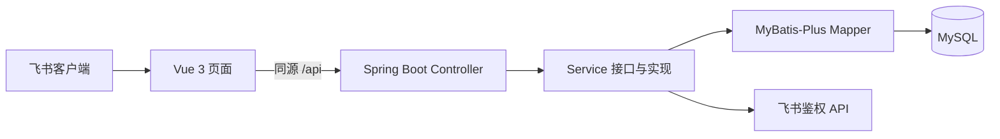

# 系统整体架构

更新日期：2026-11-11。源码现状与已确认但未实现能力分别标注。

用户确认流程是两品牌七字段原始导入 → 系统标准化（含颜色）→ 唯一明确结果自动入可用标准库、异常才人工审核 → 政策按规格不限颜色或指定颜色。详见 [商品方案](catalog-admin-design.md)和[清洗细则](../business/catalog-cleaning.md)。保留九表并补来源清洗字段、任务清洗阶段及SYSTEM审计；功能未实现。目标库仍按用户最新说明未建表，由用户自行执行SQL；本轮不连接目标库。

## 产品与运行方式

系统是飞书内运行的差异化政策网页应用，包含申请人与采购管理员两类角色。先完成申请、审核、查询闭环；不扩展结算、打款、库存或多级审批。

飞书登录后默认进入申请人工作台，侧栏只有「政策提交 → 提交政策 / 我的提交」，同一表单切换零售和百亿，无视角页签、顶部搜索、消息提示或头像。当前管理员业务工作台尚待开发。



数据库访问当前仅接入 `user_info`；政策三表的 Mapper、Service 和 Controller 尚未实现。

## 实际技术栈

| 层 | 当前配置 |
| --- | --- |
| 前端 | Vue 3、Vite 6、Composition API、自定义 CSS；依赖以 lockfile 为准 |
| 后端 | Java 17、Spring Boot 3.5.7、Lombok |
| 数据访问 | MyBatis-Plus 3.5.12、MySQL Connector；H2 仅测试 |
| API 文档 | Knife4j 4.5.0、springdoc 2.8.14 |
| 检查 | ESLint / Prettier / Vitest，JUnit / Spotless |

未引入 Element Plus / Tailwind；不按示例模板降级 Spring Boot。Knife4j 增强插件因兼容性关闭，`/doc.html` 和 `/v3/api-docs` 保留。

## 模块职责

```text
frontend/src/
  api/                         公共请求与接口调用
  assets/                      样式
  components/                  通用组件
  constants/                   固定选项
  composables/                 状态与交互
  utils/                       纯函数与 SDK 封装
  views/apply/                 申请人工作台
    components/                表单与明细表格

backend/src/main/java/com/company/policy/
  controller/                  请求、校验与接口说明
  dto/                         请求对象
  vo/                          响应对象
  service/                     服务接口
  service/impl/                业务、组件及事务注解
  entity/                      数据库实体
  mapper/                      持久化
  common/api/                  公共错误响应
  common/config/               配置与组件注册
  common/interceptor/          登录态和来源校验
  common/exception/            异常与统一处理
```

`router/`、`stores/`、`views/audit/` 为后续按需启用的位置，不视为已完成模块。Controller 和服务通过接口注入，不把实现写进接口或配置类。页面不承担服务端权限和最终生效判断。

前端公共请求由 `api/request.js` 处理超时、错误和请求头；组件通过 props、emit 或 v-model 交互，不直接修改 props，列表使用稳定标识。未来金额使用十进制字符串传输，服务端 `BigDecimal` 计算。

## 数据与安全边界

- 九表及字段见 [数据字典](../sql/database-design.md)。政策用户核心四表加标准规格、规格颜色、七字段来源、同步任务、商品操作日志；来源内联映射，不另建品牌/系列/型号和规则表。skuId 仅续拉，按内容全量比对，不承诺外部SKU稳定身份更新；历史快照不改写。
- 主表保存申请人、渠道、平台集合、时间、状态及版本；明细逐平台保存机型、数量和补贴；日志保留各轮提交和审核意见。
- 提交、审核和日志须由 Service 同事务完成，条件更新执行状态和版本保护。
- 后端校验权限。ADMIN 是本地受控角色；当前角色来自登录时快照，未来管理员接口须重新校验有效账号、角色与租户。
- 含删除标记的表查询须过滤；明细和日志通过父申请授权。身份查找须识别停用账号，不能重新注册绕过。
- 密钥仅在被忽略的 `backend/.env.local.properties` 或环境变量；用户 token 不存储、不下发。

## 当前实现与验证边界

| 能力 | 状态 |
| --- | --- |
| 票据缓存、页面签名、config/ready | 已实现 |
| requestAccess、身份核验、用户落库 | 已实现；用户已确认真实登录成功 |
| 会话恢复、退出、来源保护 | 已实现；恢复及退出重登未逐项人工验证 |
| 渠道显隐、平台独立明细、补贴切换 | 已实现前端交互 |
| 草稿保存、正式提交、我的提交 | 未接业务持久化，不显示假成功 |
| 机型读取、共享补贴批量操作、上传 | 待接入 |
| 审核、筛选、覆盖预览和生效 | 待实现，覆盖口径待确认 |

当前用户目标库未建表，以 2026-11-11 最新说明为准。曾有独立 user_info 回滚测试历史，但不能证明当前目标库存在该表。项目未启用 Flyway 或自动建表，九表 DDL 与业务代码接入分开验收。

此前 2026-11-10 代码检查记录：前端 27 项测试及 lint、格式、构建通过；后端 40 项常规测试及打包、Spotless 通过，1 项真实 MySQL 专项当轮跳过。更早真实 MySQL 回滚及独立 HTTP 检查通过。这些是既往记录，本次文档整理不代表重新运行。命令及验证范围见 [项目 README](../../README.md)。

本地前端 `http://127.0.0.1:5173`，后端 `http://127.0.0.1:8080`，Vite 代理 `/api`；默认只监听本机。正式 HTTPS 部署须同源代理并设置 Secure Cookie，多实例共享会话和缓存。当前单进程会话随重启清空。
