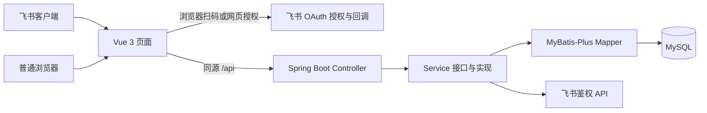

# 系统整体架构

更新日期 2026-11-20。源码现状与已确认但未实现能力分别标注。

2026-11-15 用户确认源商品与标准商品一对一：清洗或人工审核通过后，`goods.sku_id` 延续该来源的原始 SKU，不同源 SKU 的相同配置颜色不再归并；无来源手工商品 SKU 为空。用户确认删除旧表后重建，执行顺序见 [Navicat 重建步骤](../sql/database-design.md#1-在-navicat-建表)。目标库调整由用户在 Navicat 执行。

商品读取已接入后端 `JackyunGoodsService`，并实测一加、OPPO 两品牌的单页查询及续拉。已实现按 SKU 更新原文、建档日追溯、手动启动清洗及异常审核。管理员在源商品库右上角打开导入弹窗，选品牌并发起全量或按建档日期导入。[商品方案](catalog-admin-design.md) · [清洗细则](../business/catalog-cleaning.md)

## 产品与运行方式

系统是嵌入飞书的公司内部 ERP，支持飞书客户端和普通浏览器访问，包含申请人与采购管理员两类角色。客户端通过 JS-SDK 免登，浏览器提供飞书扫码与网页 OAuth 授权，使用同一套服务端身份核验及会话。先完成申请、审核、查询闭环；不扩展结算、打款、库存或多级审批。

飞书登录后按服务端 `user.roleType` 分流。ADMIN 进入「商品 → 源商品库」，其他角色沿用申请人工作台。申请人侧栏为「政策提交 → 提交政策 / 我的提交」，同一表单切换零售和百亿。管理员可从「商品」查看清洗任务和标准目录，从「政策管理 → 差异化政策」查看或审核已提交政策。[管理员工作台](admin-workspace.md)

两角色共用顶部栏，包含侧栏开关、当前位置、角色菜单搜索、帮助及登录人头像，侧栏复用同一份菜单视觉样式。申请人左下角的角色标识区已移除，手机保留两个直接入口。头像由登录服务保存到 `user_info.avatar_url`，经登录和会话接口的 `user.avatarUrl` 返回；缺失或加载失败显示姓名首字。[实现及验证](frontend-development.md#2026-11-15-共用顶部导航与飞书头像)



十五表基线包含用户、申请人平台分工、源商品导入、手动清洗、商品审核、标准目录和政策三表。申请人政策接口已接入，商品中心按政策明细检查商品和机型引用。目标 MySQL 待联调。

现有后端为 11 张用户及商品相关表提供实体映射。清洗通过 `Brand`、`Series`、`Spu`、`ColorDict` 读取或写入标准目录，导入任务操作和来源变更通过 `CatalogOperationLog` 保存。政策明细当前用于检查商品和配置是否已被引用，政策实体随对应业务接入。

吉客云只读服务独立于页面和数据库写入。服务端按 `brandName` 请求单页，校验返回品牌和游标顺序，向后续同步任务提供 SKU 原文、分类路径、修改时间、状态和下一页游标。[单页查询联调](catalog-admin-design.md#单页查询联调)

管理员从「系统管理 → 用户管理」进入 `#/admin/users`。页面已接入用户列表、独立全量统计、详情、角色调整、账号启停及渠道平台分工，服务端实时核验本公司有效管理员。角色及启停写入校验最新详情中的旧值，成功后重读列表、统计和已打开的详情。[页面规则](admin-workspace.md#用户管理) · [用户接口](../api/user-api.md)

## 实际技术栈

| 层 | 当前配置 |
| --- | --- |
| 前端 | Vue 3、Vite 6、Composition API、Element Plus、业务布局 CSS；依赖以 lockfile 为准 |
| 后端 | Java 17、Spring Boot 3.5.7、Lombok |
| 数据访问 | MyBatis-Plus 3.5.12、MySQL Connector；H2 仅测试 |
| API 文档 | Knife4j 4.5.0、springdoc 2.8.14 |
| 检查 | ESLint / Prettier / Vitest，JUnit / Spotless |

Element Plus 组件及样式通过 unplugin-vue-components 按需导入，中文语言包由 ElConfigProvider 配置；申请工作台在登录后延迟加载。未引入 Tailwind；不按示例模板降级 Spring Boot。Knife4j 增强插件因兼容性关闭，`/doc.html` 和 `/v3/api-docs` 保留。

## 前端组件与页面现状

管理员「政策管理 → 机型补贴查询」`#/admin/model-subsidies` 已提供静态预览。`AdminModelSubsidiesPage.vue` 组织紧凑筛选及补贴明细，`PolicySubsidyTimeline.vue` 通过 ECharts 6.1.0 自定义图与 SVGRenderer 上下展示零售、百亿区间；`useSubsidyTimelineNavigation` 共用指针和缩放状态，示例集中在 `mocks/fixtures/model-subsidies.js`。比例显示计算基数，支持当前标记、独立商品、色块点击和右侧时点查询；悬停保持底色、移开恢复边框，移动指针不重建图表。「当前时间」读取浏览器时钟，按北京时间将查询日期范围带到今天，恢复完整缩放并同步两图指针和右侧时点结果。机型摘要、独立指针操作栏、冗余说明及明细下拉框已移除。查询条件下方说明数据来自内置示例。页面不调用商品或政策业务接口；真实已通过政策历史计算及申请人端未接入，无后端或数据库调整。[页面规则](admin-workspace.md#机型补贴查询静态预览) · [既往验证](frontend-development.md#2026-11-16-紧凑查询区与当前时间定位)

管理员五页及申请人提交政策、我的提交已统一侧栏、标题横幅和主内容区视觉：`workspace-sidebar-waves.png` 维护侧栏贴底波浪，`workspace-page-banner.png` 维护标题背景，`workspace-content-background.png` 在两角色布局的顶部导航下铺满正文区域。标题通过 `WorkspacePageHeading.vue` 复用 `AppIcon` SVG 线性图标，移除说明小字；共用 104px 横幅基准高度、桌面 22px／手机 20px 标题和 48px 图标底座。资源归属、裁切及响应式间距见[两角色工作台视觉](frontend-development.md#两角色工作台视觉)，各轮本地检查与模拟预览已记录，飞书真机仍待复测。

2026-11-20 覆盖确认移至申请人正式提交前。管理员直接审核申请快照。以下 11 月 16 日的批准确认与管理员覆盖区记录为历史实现。[当前覆盖确认规则](../business/override-engine.md#4-申请人提交前确认覆盖范围)

2026-11-16 管理员批准前增加整单确认：`AdminPolicyApprovalDialog.vue` 通过 `useAdminPolicyApproval` 复用详情接口核对当前版本、提交轮次、待审状态、权限及覆盖结果，`utils/policy-approval.js` 比较覆盖的业务变化。变化时展示最新预览并要求勾选已核对，仅点击「确认通过」才发送审核请求，取消保留原审核上下文。通过不填写意见，已通过内容的空意见项隐藏，历史列表显示「—」。沿用原审核接口和覆盖算法；复核不锁定其他申请。已完成的检查及模拟预览见[批准确认验证](frontend-development.md#2026-11-16-审核通过前复核与确认)。

2026-11-16 管理员列表、筛选、状态计数与详情摘要统一采用最近正式提交快照；驳回后的修改保存只用于本人继续编辑，重提成功后才切换管理员所见内容。权限、状态和并发版本仍由有效主表判断，未改表结构。[查询契约](../api/admin-api.md#列表与详情)

2026-11-16 覆盖结果的普通选品先按型号配置与平台汇总，混合结果显示「部分覆盖」及分项数量，展开后查看各商品的结果、补贴和对照。指定卡保留单品。`policy-coverage-groups.js` 维护展示分组，`AdminPolicyCoverageReference.vue` 复用整组与逐件对照入口，后端仍按同渠道、同平台及同商品执行覆盖判断。布局使用浅色工具区，商品数量整合到型号配置列。验收与兼容规则见[型号配置汇总记录](frontend-development.md#2026-11-16-覆盖区型号配置总览与布局)。

2026-11-16 管理员覆盖区由 `AdminPolicyCoverage.vue` 展示汇总、组合筛选与分页，`AdminPolicyReferenceDialog.vue` 独立读取并对照命中的提交轮次，返回保留原审核上下文；补贴定位及十进制差值在 `utils/policy-coverage.js`。后端 `winner` 增加审核日志 ID，复用原有单轮快照与附件接口，未修改覆盖规则和表结构。

2026-11-16 管理员详情补上「审核记录」页签，`AdminPolicyHistory.vue` 配合 `useAdminPolicyHistory` 调用现有历轮列表及单轮快照接口，复用 `AdminPolicyDetail.vue` 展示该轮内容和附件。历史不提供审核写入或覆盖状态，当前申请继续沿用原审核流程。未调整后端和数据库结构。

2026-11-11 已完成现有页面的 Element Plus 替换，依赖版本以 `frontend/package-lock.json` 为准。

| 位置 | 已使用组件与行为 |
| --- | --- |
| `src/App.vue` | ConfigProvider 配置中文，统一会话按角色加载工作台 |
| `layouts/components/WorkspaceTopbar.vue`、`constants/navigation.js` | 两角色共用顶部栏；按当前角色已有菜单搜索、当前位置、帮助及头像；侧栏与搜索共用管理员菜单定义 |
| `components/WorkspacePageHeading.vue`、`layouts/components/PolicyBanner.vue`、`assets/styles/brand.css` | 两角色共用标题、SVG 图标和横幅尺寸；侧栏、横幅、正文分别使用各自背景资源，正文背景由两角色布局共用容器铺满 |
| `views/auth/FeishuLoginPage.vue` | 飞书客户端免登状态，普通浏览器扫码及网页授权入口 |
| `layouts/AdminLayout.vue`、`views/admin/catalog/CatalogSourcesPage.vue` | 管理员侧栏依次为系统管理、商品、政策管理；默认进入源商品库，支持分品牌导入及已落库原文列表，表格在窄屏容器内横向滚动 |
| `views/admin/users/AdminUsersPage.vue`、`UserDetailDrawer.vue`、`UserAccountAction.vue`、`UserPlatformDialog.vue`、`composables/useUserManagement.js` | 管理员用户查询、角色调整、启停及分工，七个接口经 `api/admin-users.js` 调用 |
| `views/admin/catalog/CatalogCleaningPage.vue` | 跨品牌查询、按品牌和日期预览、二次确认、进度、审核、重试和任务结果统计 |
| `views/admin/catalog/CatalogCenterPage.vue` | 三级分类、即时筛选、分页、详情、手工新增、编辑、删除和字典维护 |
| `views/admin/policies/AdminPoliciesPage.vue`、`AdminPolicyDetail.vue` | 政策状态页签、两行分区筛选、同尺寸查看和审核窗口、驳回原因小窗。筛选控件为 32px，标签位于上方；详情右侧将备注、附件及审核信息分区。普通机型可展开已选颜色，指定机型按平台显示颜色、数量和补贴 |
| `views/apply/PolicyApplicationPage.vue` | `/apply` 页面入口，组装基础信息、时间、明细与附件区块；工作台确认渠道切换、取消平台及清空表单 |
| `views/apply/components/PolicyGoodsPicker.vue`、`PolicyModelCard.vue`、`PolicySubsidyFields.vue` | 「指定适用机型」单选具体颜色成卡，「选择手机型号」新建普通卡，卡内可继续追加配置。卡片默认沿用整单平台，支持调整和分配补贴方案 |
| `layouts/ApplicantLayout.vue`、`layouts/workspace-navigation.css` | 两端共用侧栏视觉。申请人「政策提交」可展开、收起，子菜单无圆点，底部角色标识区已移除；手机保留两个直接入口。布局持有表单状态，菜单收起和路由切换保留填写；身份变化及失效清理 |
| `vite.config.js`、`tests/` | 按需导入组件及样式；Vitest 在 `tests/` 下收集单元、组件和集成测试，`setup.js` 为 jsdom 提供尺寸监听替身 |

自定义 CSS 保留侧栏、横幅、业务网格、响应式布局和少量控件尺寸调整。`assets/styles/` 维护全局基础及品牌，工作台布局样式位于 `layouts/`，各页面样式随组件加载。桌面上机型卡片并列显示适用平台和补贴方案，平板和手机上改为上下排列。数量仅在指定适用机型卡中选填。手机上日期范围上下显示完整时间，日期弹层限制宽度并可纵向滚动。构建与验收见[前端工程检查与验收](frontend-harness.md)。

日期保存精确到秒的北京时间墙上时间字符串；金额按十进制字符串录入。清除动作以确认结果为准。Upload 选文件后由 useAttachments 逐个上传，失败显示实际结果并可重试。申请页读取在售目录，支持配置多选及当前筛选范围内的「全部配置」。普通卡按配置跨页勾选，可取消具体颜色商品，最终按 `goodsId` 保存。已接入草稿保存、本人回填和正式提交，文件随草稿保存引用并在提交快照中保留，支持授权下载及引用删除保护。[附件接口](../api/attachment-api.md)

## 模块职责

以下描述当前结构。目录职责、组件数据流、模型适配、请求/会话与渐进整改按[前端架构与开发规范](frontend-development.md)执行；前三阶段适用整改已落地，规范中的完整目标骨架仍不等于当前文件清单。前端本地阅读入口见 [frontend/README.md](../../frontend/README.md)。

```text
frontend/src/
  api/                         公共请求与接口调用
  assets/                      样式
  components/                  通用组件
  constants/                   固定选项
  composables/                 状态与交互
  utils/                       纯函数与 SDK 封装
  layouts/                     申请人/管理员导航与出口；申请布局持有表单
  mocks/                       明确展示入口及 fixtures，不作请求失败回退
  router/                      Hash 命名路由与角色元信息
  views/auth/                  飞书登录页
  views/apply/                 政策申请页、我的提交及当前申请详情
    components/                基础、时间、明细和附件表单区块
  views/admin/catalog/         源商品库、商品清洗与识别、商品中心
  views/admin/policies/        差异化政策审核及机型补贴静态预览
  views/admin/users/           用户管理、详情抽屉、分工弹窗及角色和启停确认弹窗

backend/src/main/java/com/company/policy/
  controller/                  请求、校验与接口说明
  dto/                         请求对象
  vo/                          响应对象
  service/                     服务接口
  service/impl/                仅存放与服务接口同名加 Impl 的实现类
  support/                     商品规则、政策表单与快照处理、吉客云签名
  entity/                      数据库实体和已落库的 JSON 数据结构
  mapper/                      持久化
  common/api/                  公共错误响应
  common/config/               配置与组件注册
  common/interceptor/          登录态和来源校验
  common/exception/            异常与统一处理
```

`router/` 已接入 Vue Router Hash 路由，`views/admin/` 为管理员展示页面；当前未建立 `stores/`、`views/audit/`。后续不强制引入 Pinia 或另建审核目录，按前端规范和实际共享需求评估。Controller 和服务通过接口注入，不把实现写进接口或配置类。页面不承担服务端权限和最终生效判断。

前端公共请求由 `api/request.js` 处理超时、取消、错误和请求头；组件通过 props、emit 或 v-model 交互，不直接修改 props，列表使用稳定标识。现有金额/比例保留十进制字符串，服务端未来使用 `BigDecimal` 计算；展示适配不作为业务 DTO 提交。

## 数据与安全边界

- 十五表空库基线包括申请人平台分工、用户和政策核心四表、标准商品目录五表，以及 SKU 来源、导入任务、清洗任务与明细、商品导入记录。标准目录由公司共用，清洗仅保存处理结果和进度。`skuId` 兼作续拉位置和账套内来源身份，提交时的历史快照保留。[数据字典](../sql/database-design.md)
- 第一开发阶段允许重新设计项目内所有表，每次开始前须再次取得用户明确确认。[项目约定第 13 条](../../AGENTS.md#3-核心技术规则与边界)
- `policy_apply` 保存申请状态、整单字段及当前商品卡；`policy_audit_log` 保留各轮完整快照及审核结果；`policy_goods_detail` 保存各轮每个平台实际选中的商品 ID 及所属配置。补贴和数量从该轮快照读取。
- 提交事务写入主表、快照和明细。审核事务更新主表及当前轮次审核结果。条件更新校验状态和版本。
- ADMIN 是本地受控角色。商品管理接口按会话重新校验有效账号、管理员角色和公司飞书租户。公司内所有有效管理员共享商品数据。
- 含删除标记的表正常业务查询须过滤；用户管理为查看启用和停用账号，专门限定本公司 `user_info.is_deleted IN (0,1)`，不放宽操作人的有效管理员要求。明细和日志通过父申请授权。身份查找须识别停用账号，不能重新注册绕过。
- 密钥仅在被忽略的 `backend/.env.local.properties` 或环境变量；用户 token 不存储、不下发。

## 当前实现与验证边界

### 2026-11-17 后端结构检查

首轮检查覆盖当时的 125 个生产 Java 文件、22 个测试 Java 文件，以及 Maven 配置和资源目录。Controller 通过服务接口访问业务数据，顶层分层可沿用。修复前 Maven `verify` 共 185 项，183 项通过，2 项外部环境测试跳过。下表保留原检查编号，便于跟踪。

| 编号 | 检查项 | 修复结果或当前工作区状况 |
| --- | --- | --- |
| 1 | 参数类型错误落入通用 500 | 已修复。政策附件路径中的申请或审核日志 ID 无法转为长整数时，统一返回 400 `INVALID_REQUEST`。已有接口专用错误码继续生效。 |
| 2 | 导入和清洗共用默认调度线程 | 待处理。吉客云请求等待或批量清洗耗时较长时，另一个定时任务会延后。 |
| 3 | Controller 读取整份政策并核对附件 | 已修复。附件服务校验有效账号、公司、父申请与文件引用，Mapper 直接按当前状态或指定审核轮次查询。下载保留原接口和文件响应。 |
| 4 | 请求对象直接作为永久快照格式 | 已修复。独立快照模型保存每轮提交的表单与商品。新旧记录共用已有 JSON 结构，管理员筛选、覆盖查询和历史附件继续使用原字段。 |
| 5 | 审核实现静态引用申请实现 | 待处理。`PolicyReviewServiceImpl` 仍从 `PolicyApplyServiceImpl` 取短单号、时间、分页及审核摘要等共用逻辑。 |
| 6 | 公司权限与商品品牌规则混放 | 部分整理。当前品牌名单已移到 `JackyunGoodsQuery.SUPPORTED_BRANDS`，导入与清洗共用；`GoodsSyncRequest` 仍单独声明可选品牌，跨业务权限入口仍命名为 `CatalogAccess`。 |
| 7 | 选品响应对象承担查询筛选 | 待处理。服务先读取全部在售配置，再由 `ApplicantCatalogResponse.Options.from` 在内存中完成联动筛选。 |
| 8 | 商品同步测试类跨多个业务 | 待处理。`GoodsSyncIntegrationTest` 同时覆盖导入、政策提交、审核覆盖、附件及并发操作，按功能运行回归时仍需定位到该类。 |

**修复验证记录。** 第 1、3、4 项的针对性测试通过 49 项。随后完整运行 Maven `verify`，共 189 项，187 项通过、2 项外部环境测试跳过，打包与 Spotless 检查通过。旧格式样本与 H2 接口回归覆盖旧单号、已移除字段、十进制金额尾零、数量为 0 和未填写，以及草稿、提交快照、指定轮次和已删除申请的附件权限。该轮未连接目标 MySQL 或真实吉客云。[政策快照契约](../api/policy-api.md#提交快照的存储与兼容) · [附件接口](../api/attachment-api.md#政策绑定与历史保护)

### 2026-11-17 服务层整理

本次源码核对确认，`service` 下有 19 个接口，`service.impl` 下有 19 个对应的 `接口名Impl` 实现类。19 个接口及其声明的 78 个方法均有一句中文 Javadoc，重载方法分别计数。实现类省略类级职责备注，内部业务注释保留。[服务接口与注释规范](ai-development.md#服务接口与注释)

- `CatalogAccess` 由 `CatalogAccessImpl` 实现，分别核验申请人身份、商品管理、政策审核和用户管理权限。调用方通过接口取得已核验的用户。[权限接口](../../backend/src/main/java/com/company/policy/service/CatalogAccess.java)
- `CatalogCleaningResultWriter` 由 `CatalogCleaningResultWriterImpl` 实现。人工审核和自动清洗都注入该接口，在各自的事务内解析标准商品映射、保存源商品清洗结果。[清洗结果写入接口](../../backend/src/main/java/com/company/policy/service/CatalogCleaningResultWriter.java)
- `support.catalog` 存放 `CatalogCleaningRule` 和 `CatalogText`，`support.policy` 存放 `PolicyFormValidation` 和 `PolicySnapshotCodec`，`support.jackyun` 存放 `JackyunRequestSigner`。

服务层整理和注释调整完成后，后端 Maven `verify` 及 Spotless 检查通过。187 项测试通过，真实吉客云和 MySQL 联调测试各跳过 1 项。

### 其他既往验证

2026-11-15 申请人地址切换与普通卡配置移除已修复。工作台在替换未保存内容前确认，取消导航保留原地址、表单和暂存附件；Hash 变化不关闭确认框。配置移除按完整卡片覆盖分页外颜色，抽屉确认后才更新表单，重选仍保留手动取消的商品。该次修复新增 9 项回归，前端 24 个文件的 132 项测试及生产构建通过，并使用模拟申请人及接口检查 1440×1000、768×1000、390×844 的主路径。验证细节见[修复记录](frontend-development.md#2026-11-15-申请地址切换保护与已有配置移除)。本次同步仅更新文档，未重新运行上述业务检查，未修改数据库；真实飞书与目标 MySQL 仍待联调。

2026-11-13 商品编辑保存通过前端 72 项测试及生产构建。后端 Maven verify 通过 79 项，跳过 2 项外部环境测试。隔离 H2 验证实际接口写入和引用保护，Chrome 使用模拟管理员与商品接口验证桌面、平板和手机的编辑流程。目标 MySQL 上的商品编辑和真实飞书会话留待联调。[管理员工作台历次验证](admin-workspace.md#历次验证)

前序工作台和申请布局重构的验证记录见前端规范，真实飞书授权与扫码验证按身份流程单独记录。[前端规范第 9 节](frontend-development.md#9-验证记录与维护) · [飞书鉴权](feishu-auth-flow.md)

| 能力 | 状态 |
| --- | --- |
| 票据缓存、页面签名、config/ready | 已实现 |
| requestAccess、身份核验、用户落库 | 已实现；用户已确认真实登录成功 |
| 普通浏览器扫码、网页授权与回调 | 已实现，已看到真实二维码并验证模拟扫码回调。真实手机确认后的登录待联调。[飞书登录验证记录](feishu-auth-flow.md#验证记录) |
| 会话恢复、退出、来源保护 | 已实现。角色调整后的旧会话分流已通过 Chrome 与隔离 H2 验证。真实飞书账号重新进入工作台和退出重登待复测。[验证记录](feishu-auth-flow.md#验证记录) |
| 渠道显隐、平台独立明细、补贴切换 | 已实现前端交互 |
| 草稿保存、回填、正式提交 | 零售保存实际多选场景。按最新分工预览，有可生效时段且整单无命中可直提；有交叉时按机型配置核对，提交保存原始商品范围、时段决定与本轮快照 |
| 我的提交与申请详情 | 已接入本人分页列表、当前申请详情及驳回原因，界面不展示提交轮次和历轮审核；后台保留日志和快照。草稿及已驳回申请可继续编辑，本人未提交草稿可物理删除。商品及补贴通过 `PolicySubmissionGoods.vue` 按机型、配置汇总颜色，直接对应平台与方案，指定卡按平台显示数量 |
| 选品、共享补贴、上传 | 已接入在售选品、平台方案分配、文件上传和政策附件绑定 |
| 吉客云货品读取 | 已实测两品牌查询和续拉。服务端支持全量、按建档日和按修改日，同 SKU 更新原行 |
| 管理员源商品库 | 导入弹窗支持全量和按建档日，提供续跑、建档日查看和组合筛选分页 |
| 管理员商品中心 | 已接入列表、详情、统计、三级分类、即时筛选、手工新增、编辑、删除及字典维护。标准商品批量导入待接入 |
| 管理员商品清洗 | 已接入手动清洗、SKU 预览、跨品牌结果、审核、重试和任务统计 |
| 管理员用户管理 | 用户资料由 `user_info` 保存，各渠道平台的负责人由 `user_platform_assignment` 保存。页面已接入分工、角色和启停等七个用户管理接口。目标 MySQL 并发和真实会话待联调。[接口及验证](../api/user-api.md) |
| 审核、覆盖计算和生效 | 提交、审核、两端预览及生效查询共用区间判断。通过前复核剩余时段的组合，生效查询逐时点应用已获批轮次的决定。旧单自切换时刻起按快照截止日退出。[决策表和案例](../business/override-engine.md#6-决策表与验收案例) |

项目未启用 Flyway 或自动建表。由用户在 Navicat 对空库执行十五表基线。商品中心的政策引用检查已使用 `policy_goods_detail`，目标库需具备该基线结构才能联调。目标库结构和实际导入结果以用户提供的 Navicat 或运行页面结果为准。[数据库设计与字段字典](../sql/database-design.md)

此前 2026-11-10 代码检查记录：前端 27 项测试及 lint、格式、构建通过；后端 40 项常规测试及打包、Spotless 通过，1 项真实 MySQL 专项当轮跳过。更早真实 MySQL 回滚及独立 HTTP 检查通过。这些是既往记录，本次文档整理不代表重新运行。命令及验证范围见 [项目 README](../../README.md)。

2026-11-11 Element Plus 替换：本轮前端 lint、格式、41 项测试及生产构建通过。覆盖组件切换、确认框、日期及附件暂存交互。用户授权后，已检查 1440px、768px、390px 浏览器布局，修复窄屏时间与弹层及空状态显示，验证日期选择、明细输入、渠道提示和菜单返回。使用本地临时组件预览，未进行真实飞书授权或业务提交联调；本次未运行后端检查。

本地前端 `http://127.0.0.1:5173`，后端 `http://127.0.0.1:8080`，Vite 代理 `/api`；默认只监听本机。正式 HTTPS 部署须同源代理并设置 Secure Cookie，多实例共享会话和缓存。当前单进程会话随重启清空。

环境配置统一由实际 `.env.local.properties` 或系统环境变量经 YAML 映射读取，样例不参与运行。正式同机 Nginx 代理也可监听 `127.0.0.1:8080`，独立容器按网络需要监听 `0.0.0.0:8080`。导入和清洗任务由后端执行，任务成功创建后不依赖网页或飞书客户端保持打开；后台继续执行以服务、宿主机、开关和任务状态正常为前提。[完整配置与运行规则](environment-configuration.md)
