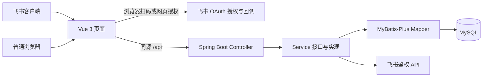

# 系统整体架构

更新日期：2026-11-12。源码现状与已确认但未实现能力分别标注。

商品读取已接入后端 `JackyunGoodsService`，并实测一加、OPPO 两品牌的单页查询及续拉。已实现按 SKU 更新原文、建档日追溯、自动识别系列型号配置颜色及异常审核。管理员在源商品库右上角打开导入弹窗，选品牌并发起全量或按建档日期导入。[商品方案](catalog-admin-design.md) · [清洗细则](../business/catalog-cleaning.md)

## 产品与运行方式

系统是支持飞书客户端和普通浏览器访问的差异化政策网页应用，包含申请人与采购管理员两类角色。客户端通过 JS-SDK 免登，浏览器提供飞书扫码与网页 OAuth 授权，使用同一套服务端身份核验及会话。先完成申请、审核、查询闭环；不扩展结算、打款、库存或多级审批。

飞书登录后按服务端 `user.roleType` 分流。ADMIN 进入「商品 → 源商品库」，其他角色沿用申请人工作台。申请人侧栏为「政策提交 → 提交政策 / 我的提交」，同一表单切换零售和百亿。管理员可从商品导航打开「商品清洗与识别」查看真实任务和处理结果。[管理员工作台](admin-workspace.md)



数据库访问已接入用户和商品同步、清洗相关表。政策三表的 Mapper、Service 和 Controller 尚未实现。

吉客云只读服务独立于页面和数据库写入。服务端按 `brandName` 请求单页，校验返回品牌和游标顺序，向后续同步任务提供 SKU 原文、分类路径、修改时间、状态和下一页游标。[单页查询联调](catalog-admin-design.md#单页查询联调)

## 实际技术栈

| 层 | 当前配置 |
| --- | --- |
| 前端 | Vue 3、Vite 6、Composition API、Element Plus、业务布局 CSS；依赖以 lockfile 为准 |
| 后端 | Java 17、Spring Boot 3.5.7、Lombok |
| 数据访问 | MyBatis-Plus 3.5.12、MySQL Connector；H2 仅测试 |
| API 文档 | Knife4j 4.5.0、springdoc 2.8.14 |
| 检查 | ESLint / Prettier / Vitest，JUnit / Spotless |

Element Plus 组件及样式通过 unplugin-vue-components 按需导入，中文语言包由 ElConfigProvider 配置；申请工作台在登录后延迟加载。未引入 Tailwind；不按示例模板降级 Spring Boot。Knife4j 增强插件因兼容性关闭，`/doc.html` 和 `/v3/api-docs` 保留。

## 前端组件与页面现状

2026-11-11 已完成现有页面的 Element Plus 替换，依赖版本以 `frontend/package-lock.json` 为准。

| 位置 | 已使用组件与行为 |
| --- | --- |
| `src/App.vue` | ConfigProvider 配置中文，统一会话按角色加载工作台 |
| `views/auth/FeishuLoginPage.vue` | 飞书客户端免登状态，普通浏览器扫码及网页授权入口 |
| `layouts/AdminLayout.vue`、`views/admin/catalog/CatalogSourcesPage.vue` | 单一商品导航、分品牌导入及已落库原文列表，表格在窄屏容器内横向滚动 |
| `views/admin/catalog/CatalogCleaningPage.vue` | 清洗任务和进度、结果筛选及分页、审核、重试和日志 |
| `views/apply/PolicyApplicationPage.vue` | `/apply` 页面入口，组装基础信息、时间、明细与附件区块；工作台确认渠道切换、取消平台及清空表单 |
| `views/apply/components/PolicyDetailsTable.vue` | Table 使用稳定行 key、横向滚动和右侧固定操作列；Input、Select 编辑明细，Empty 显示无明细提示 |
| `layouts/ApplicantLayout.vue` | 保留业务侧栏和横幅；持有表单状态，路由切换保留填写；身份变化及失效清理 |
| `vite.config.js`、`tests/` | 按需导入组件及样式；Vitest 在 `tests/` 下收集单元、组件和集成测试，`setup.js` 为 jsdom 提供尺寸监听替身 |

自定义 CSS 保留侧栏、横幅、业务网格、响应式布局和少量控件尺寸调整。`assets/styles/` 维护全局基础及品牌，工作台布局样式位于 `layouts/`，各页面样式随组件加载。桌面基础信息在适当宽度分两行排列；手机上日期范围上下显示完整时间，日期弹层限制宽度并可纵向滚动，确认操作保持可访问；明细表格在容器内横向查看，空状态使用正常行高。构建与验收见[前端工程检查与验收](frontend-harness.md)。

日期仍保存精确到秒的北京时间墙上时间字符串，不转换为 UTC；金额仍按十进制字符串录入。确认框以异步结果决定是否清除，取消时不修改原渠道和已填明细。Upload 关闭自动上传，仅暂存当前页面文件，可移除；独立附件接口及 `useAttachments` 已有实现，但当前申请页没有接入该上传流程，详见 [附件接口](../api/attachment-api.md)。组件替换不代表政策持久化、标准机型库或申请页附件上传已接通。当前型号、配置和颜色仍是手工输入占位，不能视为已完成标准目录和颜色范围选择。

## 模块职责

以下描述当前结构。目录职责、组件数据流、模型适配、请求/会话与渐进整改按[前端架构与开发规范](frontend-development.md)执行；前三阶段适用整改已落地，规范中的完整目标骨架仍不等于当前文件清单。前端本地阅读入口见 [frontend/README.md](../../frontend/README.md)。

```text
frontend/src/
  api/                         公共请求与接口调用
  assets/                      样式
  components/                  通用组件
  constants/                   固定选项
  composables/                 状态与交互
  utils/                       纯函数与 SDK 封装
  layouts/                     申请人/管理员导航与出口；申请布局持有表单
  mocks/                       明确展示入口及 fixtures，不作请求失败回退
  router/                      Hash 命名路由与角色元信息
  views/auth/                  飞书登录页
  views/apply/                 政策申请页及我的提交占位页
    components/                基础、时间、明细和附件表单区块
  views/admin/catalog/         源商品库、商品清洗与识别

backend/src/main/java/com/company/policy/
  controller/                  请求、校验与接口说明
  dto/                         请求对象
  vo/                          响应对象
  service/                     服务接口
  service/impl/                业务、组件及事务注解
  entity/                      数据库实体
  mapper/                      持久化
  common/api/                  公共错误响应
  common/config/               配置与组件注册
  common/interceptor/          登录态和来源校验
  common/exception/            异常与统一处理
```

`router/` 已接入 Vue Router Hash 路由，`views/admin/` 为管理员展示页面；当前未建立 `stores/`、`views/audit/`。后续不强制引入 Pinia 或另建审核目录，按前端规范和实际共享需求评估。Controller 和服务通过接口注入，不把实现写进接口或配置类。页面不承担服务端权限和最终生效判断。

前端公共请求由 `api/request.js` 处理超时、取消、错误和请求头；组件通过 props、emit 或 v-model 交互，不直接修改 props，列表使用稳定标识。现有金额/比例保留十进制字符串，服务端未来使用 `BigDecimal` 计算；展示适配不作为业务 DTO 提交。

## 数据与安全边界

- 当前九表基线包括用户和政策核心四表，以及标准规格、规格颜色、SKU 来源、同步任务、商品操作日志。`skuId` 兼作续拉位置和账套内来源身份，提交时的历史快照保留。[数据字典](../sql/database-design.md)
- 第一开发阶段允许重新设计项目内所有表，每次开始前须再次取得用户明确确认。[项目约定第 13 条](../../AGENTS.md#3-核心技术规则与边界)
- 主表保存申请人、渠道、平台集合、时间、状态及版本；明细逐平台保存机型、数量和补贴；日志保留各轮提交和审核意见。
- 提交、审核和日志须由 Service 同事务完成，条件更新执行状态和版本保护。
- ADMIN 是本地受控角色。商品管理接口按会话重新校验有效账号、管理员角色和账套绑定的租户。
- 含删除标记的表查询须过滤；明细和日志通过父申请授权。身份查找须识别停用账号，不能重新注册绕过。
- 密钥仅在被忽略的 `backend/.env.local.properties` 或环境变量；用户 token 不存储、不下发。

## 当前实现与验证边界

源商品库与商品清洗均已接入后端。2026-11-12 的导入弹窗改版通过前端 68 项测试及生产构建，Chrome 模拟管理员在桌面、平板和手机尺寸完成弹窗、筛选和路由往返验收。建档日后端在隔离 H2 通过 70 项测试，2 项外部环境测试跳过。[管理员工作台](admin-workspace.md)

前序工作台和申请布局重构的验证记录见前端规范，真实飞书授权与扫码验证按身份流程单独记录。[前端规范第 9 节](frontend-development.md#9-验证记录与维护) · [飞书鉴权](feishu-auth-flow.md)

| 能力 | 状态 |
| --- | --- |
| 票据缓存、页面签名、config/ready | 已实现 |
| requestAccess、身份核验、用户落库 | 已实现；用户已确认真实登录成功 |
| 普通浏览器扫码、网页授权与回调 | 已实现，已看到真实二维码并验证模拟扫码回调。真实手机确认后的登录待联调。[飞书登录验证记录](feishu-auth-flow.md#验证记录) |
| 会话恢复、退出、来源保护 | 已实现；恢复及退出重登未逐项人工验证 |
| 渠道显隐、平台独立明细、补贴切换 | 已实现前端交互 |
| 草稿保存、正式提交、我的提交 | 未接业务持久化，不显示假成功 |
| 机型读取、共享补贴批量操作、上传 | 待接入 |
| 吉客云货品读取 | 已实测两品牌查询和续拉。服务端支持全量、按建档日和按修改日，同 SKU 更新原行 |
| 管理员源商品库 | 导入弹窗支持全量和按建档日，提供续跑、建档日查看和组合筛选分页 |
| 管理员商品清洗 | 已接入 `v1.2.0` 任务、结果、审核、重试和日志 |
| 审核、覆盖计算和生效 | 待实现，覆盖口径待确认；展示版不执行决定 |

项目未启用 Flyway 或自动建表。新环境由用户在 Navicat 对空库执行九表基线。目标库结构和实际导入结果以用户提供的 Navicat 或运行页面结果为准。[数据库设计与字段字典](../sql/database-design.md)

此前 2026-11-10 代码检查记录：前端 27 项测试及 lint、格式、构建通过；后端 40 项常规测试及打包、Spotless 通过，1 项真实 MySQL 专项当轮跳过。更早真实 MySQL 回滚及独立 HTTP 检查通过。这些是既往记录，本次文档整理不代表重新运行。命令及验证范围见 [项目 README](../../README.md)。

2026-11-11 Element Plus 替换：本轮前端 lint、格式、41 项测试及生产构建通过。覆盖组件切换、确认框、日期及附件暂存交互。用户授权后，已检查 1440px、768px、390px 浏览器布局，修复窄屏时间与弹层及空状态显示，验证日期选择、明细输入、渠道提示和菜单返回。使用本地临时组件预览，未进行真实飞书授权或业务提交联调；本次未运行后端检查。

本地前端 `http://127.0.0.1:5173`，后端 `http://127.0.0.1:8080`，Vite 代理 `/api`；默认只监听本机。正式 HTTPS 部署须同源代理并设置 Secure Cookie，多实例共享会话和缓存。当前单进程会话随重启清空。
