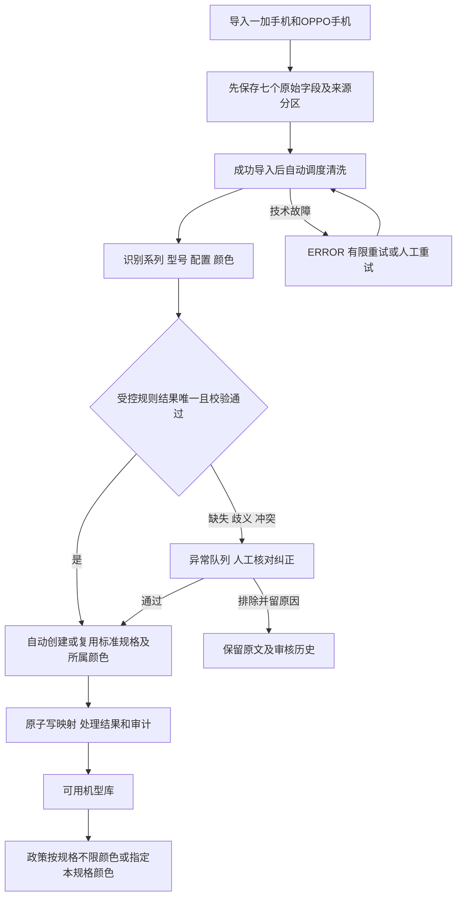

# 商品自动清洗与异常审核

更新日期：2026-11-11。按用户确认流程整理；本文件是待实现业务设计，不表示自动清洗已上线。九表及字段见 [数据库字典](../sql/database-design.md)，范围见 [商品方案](../architecture/catalog-admin-design.md)。

## 1. 总流程与两次入库

原始层先入 source_goods_item，七字段不可被清洗覆盖；标准层只保存通过校验的系列、型号、配置、颜色。颜色从已授权七字段中提取，是本地派生标准信息，不是新增吉客云采集字段。不得把完整响应或额外价格、库存等属性藏进候选或审计。

正常导入完成自动衔接清洗，不要求管理员先逐条建颜色，也不要求所有商品再统一人工发布。待审核商品不阻塞其他明确结果；后台区分导入状态、清洗状态和政策可选状态。

## 2. 识别依据与自动通过门槛

1. 品牌来自固定查询分区。goodsField4、cateName、skuName 分别作为系列、型号、配置的主要候选，goodsName/goodsField1/goodsField5 作交叉证据；真实自定义字段含义联调确认。
2. 对匹配副本统一首尾空格、全半角、明确单位和已批准别名，不修改原文，不去掉可能表达地区版、套装、容量差异的字符。
3. 对 goodsName 等文本应用受控模式解析。例如来源为“A92s 佳人粉 6+128”时，只有规则能唯一识别型号、配置及颜色边界，并与结构化字段一致时，才把“佳人粉”认定为颜色。不能简单取“型号和配置之间剩余文本”作为颜色，也不默认通用红/黑词就是正确归属。
4. 自动通过要求四维都完整且各自唯一：系列、型号、配置、颜色；品牌与目标一致，结构化与名称信息不矛盾，输出长度合法，同名规格/颜色复用关系唯一且没有停用或人工禁止。规则命中但有冲突仍待审核，不以一个置信分数代替证据。
5. 目标标准规格不存在时，经过上述验证可自动创建 ACTIVE 规格并生成本地稳定编码；该规格颜色不存在时自动创建 ACTIVE 颜色。已有 ACTIVE 对象复用；已有 DRAFT/DISABLED 或系列冲突进入审核，不能自动激活管理员停用对象。
6. 同一个颜色名只在当前 catalog_variant 内查找或创建；不同型号、同型号不同配置各有集合。自动建颜色的唯一性与规格/租户外键共同防止串色。

若没有可用规则或源字段不足，保留已知候选，原因记为 MISSING_FIELD、COLOR_MISSING、AMBIGUOUS_MATCH、MODEL_SPEC_CONFLICT、TARGET_DISABLED 等；这些是建议的稳定原因类别，不是已经存在的程序枚举。技术异常 ERROR 区分格式错误、执行超时、存储失败，不进入自动通过。

首期规则包维护在受控代码或版本配置内，包括字段映射、白名单别名、模式、规范化及校验规则。每次运行固定 ruleVersion，启用新版本先离线预览命中、异常和影响，配置不可执行任意脚本。现阶段不建立规则表或完整在线规则引擎，也不让大模型单独决定最终身份。

## 3. 候选、状态和已生效结果

source_goods_item.clean_candidate 是当前结构化候选对象，建议包含 seriesName、modelName、spec、colorName、目标候选本地 ID、命中 ruleIds、校验结果以及 evidence（仅七字段的字段名和对应片段）。无法唯一确定时保存多个候选数组，不强选一个；JSON 对象外层由 SQL 检查，内容结构、大小和字段白名单由 DTO/Service 检查。

| clean_status | 含义 | 当前映射处理 |
| --- | --- | --- |
| PENDING | 已导入待清洗 | 首次无映射；重算保留旧通过结果 |
| PROCESSING | 带执行租约处理 | 计算候选，不提前更改已发布目录 |
| AUTO_PASSED | 唯一规则结果自动通过 | MAPPED + AUTO，规格与具体颜色齐全 |
| REVIEW_REQUIRED | 缺项、歧义、冲突 | 首次不可选，重算保留旧映射供核对 |
| MANUAL_PASSED | 必要时人工纠正通过 | MAPPED + MANUAL，规格颜色齐全并有审核人时间原因 |
| ERROR | 技术失败，可重试 | 不产生未验证的新映射 |
| EXCLUDED | 人工明确排除 | 无映射，保留原因与历史 |

mapping_status 和 mapping_origin 保存当前有效结果，clean_status 保存当前尝试，所以重算可能是 MAPPED+AUTO 与 REVIEW_REQUIRED 并存；不能把旧通过的标准ID清掉而改写政策。候选只是候选，不经 API 暴露给申请人。AUTO_PASSED 不写审核人，SYSTEM 审计不冒用发起人；MANUAL_PASSED 必须写真实 ADMIN，且不因下次规则升级自动覆盖。

首次通过要求颜色完整。缺颜色不能自动通过，也不以“未知/默认/不限”建颜色；人工仍需核对出具体颜色后通过，暂不能确定就继续待审核，或有理由排除。手工直建规格/颜色可作为补充入口，但不能成为必须先手工维护全量颜色的步骤。

规则升级对原 AUTO 映射可以预览并重算，但若目标改变须转 REVIEW_REQUIRED，不自动重指；原 MANUAL 映射和 EXCLUDED 默认跳过。需改变人工结果时，管理员先预览显式解除保护并留原因，再按新版本处理。相同内容和规则版本已通过则幂等跳过，原文变更是新来源内容，不盲目继承旧映射。

goods_sync_job.clean_status 为 NOT_STARTED/RUNNING/COMPLETED/PARTIAL/FAILED，只有导入 status=SUCCEEDED 才开始，并固定 clean_rule_version。COMPLETED 表示本轮所有候选已分流，允许仍有待人工审核；不能显示全部已入库可选。PARTIAL/FAILED 表示执行未完成或失败。当前分类数量查询来源表，非历史精确快照；九表不提供完整批次回放。

## 4. 执行、审核与并发

1. 清洗启动时固定成功导入 job、来源 recordVersion 和规则版本；来源在该成功批次范围内才领取。任务阶段与导入阶段分开，原始入库不因清洗失败回滚。
2. 来源以 clean_run_key、clean_lease_until 和 recordVersion 条件领取；租约失效可接管，旧执行者提交必须失败。技术重试次数记 clean_attempts，不无限循环。候选计算放短事务外。
3. 提交短事务内重新检查来源、规则版本、规格/颜色状态及版本；创建/复用目录、当前生效映射、完成状态和审计一起提交。唯一键碰撞重新读取校验，不吞错当成功；若验证或审计失败，全部回滚，不遗留误启用规格。
4. 审核页面显示七字段原文、候选、规则命中证据、异常原因以及已有映射。管理员纠正字段或选本地目标，预览后带 recordVersion 审核通过/排除；后端从会话取审核人，不接受自报身份。批量仅限同一明确目标且逐条校验，不能盲目整批通过。
5. 每次完成/异常/重试/人工纠正追加 catalog_operation_log，含本地来源ID、规则版本、前后候选及结果，不含完整上游响应、外部SKU标识或游标轨迹。当前候选可更新，历史证据不覆盖。

数据库只能检查状态组合、颜色归属和必填结构，不能证明解析正确、目标 ACTIVE、规则存在、导入任务成功或证据来自对应原文。这些由服务层、受控规则测试、版本条件更新和同事务审计实现；不能以 DDL 通过声称自动清洗功能已运行。

## 5. 验收范围

后续实现应验证：同规则唯一结果自动创建/复用规格颜色；系列/型号/配置交叉矛盾与缺颜色转审核；同名颜色不跨规格；未知颜色不变不限颜色；停用不复活；人工结果受保护；相同内容重放不重复建目录；过期执行者提交失败；规则升级预览及目标变更复核；SYSTEM/USER 审计区分；异常不阻塞明确结果；原文七字段保持不变；政策历史快照不被重跑改写。

当前仅交付设计、接口契约和九表 SQL 调整，不包含自动解析器或页面实现；实际测试范围在数据库字典单列。
