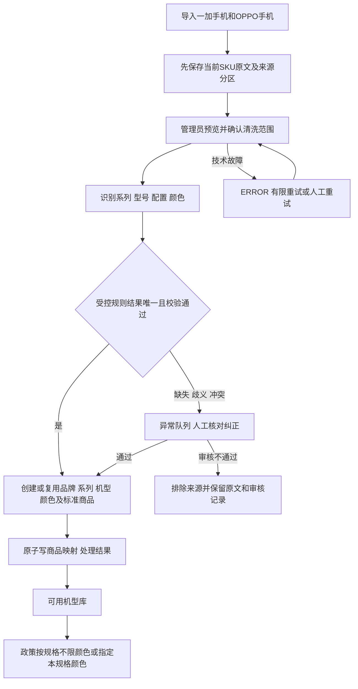

# 商品清洗与异常审核

更新日期：2026-11-13。管理员手动发起清洗，后台执行当前识别代码。清洗和审核按十四表基线写入标准目录。[商品管理接口](../api/catalog-api.md) · [数据库字典](../sql/database-design.md)

## 1. 总流程与两次入库

原始层先入 source_goods_item，原文只随吉客云 SKU 同步更新；新基线由 `brand`、`series`、`spu`、`color_dict` 和 `goods` 保存通过校验的标准目录。颜色从已授权原文中提取，是本地派生标准信息，不是新增吉客云采集字段。不得把完整响应或额外价格、库存等属性写入候选。

源商品导入成功后等待管理员发起。选择一个品牌，可指定建档日或处理该品牌全部已入库商品。指定日期复用源商品库的建档日证据，全部范围含未知建档日。预览关键词只过滤预览表。默认纳入最近导入已完成或已结束的待清洗 SKU，可选同时重新识别未映射待审 SKU。异常商品各自分流。

## 2. 识别依据与自动通过门槛

1. 品牌来自固定查询分区。自动通过要求 `goodsField4` 去掉首尾空白后以「系列」结尾且包含系列名称。该字段含「手机-一加（高成本折扣）」时进入排除审核。字段 5 的折扣标签不参与此判定。商品名命中「工厂代发」，或分类命中「组合装」「IOT&配件」也会进入排除审核。
2. 对匹配副本统一首尾空格、全半角、明确单位和已批准别名，不修改原文，不去掉可能表达地区版、套装、容量差异的字符。
3. `cateName` 提供完整型号，`skuName` 和商品名各自提供配置。先剥离完整型号再读取自定义字段 1 的配置，覆盖「Reno48+128」这类连写。型号、配置和证据一致时，从商品名中唯一的颜色位置提取颜色。颜色候选须符合受控的中文名称格式。简装版、样机、套装版、卫星通信版等版本词单独识别，转待审核确认政策适用范围。
   - 将 OPPO 自定义字段 1 开头的 `Reon17` 归一为 `Reno17`，保留 `Pro` 等完整型号后缀。别名自动通过仍要求完整型号匹配，字段 1、SKU 名和商品名的配置一致。
   - 识别使用完整分类路径和停用、组合标记。明确的「品牌 / 系列 / 型号」路径用于交叉核验，原分类名称缺失时可补型号。路径与其他字段冲突转审核。自定义字段 4 为空时只提供路径系列候选，仍须人工确认。停用或组合商品进入排除审核。
   - 颜色候选在型号、配置及排除规则分流前提取。字段冲突时，来源中能定位的颜色随待审结果显示。多颜色并列时保留候选列表，由管理员确认单个颜色。来源中缺少颜色线索时，候选列表为空。
4. 自动通过要求四维都完整且各自唯一：系列、型号、配置、颜色；品牌与目标一致，结构化与名称信息不矛盾，输出长度合法，同名规格和颜色的复用关系唯一，且来源未停用或被人工排除。规则命中但有冲突仍待审核，不以一个置信分数代替证据。
5. 后端需将配置拆成 RAM、ROM，统一保存为正整数 GB。明确独立版本才写 `spu.edition`，常规型号后缀保留在机型名。无法可靠拆分配置或区分版本时交人工复核。
6. 在公司共用目录中按机型版本、RAM、ROM、颜色创建或复用商品。颜色按 `color_name` 在独立颜色表中创建或复用，商品保存 `color_id`。标准品牌直接采用清洗确认的吉客云 `brandName`。来源的 `catalog_brand_id` 和 `goods_id` 指向对应品牌和商品。生成本地标准 SKU，首次创建商品时按机型、配置、颜色拼接标准商品名称，有独立版本时加在末尾括号内，同时保存来源货品编号。原 SKU 和货号也保留在来源，复用标准商品时保留已确认的名称和货品编号。符合规格和颜色的现存商品可复用，系列或映射冲突交人工处理。自动清洗或人工审核通过时，新建标准商品及复用时销售状态为空的标准商品默认在售。已有明确销售状态予以保留。

若规则无法确认，保留已知候选及异常原因。当前原因码包括 `MODEL_UNCERTAIN`、`COLOR_UNCERTAIN`、`CATEGORY_PATH_CONFLICT`、`SERIES_FROM_PATH`、`CATALOG_MAPPING_CHANGED`。技术失败记为 `ERROR`，由管理员按条或按批次重试。

识别代码维护字段映射、受控别名、模式、规范化及校验条件。每次任务直接使用当前后端代码，在来源记录保留当前候选、原文证据和异常原因。

## 3. 候选、状态和已生效结果

`source_goods_item.clean_candidate` 是当前结构化候选对象，包含 `seriesName`、`modelName`、`spec`、`colorName`、`colorCandidates`、版本词、展示名称、异常说明、建议操作和来源证据。识别到多个颜色时保留候选数组，由管理员确认。SQL 检查 JSON 对象外层，候选字段由 DTO 和服务实现约束。

| clean_status | 含义 | 当前映射处理 |
| --- | --- | --- |
| PENDING | 已导入待清洗 | 首次无映射；重算保留旧通过结果 |
| AUTO_PASSED | 唯一规则结果自动通过 | MAPPED + AUTO，标准商品映射齐全 |
| REVIEW_REQUIRED | 缺项、歧义、冲突或命中排除规则 | 首次不可选，重算保留旧映射供核对。排除候选需管理员确认 |
| MANUAL_PASSED | 人工审核通过 | MAPPED + MANUAL，标准商品映射齐全，记录审核人、时间和结果 |
| ERROR | 技术失败，可重试 | 不产生未验证的新映射 |
| EXCLUDED | 人工审核不通过 | 无映射，保留原文和审核记录 |

mapping_status 和 mapping_origin 保存当前有效结果，clean_status 保存当前尝试，所以重算可能是 MAPPED+AUTO 与 REVIEW_REQUIRED 并存；不能把旧通过的标准ID清掉而改写政策。候选只是候选，不经 API 暴露给申请人。AUTO_PASSED 的审核人为空。MANUAL_PASSED 保存实际审核管理员，后续重新识别时保护人工映射。

首次通过要求颜色完整。缺颜色不能自动通过，也不以“未知/默认/不限”建颜色。管理员核对出具体颜色后可审核通过，暂不能确定可继续待审或审核不通过。商品中心支持使用已有品牌、系列及颜色手工新增标准商品。

同一 SKU 原文变化后更新来源行并标为待清洗，保留已有规格和颜色。新候选与当前映射不一致时交人工复核，已人工排除的来源保留排除。

独立清洗任务使用 RUNNING、COMPLETED、PARTIAL、FAILED。COMPLETED 表示本轮已分流，允许仍有待人工审核。PARTIAL 表示有技术失败或成员在确认后变化而跳过，全部技术失败时为 FAILED。任务进度和结果按固定成员统计。

后端以 `CatalogCleaningJob` 映射任务主表，以 `CatalogCleaningJobItem` 映射任务明细。执行器读取明细保存的来源版本，按 `job_id` 和 `source_id` 更新仍为 `PENDING` 的结果。

`CatalogCleaningService` 负责管理员查询、发起任务、审核和重试。调度器通过 `CatalogCleaningWorker` 领取租约、处理明细并汇总任务状态。人工审核和自动清洗共用 `CatalogCleaningResultWriter`，在各自的事务内完成目录映射和来源结果写入。目录写入前发现的业务冲突可转待审，写入失败回滚后再记录技术失败。

## 4. 执行、审核与并发

1. 管理员二次确认品牌、日期和预计处理数。服务端确认实际数量后，同事务创建任务及成员快照。每个成员固定本地 SKU 和当前记录版本，支持跨多个导入批次。
2. 执行器按任务领取租约。每条写入前锁定任务和来源，核对租约及来源版本；来源变化则在任务成员中标记跳过。目录并发冲突重试一次，技术失败可从列表重试。
3. 提交短事务内重新检查来源、来源版本及标准商品映射；创建/复用目录、当前生效映射、来源状态和任务成员结果一起提交。唯一键碰撞后重新读取校验，写入失败时整笔回滚。
4. 审核接口返回 SKU 来源原文、候选、命中证据、异常原因及已有映射。审核弹窗保留系列、型号、配置、颜色四项，点击底部按钮直接提交，无需填写原因。审核通过要求四项齐全，审核不通过会排除该来源。请求携带来源记录版本，审核人从会话读取，后端记录审核时间和结果。命中明确排除规则的商品只允许审核不通过。
5. 清洗的当前异常、审核和映射信息保存在来源行，每轮执行结果保存在任务成员。公司管理员通过「清洗记录」查看进度与统计，通过来源详情查看当前结果。

数据库只能检查状态组合、颜色归属和必填结构，不能证明解析正确、目标规格符合识别结果、规则存在、导入任务成功或证据来自对应原文。这些由服务层、受控规则测试、版本条件更新和同事务结果写入实现；不能以 DDL 通过声称自动清洗功能已运行。

## 5. 验收范围

验收场景包括同规则唯一结果自动创建/复用规格颜色；系列/型号/配置交叉矛盾与缺颜色转审核；同名颜色可复用，各配置的可选颜色按商品记录返回；未知颜色不变不限颜色；停用来源转排除审核；人工结果受保护；相同内容重放不重复建目录；过期执行者提交失败；预览关键词与确认范围独立、目标变更复核；管理员共用目录、来源详情显示当前结果；异常不阻塞明确结果；清洗不覆盖来源字段；政策历史快照不被重跑改写。

旧目录实现曾通过 MockMvc 与 H2 验证导入后等待手动清洗、跨导入批次的按日清洗、标准规格颜色归并、免填原因审核、分页、审计日志、失败回滚和单条重试。识别回归覆盖 `Reon17` 拼写归一、配置冲突时保留颜色、分类路径冲突、停用及组合标记、同 SKU 改色后保留映射并待复核。[页面联调记录](../architecture/admin-workspace.md)
