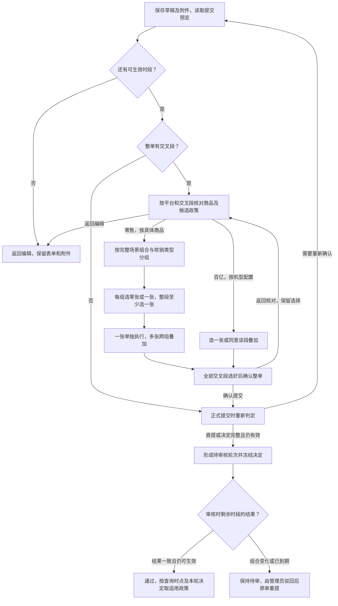

# 覆盖提示与政策范围

## 1. 平台和商品范围

政策按公司、渠道及实际分配的平台分别计算。零售按具体商品核对，百亿按机型版本、RAM 和 ROM 核对。各份申请保留原单中选定的商品、补贴及指定商品数量。

## 2. 生效与覆盖

申请开始时间和该轮采购通过时间中较晚的时刻是生效起点。原政策依据获批轮次表单与改期记录计算实际覆盖的秒，已执行时段按当时的决定回放。每个交叉段使用当轮确认的采用名单，段结束后重新读取该时点仍适用的已批准决定。补贴历史、未来安排和单商品时点查询使用同一套逐段规则。重放已批准轮次需要其快照中的商品、平台、补贴关联及受支持的确认规则版本（2 至 4）。[决策表与验收案例](#6-决策表与验收案例)

## 3. 审核与生效边界

正式提交和审核通过在读已提交事务中先按机型 ID 顺序取得同一组数据库行锁，覆盖百亿同配置不同颜色的情况。管理员对同一申请的并发操作另用状态、版本和轮次条件更新。审核时间在取得机型锁之后确定。未确认的新组合保持待审，由管理员驳回，原申请人核对后重提。操作返回和实际查询见[管理员接口](../api/admin-api.md#覆盖预览与有效政策)。

关联：[状态机](status-machine.md)、[审核接口](../api/admin-api.md)、[数据库字典](../sql/database-design.md)。

## 4. 申请人提交前确认覆盖范围

首提和驳回重提都先保存表单与附件，再读取整单 `applicability`。有交叉段时打开「确认政策适用范围」。点「提交申请」时，普通申请无交叉且未选择时间调整就直接送审。需要调整旧单时，可在「确认政策适用范围」窗口点「调整政策时间」，取消后回到对应入口。已无可生效时段时返回编辑调整日期。

窗口先按平台、机型版本和配置汇总普通选品，再按北京时间列出交叉段。零售同配置的多个颜色在同一时段命中相同政策轮次、补贴、场景与核销分组且适用结果一致时，共用一次确认。若某个颜色命中另一份旧单、补贴或时段不同，在同一配置卡中分别标出各段适用颜色。展开颜色可查实际商品与 ID，两个同色商品各自保留。指定适用机型单列颜色和平台数量，零售配置资料缺失时逐件展示。

每段列出本次及参与该段的旧单号、对应补贴。零售展示完整场景组合、核销类型和各组可选政策。同一组勾选另一张会换选，跨组勾选会叠加。每个商品、平台和交叉时段至少选一张，可以只勾旧单。百亿按服务端给出的整个配置范围叠加或选一，保留普通及指定选品明细。逐段选择作用于该段列出的所有商品，正式提交逐一回传原始范围及截止时间。

每段需明确选择。整单全部时段选完后，点「确认整单并提交」打开二次确认框。窗口按平台列出全部命中商品卡，每页 10 张。翻页和从二次确认框「返回核对」都会保留已选决定，点「确认提交」才发送整单。点击「返回编辑」时，申请保留当前可编辑状态及附件。服务端返回范围变化或要求补充确认时，页面读取新预览，清除旧选择；仍有交叉时重新核对。先前选了时间调整时，可重新核对各项截止、原因及文件，或移除该项。无交叉且无调整时可按新结果直提。提交结果未知时继续按申请 ID 和轮次核实。[请求与响应](../api/policy-api.md#正式提交)

### 缩短或延长已通过政策的时间

政策始终使用原单号。比如 024 原至 12 月 30 日 00:00:00，延至 12 月 31 日 00:00:00 后，新增的第一秒与原有区间都属于 024。候选或采用安排确有变化时仍须分段。已到期后才续期，已中断的历史不会补算。同一政策再次提前或延期，从本次实际截止办理。

「我的提交」可选择一张或多张已通过的原单。缩短须负责该单至少一个实际使用平台，延期限原申请人且须仍负责全部原平台。逐张填写新截止和原因，证明选传。确认后直接生效，每张原单另存一条改期记录及通知。[独立调整](../api/policy-api.md#在原政策上改期)

新申请也可随单调整一张或多张旧单。点「调整政策时间」，选取可调整的单号，逐单填写新截止、原因和可选证明。点「核对调整」后逐单核对，返回修改可保留已填内容。批量缩短允许选择前任负责人提交的政策，只须本人负责其渠道至少一个实际使用平台。随单延期也限本人提交并仍负责全部平台的原单。一批可以有两种方向，目标与新申请的渠道、商品、日期可以完全不同。

例如，本次申请是下月零售京东的白色机型，申请人同时负责百亿拼多多，可申请提前结束本月百亿拼多多的另一机型政策。本次零售申请仍按原结果核对。审核通过后，目标旧单的全部平台和商品按同一截止秒结束。若所填截止为 14:30:15，提前获批后从 14:30:16 起停止适用。晚于该时间批准时，旧单历史保留至批准前一秒。

以京东 Reno17 Pro 12GB+256GB 的预览为例，本次申请为 `ZC-000020`，当前段还列有 `ZC-000017` 和 `ZC-000016`。

- 若仅为 `017` 申请提前到 **2026-11-24 18:00:00** 结束，点「确认调整」后，该秒仍属于 `017` 的有效区间，从 **18:00:01** 起的预览段移除 `017`。`016` 仍按其自身有效期参与。一次调整两张时，分别按各自的新截止分段。
- 若为 `016` 申请延期，原截止所在秒仍由 `016` 承担，新增段从下一秒算起。比如原截止为 11 月 24 日 18:00:00，新增段为 18:00:01 至所填新截止。原截止前后的重叠政策和执行安排一致时，确认窗按原单号合成一个连续时段，只勾选一次。已到期的原单延期最终从新增段开始与实际批准时刻中较晚者起执行。
- 若仅修改 `020` 自己的到期时间，预览按 `020` 更新后的有效区间重算与旧单的交集，`017`、`016` 仍按各自既有截止时间执行。
- 重算后，若只改变这个组合持续的时间，原有勾选随延期延续、随提前结束缩短。中途有其他政策加入、退出，或执行安排发生变化时，分别确认对应时段。弹窗确认只更新预览。整单正式提交才保存本轮调整，审核通过后才改变旧单的实际适用范围。[发起单本轮快照与反查方法](../sql/database-design.md#在-navicat-核对整单提前结束记录)

例如本单 `ZC-000030` 的申请期为 2027-01-01 00:00:00 至 01-13 00:00:00，原单 `ZC-000027` 从 01-10 00:00:00 延至 01-16 00:00:00。选定两单叠加且组合连续时，范围确认窗、运营初审卡、采购审核和按轮详情都按原单号展示 01-01 00:00:00 至 01-13 00:00:00 这一段。获批后，机型补贴查询左侧 027 的截止是 01-16 00:00:00，右侧叠加阶段的结束时间是 01-13 00:00:00。从 01-13 00:00:01 起，在没有其他政策的情况下，027 单独执行到自己的新截止。如果改为将 027 提前至 01-07 00:00:00 结束，两单叠加到该秒，之后 030 继续按自己的期限执行。

审批同时锁定本单及目标旧单涉及的机型，再核对原截止、获批轮次、负责平台、延期商品在售及各段确认依据。整批通过时，一次生效所有缩短和延期，每项目标更新原单并保留相应流水。整批驳回或提交后有冲突需重新核对时，原政策继续按既有规则执行。调整原因和附件按发起单本轮留存。[接口及示例](../api/policy-api.md#整单提前结束)

## 5. 申请人后端区间试算

`submission-preview.applicability` 按同公司、同渠道、卡片实际平台核对已通过的当前提交轮次，包括前任负责人的有效范围。申请人预览、提交、管理员覆盖预览、审核和实际查询共用区间判定。零售预览列出该段内已通过且日期命中的候选，每次重新明确本轮将执行的名单。

- 起始秒与截止秒均计入有效期。新申请假设现在通过，取申请开始与批准时刻中较晚者作为起点。已有政策按原获批时段和逐次生效的改期确定执行区间，执行到各自最新实际截止。预览按各原单的实际交集核对采用名单，续期前已中断的历史仍为空档。
- 零售匹配同一具体商品。每段按完整场景集合和核销类型分组，场景勾选顺序不影响分组。国补＋地补／销售、国补／销售、国补／激活各自成组。组内候选按提交时间倒序展示，由申请人选单，每组最多一张。可以仅单用某组的一张，或从任意多个组各取一张叠加。
- 百亿匹配同平台、机型版本、RAM 和 ROM。普通商品按配置汇总，指定商品保留单独行、实际颜色和数量。不同颜色仍按同配置命中，交叉时段返回叠加或选一的候选。机型补贴时间轴按各原单的申报商品分行，按配置审核的时段内，各颜色行共用选单或叠加结果。[时间轴展示](../architecture/admin-workspace.md#机型补贴查询)
- 无交集且有可生效时段时，普通申请可直提。含时间调整时仍核验该批预览凭证。出现任意命中时列出组合；已无可生效时段时单独提示。[响应字段和案例](../api/policy-api.md#按日期试算适用范围)

提交时，服务端从全部最终确认段汇总真正参与叠加的政策，再比较每张整单所选的具体商品 ID。零售按商品、百亿按配置确定可选范围，两个渠道均按整轮参与单的商品 ID 集合是否完全相同决定运营初审。[审核分流](../architecture/policy-workflow-feishu-technical-design.md#classification)

直提或逐段接受后，提交事务冻结本轮 `consent`。百亿二选一中被排除的政策在该段后续叠加时继续排除；交叉段之外，各政策重新按自身有效范围参与。零售每段保存最终执行的名单，审核通过后按最近提交且覆盖该时点的决定查询。交叉段结束后，先前仍有效的决定恢复。详见[提交决定格式](../api/policy-api.md#正式提交)和[有效政策查询](../api/admin-api.md#覆盖预览与有效政策)。

自动化案例覆盖完整场景组合、同组换选、跨组选部分旧单、三单跨时段、预览后候选变化、两色同配置并发审核、驳回重提、已获批轮次回查和表单截止当秒、下一秒。生产 MySQL 锁与目标库历史数据仍需联调。

### 零售预估政策

零售申请勾选「预估政策」后，仍按同公司、零售渠道、实际平台、具体商品和交叉时段检测冲突。预估单和非预估单的完整场景集合、核销类型相同时进入同一组，该段最多选一张。跨组可以分别选单叠加。整单没有交叉且有可生效时段时可直接提交，有交叉时由申请人逐段确认，审核通过前服务端再复核。时间轴上的紫色「预估政策」标记来自审核快照，采用名单取决于该段已确认的决定。百亿渠道的预估字段为空。[提交契约](../api/policy-api.md#正式提交) · [时间轴接口](../api/page-api-plan.md#查询补贴历史)

## 6. 决策表与验收案例

下表各行是独立的验收输入，日期均为 2026 年北京时间。零售示例统一使用京东、Find X8 标准版 12GB+256GB 浮光白（商品 8001），另有说明时按行内条件。旧单先提交，新单后提交；示例均在所列起始日前获批或预览，仅给日期的整日示例均假定表单明确填了末日 23:59:59。

| 情形 | 输入 | 预期提交与生效结果 |
| --- | --- | --- |
| 无交集 | ZC-000110 国补／销售，11 月 1–10 日，100 元。新单 ZC-000111 同组，11–20 日，150 元 | 无其他命中且未选择时间调整时可直提。10 日 23:59:59 仍适用 110，11 日 00:00:00 起适用 111。日期相交但新单只选淘宝时，也与京东旧单无交集。 |
| 部分交集、同组互斥 | ZC-000110 国补／销售，1–20 日，100 元。ZC-000111 同组，8–12 日，150 元 | 8–12 日在两张中勾一张。勾 110 可继续执行旧单，勾 111 则单用新单。1–7 日和 13–20 日仍适用 110；两单各自保留原起止日期。 |
| 跨组叠加或单用 | ZC-000110 国补／销售，1–20 日，100 元。ZC-000112 地补／销售，8–12 日，60 元 | 8–12 日可勾 110、112 中任一张，也可两张都勾。两张均勾且审核通过后，查询返回两份补贴。将 112 改为国补／激活也属于跨组。 |
| 三份政策分时段命中 | ZC-000113 国补／销售，1–25 日，100 元；ZC-000114 地补／销售，3–8 日，60 元；ZC-000115 自补／销售，15–20 日，40 元。113 最后提交 | 113 的预览有两个交叉段，3–8 日确认 113＋114，15–20 日确认 113＋115。均获批后，1–2 日、9–14 日、21–25 日只查到 113。 |
| 同配置按颜色确认 | 京东 ZC-000321 国补／销售同时选浮光白 8001、墨黑 8002、银色 8003，补贴 150 元。1–7 日白、黑命中地补／销售的 ZC-000238，银色命中地补／销售的 ZC-000400 | 一张配置卡中显示两项叠加决定。浮光白和墨黑共用一次选择，银色单独核对 400。两项都确认后，按三个商品各自的原始范围提交。 |
| 百亿同配置、指定颜色 | 拼多多 ZC-000201 选同配置墨黑，1–20 日，100 元。ZC-000202 指定浮光白、数量 0，8–12 日，150 元；两单场景和核销类型均为空 | 同配置不同颜色仍有交集，指定商品单列浮光白及数量 0。选「仅适用 201」后，8–12 日按该配置查询只返回 201；选叠加则返回 201、202。 |

| 提交或审核期间发生的变化 | 应有结果 |
| --- | --- |
| 预览后另一单获批，提交时出现未确认组合 | 提交保留表单、附件和当前申请。页面读取新预览，清除旧决定，再由申请人确认。若新预览整单已无命中且仍可生效，可直接提交。 |
| 同一人提交 A、B，审核 B 前 A 刚获批；或两位管理员并发批准 A、B | 服务端在锁内按最新已通过记录复核。B 的剩余时段出现未确认组合时，B 保持待审，由管理员驳回；原申请人沿用单号重提并生成新快照。若 A 只影响已过去时段或未改变有效组合，B 可正常通过。 |
| 京东分工由甲移交乙 | 同一渠道的京东只有一名负责人。甲提交仍含京东的草稿会收到 403，可移除该平台再提交。乙的新预览纳入甲已通过且仍有交叉的京东政策；原单和附件仍归甲。 |
| 普通获批政策填写 12 月 7 日 00:00:00 至 12 月 8 日 00:00:00 | 提前获批且该段采用时，8 日 00:00:00 仍可命中，00:00:01 起退出。另一张政策在 00:00:01 开始，两单没有交叉。若待审单审核时已过所填截止秒，提示无可生效时段。 |

### 京东 Reno17 Pro 逐段选单示例

以下是申请页的模拟验收数据。京东 Reno17 Pro 12GB+256GB 的可可棕、初雪白、奇遇喵均命中同样的候选，因此三个颜色可以一起确认。三张政策的核销类型均为销售维度。

| 政策 | 完整场景组合 | 补贴 |
| --- | --- | --- |
| ZC-000007（本次申请） | 国补＋地补 | 政策价的 2%，整张政策只计一次 |
| ZC-000006（已通过） | 国补 | 固定 20 元，上限 100 元 |
| ZC-000003（已通过） | 国补 | 政策价的 20% |

ZC-000007 是综合组唯一的候选，申请人仍可将它与纯国补组的一张政策叠加。下表单号省略 `ZC-000` 前缀，日期均为 2026 年北京时间，各段从首日 00:00:00 至末日 23:59:59。

| 重叠时段 | 可单独执行 | 可叠加执行 | 截图中的选择 |
| --- | --- | --- | --- |
| 11 月 23–24 日 | 007、006、003 中任意一张 | 007＋006 或 007＋003。006 与 003 同组，只能保留其中一张 | 007＋006 |
| 11 月 25 日 | 007、003 中任意一张 | 007＋003。006 只在上一段命中 | 仅 003 |

每段选择只作用于该平台、所示商品和该段时间。弹窗中的「整单已确认 2 / 2 项」表示两段都已选好。点「确认整单并提交」，再点「确认提交」，提交成功后进入待审核。审核通过后，在 11 月 24 日最后一秒查询可得到 007 和 006 两份补贴，在 11 月 25 日零点查询只得到 003（假设提前获批）。三个商品各保存两段决定，共六条。[提交契约](../api/policy-api.md#正式提交) · [页面与请求验证](../architecture/frontend-development.md#零售按完整场景组合逐段勾选政策)

逐段选单保存在当轮审核快照中，零售按该轮完整场景集合比较。[逐段采用决定的落库位置](../sql/database-design.md#在-navicat-核对逐段采用决定)
