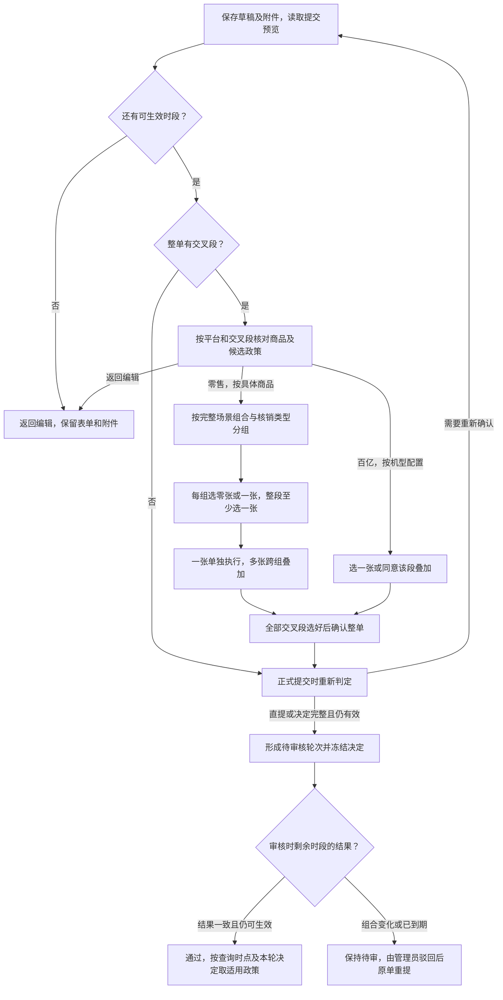
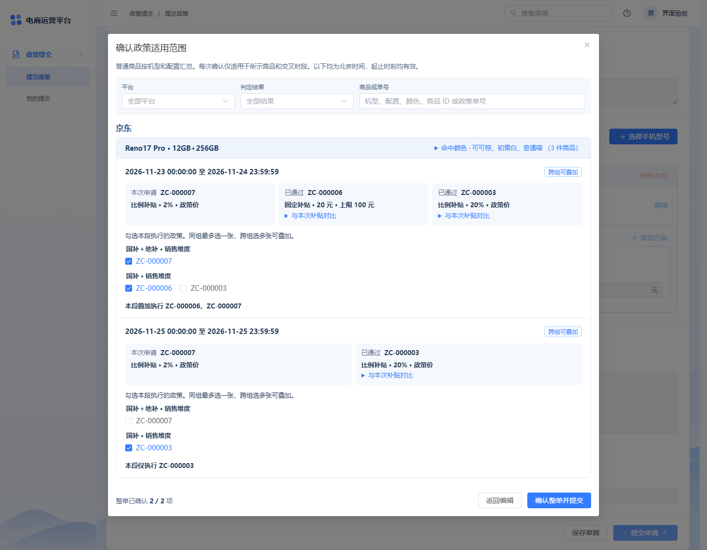

# 覆盖提示与政策范围

现行规则按每份政策自己的起止日期和本轮审核结果计算适用范围。第 1、2 节保留上线切换前的旧单口径；第 3 至 6 节用于当前提交、审核与生效查询。[决策表与验收案例](#6-决策表与验收案例)

## 1. 旧版逐商品对照的范围

同一租户、渠道及平台下，按 `goods_id` 判断商品范围。普通卡和指定卡使用同一套匹配规则。同配置黑色与白色为不同商品，分别选中才各自适用。当前轮次同一平台重复选择同一商品时，提交前须提示整理。来自不同申请的同平台同商品进入覆盖候选。

## 2. 上线前的旧单生效与覆盖

- 生效条件满足的最早时间为 `max(本申请开始时间, 本轮审核通过时间)`，包含该时点。提前审核的等到本申请的开始时间，晚审的从审核通过时间起参与选择。
- 按同租户、同渠道、同一平台和同一具体商品查询。符合生效条件的政策按本轮提交时间倒序取第一份，同一秒以提交日志 ID 倒序排序。先提交的申请晚通过时，已经生效的较新申请继续适用。
- 参考到期时间随申请保留和展示。有效政策持续适用，直到该范围有更新提交且符合生效条件的政策。业务后来恢复原补贴时，以另一次提交的申请为准。未被新申请选中的平台、商品保留各自的有效政策。
- 核销类型、涉及场景和预估沿用申请字段及列表筛选。已有范围匹配使用渠道、平台和商品 ID。

例如同一商品的 A 申请 11 月 15 日开始，B 申请后来提交并填写 11 月 20 日开始。B 在 11 月 18 日通过时，11 月 20 日起该范围取 B。B 在 11 月 22 日通过时，该范围从 11 月 22 日通过的时刻起取 B。

## 3. 审核与生效边界

正式提交和审核通过在读已提交事务中先按机型 ID 顺序取得同一组数据库行锁，覆盖百亿同配置不同颜色的情况。管理员对同一申请的并发操作另用状态、版本和轮次条件更新。审核时间在取得机型锁之后确定。未确认的新组合保持待审，由管理员驳回，原申请人核对后重提。操作返回和实际查询见[管理员接口](../api/admin-api.md#覆盖预览与有效政策)。

关联：[状态机](status-machine.md)、[审核接口](../api/admin-api.md)、[数据库字典](../sql/database-design.md)。

## 4. 申请人提交前确认覆盖范围

首提和驳回重提都先保存表单与附件，再读取整单 `applicability`。整单无命中时直接提交；已无可生效时段时返回编辑调整日期。有交叉段才打开「确认政策适用范围」。

窗口先按平台、机型版本和配置汇总普通选品，再按北京时间列出交叉段。零售同配置的多个颜色在同一时段命中相同政策轮次、补贴、场景与核销分组且适用结果一致时，共用一次确认。若某个颜色命中另一份旧单、补贴或时段不同，在同一配置卡中分别标出各段适用颜色。展开颜色可查实际商品与 ID，两个同色商品各自保留。指定适用机型单列颜色和平台数量，零售配置资料缺失时逐件展示。

每段列出本次及参与该段的旧单号、对应补贴。零售展示完整场景组合、核销类型和各组可选政策。同一组勾选另一张会换选，跨组勾选会叠加。每个商品、平台和交叉时段至少选一张，可以只勾旧单。百亿按服务端给出的整个配置范围叠加或选一，保留普通及指定选品明细。零售按颜色或商品 ID 筛选后，确认仅作用于匹配到的商品。清除筛选后可继续确认整组，正式提交逐一回传原始范围及截止时间。

每段需明确选择。整单全部时段选完后才能提交。平台、结果和商品或单号筛选、翻页均保留已选决定。点击「返回编辑」时，申请保留当前可编辑状态及附件。服务端返回范围变化或要求补充确认时，页面读取新预览，清除旧选择；仍有交叉时重新核对，已无交叉时按新结果直提。提交结果未知时继续按申请 ID 和轮次核实。[请求与响应](../api/policy-api.md#正式提交)

## 5. 申请人后端区间试算

`submission-preview.applicability` 按同公司、同渠道、卡片实际平台核对已通过的当前提交轮次，包括前任负责人的有效范围。申请人预览、提交、管理员覆盖预览、审核和实际查询共用区间判定。切换时刻起，旧已通过单也按快照日期到期；上线前的历史时点沿用第 2 节。回查旧版已通过政策沿用原规则。新版零售预览列出该段内已通过且日期命中的候选，每次重新明确本轮将执行的名单。

- 双方时段都包含起止边界，截止日期有效到北京时间 23:59:59。各自最早起效为申请开始与审核通过的较晚时刻，本次申请假设现在通过。只切分本次申请与历史政策有交集的时段，各政策保留原起止时间。
- 零售匹配同一具体商品。每段按完整场景集合和核销类型分组，场景勾选顺序不影响分组。国补＋地补／销售、国补／销售、国补／激活各自成组。组内候选按提交时间倒序展示，由申请人选单，每组最多一张。可以仅单用某组的一张，或从任意多个组各取一张叠加。
- 百亿匹配同平台、机型版本、RAM 和 ROM。普通商品按配置汇总，指定商品保留单独行、实际颜色和数量；不同颜色仍按同配置命中。交叉时段返回叠加或选一的候选。
- 无交集且有可生效时段时，整单预览结论为可直提。出现任意命中时列出组合；已无可生效时段时单独提示。[响应字段和案例](../api/policy-api.md#按日期试算适用范围)

直提或逐段接受后，提交事务冻结本轮 `consent`。百亿二选一中被排除的政策在该段后续叠加时继续排除；交叉段之外，各政策重新按自身有效范围参与。零售每段保存最终执行的名单，审核通过后按最近提交且覆盖该时点的新版决定查询。交叉段结束后，先前仍有效的决定恢复。详见[提交决定格式](../api/policy-api.md#正式提交)和[有效政策查询](../api/admin-api.md#覆盖预览与有效政策)。

自动化案例覆盖完整场景组合、同组换选、跨组选部分旧单、三单跨时段、预览后候选变化、两色同配置并发审核、驳回重提、旧快照回查和截止日最后一秒。生产 MySQL 锁与目标库历史数据仍需联调。

## 6. 决策表与验收案例

下表各行是独立的验收输入，日期均为 2026 年北京时间。零售示例统一使用京东、Find X8 标准版 12GB+256GB 浮光白（商品 8001），另有说明时按行内条件。旧单先提交，新单后提交；示例均在所列起始日前获批或预览，截止日含最后一秒。

| 情形 | 输入 | 预期提交与生效结果 |
| --- | --- | --- |
| 无交集 | ZC-000110 国补／销售，11 月 1–10 日，100 元。新单 ZC-000111 同组，11–20 日，150 元 | 无其他命中时整单直提。10 日 23:59:59 仍适用 110，11 日 00:00:00 起适用 111。日期相交但新单只选淘宝时，也与京东旧单无交集。 |
| 部分交集、同组互斥 | ZC-000110 国补／销售，1–20 日，100 元。ZC-000111 同组，8–12 日，150 元 | 8–12 日在两张中勾一张。勾 110 可继续执行旧单，勾 111 则单用新单。1–7 日和 13–20 日仍适用 110；两单各自保留原起止日期。 |
| 跨组叠加或单用 | ZC-000110 国补／销售，1–20 日，100 元。ZC-000112 地补／销售，8–12 日，60 元 | 8–12 日可勾 110、112 中任一张，也可两张都勾。两张均勾且审核通过后，查询返回两份补贴。将 112 改为国补／激活也属于跨组。 |
| 三份政策分时段命中 | ZC-000113 国补／销售，1–25 日，100 元；ZC-000114 地补／销售，3–8 日，60 元；ZC-000115 自补／销售，15–20 日，40 元。113 最后提交 | 113 的预览有两个交叉段，3–8 日确认 113＋114，15–20 日确认 113＋115。均获批后，1–2 日、9–14 日、21–25 日只查到 113。 |
| 同配置按颜色确认 | 京东 ZC-000321 国补／销售同时选浮光白 8001、墨黑 8002、银色 8003，补贴 150 元。1–7 日白、黑命中地补／销售的 ZC-000238，银色命中地补／销售的 ZC-000400 | 一张配置卡中显示两项叠加决定。白、黑共用一次；银色核对另一旧单。仅筛选墨黑并确认时，浮光白仍待确认。整单按三个商品各自的原始范围提交。 |
| 百亿同配置、指定颜色 | 拼多多 ZC-000201 选同配置墨黑，1–20 日，100 元。ZC-000202 指定浮光白、数量 0，8–12 日，150 元；两单场景和核销类型均为空 | 同配置不同颜色仍有交集，指定商品单列浮光白及数量 0。选「仅适用 201」后，8–12 日按该配置查询只返回 201；选叠加则返回 201、202。 |

| 提交或审核期间发生的变化 | 应有结果 |
| --- | --- |
| 预览后另一单获批，提交时出现未确认组合 | 提交保留表单、附件和当前申请。页面读取新预览，清除旧决定，再由申请人确认。若新预览整单已无命中且仍可生效，可直接提交。 |
| 同一人提交 A、B，审核 B 前 A 刚获批；或两位管理员并发批准 A、B | 服务端在锁内按最新已通过记录复核。B 的剩余时段出现未确认组合时，B 保持待审，由管理员驳回；原申请人沿用单号重提并生成新快照。若 A 只影响已过去时段或未改变有效组合，B 可正常通过。 |
| 京东分工由甲移交乙 | 同一渠道的京东只有一名负责人。甲提交仍含京东的草稿会收到 403，可移除该平台再提交。乙的新预览纳入甲已通过且仍有交叉的京东政策；原单和附件仍归甲。 |
| 旧获批快照截止日为 11 月 10 日，查询时点已在上线切换之后 | 其他条件相同时，10 日 23:59:59 可命中，11 日 00:00:00 起退出。原申请仍为已通过，快照可回查。若待审单审核时已过自身截止日，提示无可生效时段，管理员可驳回调整。 |

### 京东 Reno17 Pro 逐段选单示例

以下是申请页的模拟验收数据。京东 Reno17 Pro 12GB+256GB 的可可棕、初雪白、奇遇喵均命中同样的候选，因此三个颜色可以一起确认。三张政策的核销类型均为销售维度。

| 政策 | 完整场景组合 | 补贴 |
| --- | --- | --- |
| ZC-000007（本次申请） | 国补＋地补 | 政策价的 2%，整张政策只计一次 |
| ZC-000006（已通过） | 国补 | 固定 20 元，上限 100 元 |
| ZC-000003（已通过） | 国补 | 政策价的 20% |

ZC-000007 是综合组唯一的候选，申请人仍可将它与纯国补组的一张政策叠加。下表单号省略 `ZC-000` 前缀，日期均为 2026 年北京时间，各段从首日 00:00:00 至末日 23:59:59。

| 重叠时段 | 可单独执行 | 可叠加执行 | 截图中的选择 |
| --- | --- | --- | --- |
| 11 月 23–24 日 | 007、006、003 中任意一张 | 007＋006 或 007＋003。006 与 003 同组，只能保留其中一张 | 007＋006 |
| 11 月 25 日 | 007、003 中任意一张 | 007＋003。006 只在上一段命中 | 仅 003 |

每段选择只作用于该平台、所示商品和该段时间。弹窗中的「整单已确认 2 / 2 项」表示两段都已选好。点「确认整单并提交」进入待审核；审核通过后，在 11 月 24 日最后一秒查询可得到 007 和 006 两份补贴，在 11 月 25 日零点查询只得到 003（假设提前获批）。三个商品各保存两段决定，共六条。[提交契约](../api/policy-api.md#正式提交) · [页面与请求验证](../architecture/frontend-development.md#零售按完整场景组合逐段勾选政策)

逐段选单复用已有审核快照。已有库如需升级零售多选场景字段，执行步骤见[数据库设计](../sql/database-design.md#已有库升级零售场景多选)。
