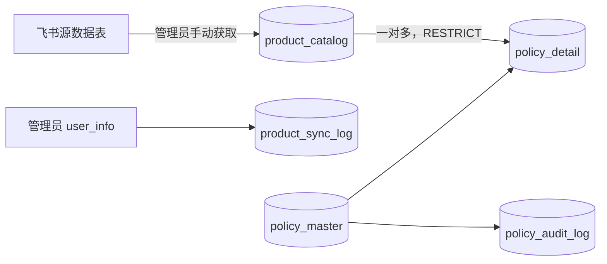

# 商品目录与管理员手动同步

更新日期：2026-11-10。本文为本轮确定的数据与交互设计，SQL 已提供，接口、同步程序及选择组件均未实现，未执行数据库迁移。

## 已确认的使用方式

飞书多维表格维护商品；管理员点击「更新商品列表」，后端获取商品并存入本地 MySQL。申请人打开表单、搜索和选择商品均查询本地目录，不因打开表单、搜索或提交而自动请求飞书。飞书修改内容在管理员下一次成功更新后可见，首期不做定时同步、双向写回或持续监听。

| 源表字段 | 本地目录 / 政策快照 | 表单 |
| --- | --- | --- |
| 型号 | `model_full_name` | 涉及型号 |
| 单型号 | `single_model` | 单型号 |
| 配置 | `spec` | 配置 |

一次选择源表的一条记录，三个字段整体带出；单型号、配置只读，更换商品时一起更新。完整保留简装、卫星版等原值，不拆型号字符串，不允许跨记录自由组合。颜色、数量和补贴不来自此表，仍逐平台填写。同一商品可用于多个平台，平台数量不共享。

用户提供的来源是 Wiki 链接，指定数据表 `tbllWSDvygiMHMhH`、视图 `vewjVCCSTU`。Wiki 节点 `C9lWwuFjBi7TtWkTAGmcmqt9n7z` 不能当作 Base token；实际 Base token、三个 field ID、字段类型和应用读取权限尚未通过 API 核实。截图仅用于理解字段，不作为初始化数据。

## 商品身份与数据关系

新增 `product_catalog` 和 `product_sync_log`，原四张政策业务表保留。`policy_detail` 增加可空的 `product_id`、`product_version`，原三个文本字段继续保存快照。

- 商品用本地 `id` 关联；源身份是 `(tenant_key, source_base_token, source_table_id, source_record_id)`，各来源标识区分大小写。飞书记录 ID 是表内记录标识，不是可跨系统复用的库存 SKU 编码。
- 重复同步同一源记录更新原商品，不重建本地 ID；同名的不同源记录不合并。源记录删除后重建产生新 ID，不能按名称自动继承旧政策。
- `record_version` 初始 1；三个商品字段或可选状态变化时递增。只刷新同步时间不递增；恢复同一源记录沿用本地 ID、恢复可选并递增版本。
- `last_synced_at` 表示最近一次成功同步中确实读到此记录的时间；停用缺失记录时不把它更新成「最近读到」。`updated_at` 是数据库更新时间，不用于判断商品版本。
- 不物理删除目录、不级联更改政策。历史读取直接展示明细/提交快照，不能要求目录仍可选，不能通过目录当前状态过滤掉旧政策。
- 商品与同步日志保存租户；外键只校验 ID 存在，Service 仍须校验商品、管理员与申请属于相同租户，来源取服务端配置。

## 同步流程与失败保护

1. 后端重新查询有效账号和 ADMIN 角色，确认本租户配置的固定来源。生产同步拟使用服务端应用身份读取，经开放平台权限及源资源授权后接入；现有用户免登成功不代表已有读表权限，不保存用户 token 供同步使用。
2. 按「数据库、租户、Base、数据表」串行执行同步。拟使用 MySQL `GET_LOCK`，锁名使用上述范围的 SHA-256 十六进制摘要；超时为 0，并发请求返回 409。必须由同一专用物理连接持有锁、完成后续事务并在 finally 中 `RELEASE_LOCK`，不得借出连接后提前归还池中；进程连接断开时锁释放。该策略尚未实现及验证。
3. 取得同范围锁后，先将此前遗留 RUNNING 标记 FAILED / `SYNC_INTERRUPTED`，再在独立短事务创建新 RUNNING 批次，保存真实操作人和来源，不能把进程中断当成功。后台工作任务持有该连接；请求线程收到锁已取得且新批次已持久化的通知后才响应 202，同范围其他任务取锁失败返回 409。
4. 分页完整读取配置的整张数据表，仅投影三列及记录 ID。不把链接视图的筛选、隐藏、排序或行号作为同步范围与商品身份；不能把一页数据当全表。若应用无整表可见权限，应拒绝将局部结果用于停用判断。
5. 在内存暂存并校验全部记录：记录 ID 唯一、三个字段非空、字段类型可单值映射、长度不超过 128/64/64。公式/查找字段按 API 实际结果适配，多值、缺列、异常值不能取第一项、猜测、静默跳过或截断。field ID 在接入时核实并配置，列名仅辅助识别；字段删除重建时重新核对。
6. 分页中断、限流重试耗尽、无权限、字段不兼容、空结果或读取范围异常均失败，保留旧目录。已有目录源记录缺失时，只有确认完整读取和源可见范围未变化、缺失确属删除后才停用；无法确认时返回 `SYNC_SOURCE_UNVERIFIED`，不把权限变化当删除。源被复制或换表须作为显式配置变更评审，不能自动切换来源并停用旧目录。
7. 在短数据库事务中按源身份新增、更新、恢复或停用；同一批更新和 SUCCESS 日志一起提交。新增、修改、停用都不修改政策表。失败回滚目录全部变更，再用独立短事务记录 FAILED 和脱敏错误代码；若失败日志也无法写入，报告存储异常并由下次持锁运行修复遗留 RUNNING。
8. 成功显示总读取、新增、修改（含恢复）、停用、未变化数量、完成时间和操作人。`fetched_count = created_count + updated_count + unchanged_count`；停用记录已不在源结果中，单独计数。失败批次的已应用数量均为 0，已解析数量不代表总量。

分页 API 不提供本设计已核实的一致性快照；源表在同步过程中持续改动可能造成跨页差异。遇到总量、重复记录或缺失范围异常应整批失败后重试，不能承诺与飞书某一瞬间严格一致。同步日志只是结果记录，本身不自动提供互斥锁或完整性证明。

## 表单、草稿与提交

- 选择项包含 `productId`、`productVersion` 和三个展示字段。页面只查本租户配置来源且可选的本地商品，展示最近成功同步时间。管理员更新后，申请人重新打开选择器或刷新候选列表可查询新版；不静默覆盖已经填写的行。
- 保存选定商品时，客户端传商品 ID、所选版本及数量/补贴等业务值；三个商品文本由后端核对本地目录后派生，不信任客户端任意文本。版本或可选状态变化返回 409，用户确认并重新选择后保存，保留数量和补贴。
- 未选商品的草稿两列关联均可空。迁移前旧明细保留文本、关联留空，不做名称回填；历史记录可以读取，旧草稿或拒绝申请在下次完整提交前须重新选商品。
- 正式提交在政策事务内重新核对本地商品有效性、租户与 `product_version`，按商品 ID 升序读取并持有共享行锁至事务结束，使商品同步更新与提交串行。实际实现须处理锁超时/死锁并回滚，不能只依赖事务外查询或前端版本。
- 每轮提交快照保存 `product_id`、`product_version`、型号/单型号/配置、颜色、数量及补贴。商品版本只表示当时目录版本，不要求历史商品版本永久等于当前目录版本。
- 已待审、通过的提交不因商品改名或停用自动退回、重写或失效。商品 ID 为未来精确检索提供身份，覆盖算法的颜色、时间、优先级等口径仍待确认。

## 迁移、接入与验收

新空库执行 [schema.sql](../sql/schema.sql) 或与其一致的 [V1](../sql/V1__create_policy_tables.sql)，二选一；已有四表库核对真实结构后仅执行 [V2 增量脚本](../sql/V2__add_product_catalog.sql)。V1 依项目约定同步为当前完整结构入口的版本副本，不用于已存在表的升级。MySQL DDL 不支持整份事务回滚，失败后核对完成步骤，不能盲目重复运行。

待接入核实：实际 Base token、三个 field ID/类型、完整数据范围、源是否有空行及重复记录、应用权限和资源授权；截图不能替代核实。不在本轮更改飞书源表、创建远端字段或写入真实商品。

后续验证全分页读取、重复更新不新增、改名版本递增、恢复、缺失判定、空表与权限异常保护、事务回滚、并发更新/提交、草稿过期提示、历史快照保留、跨租户与非管理员拦截。本文与 SQL 的静态核对不等于这些功能或真实 MySQL 测试已通过。

关联：[数据字典](../sql/database-design.md)、[商品接口](../api/product-api.md)、[政策接口](../api/policy-api.md)、[表单规约](perspective-rules.md)。
