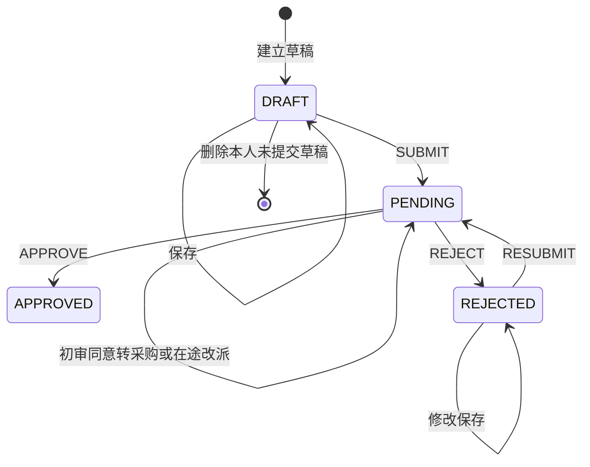

# 草稿、提交与审核状态机

更新日期 2026-11-24。已接入草稿保存、提交与重提、产品运营初审、采购终审及按轮查询。[政策三表](../sql/database-design.md#政策三表) · [两级审核接口](../architecture/policy-workflow-phase-c.md#api-与字段)

## 状态迁移

| 状态 | 含义 | 允许操作 |
| --- | --- | --- |
| `DRAFT` | 草稿，可不完整 | 保存；完整校验后提交；本人可物理删除未提交草稿 |
| `PENDING` | 当前轮次待审核 | 按 `PRODUCT_REVIEW`／`PURCHASE_REVIEW` 及当轮指派判权，初审同意转采购时仍为待审。[按轮审核与改派](../architecture/policy-workflow-phase-c.md) |
| `REJECTED` | 已拒绝 | 本人基于原申请修改、保存、重提 |
| `APPROVED` | 已通过 | 首期不开放编辑或再次审核 |

驳回后沿用原申请 ID 和单号，编辑或保存时保持 `REJECTED`，重提成功后进入新一轮 `PENDING`。已通过单到期只会退出适用范围，主表状态和最近审核结果仍为 `APPROVED`，历轮快照可查。待审撤回、通过后修改或删除均未开放。

提交和重提都按公司当前有效范围分段。无交叉且无时间调整时可直提。有交叉时确认各段，附带调整时核验调整后的预览。审核通过前重新判定，出现未确认组合时保持待审，管理员沿用驳回重提。正式提交时，所选旧单的调整写入发起申请本轮审核快照。待审和驳回期间各旧单维持此前的有效截止。审核通过时，整批缩短与延期一并生效。缩短按各原单实际截止生效，延期在同一事务生成已通过的关联单。[确认流程](override-engine.md#5-申请人后端区间试算)

每次提交与重提都按轮审核。没有确认段且没有随单调整的申请直接进入采购终审。需要在「确认政策适用范围」点「确认整单并提交」的申请，整轮先给产品运营。服务端核对本轮是否有必须确认的交叉时段，或是否随本单提交了其他政策的截止调整。原政策 A 和本单 B 重叠时，只选 A、用 B 替换 A 或按规则叠加都要初审。随单调整经重算没有交叉段，只要仍需确认整批调整，也要初审。仅打开调整窗口又取消，按最终提交内容判断。已提交轮次沿用当时冻结的审核依据和指派，成员调整另记改派记录。

零售某段只勾旧单时，采购最终批准后该段只执行勾选的旧单。其他时段分别依据各自的决定和有效日期查询。终审复核剩余时段、分组及候选轮次，依据发生冲突时保持待审。[采购复核与有效政策](../api/admin-api.md#覆盖预览与有效政策)

审核日志的 `SUBMITTED` 对应主表的 `PENDING`。初审同意后当轮日志仍为 `SUBMITTED`，实际初审人在节点决定中留名。两关的通过意见均可省略，初审退回须填原因，采购驳回可省略意见。任一节点退回即结束本轮，并为原申请人登记修改任务。

进入初审时，系统为每名当轮产品运营登记一张私聊审核卡。产品运营在飞书交互卡上点「通过」或填写原因后点「拒绝」。卡片中的详情链接供查看本轮依据与附件。首个有效决定、各卡的只读更新和一条结果群通知在同一事务登记，事务成功提交后再投递。同意时群内点名合格采购，每名采购收到终审待办，进入管理员「差异化政策」办理。终审批准后该申请结束。退回时群内点名原申请人，原申请人收到修改待办。直达采购的轮次在提交时登记采购群通知及逐人待办。自动发送由独立开关 `POLICY_REVIEW_DELIVERY_ENABLED` 控制，飞书 Task V2 勾选只更新外部任务状态。[各节点的收件人与回执](../architecture/policy-workflow-phase-e.md#各节点的收件人与回执)

## 权限与校验

在「我的提交」中，申请人可为本人已通过的原单发起独立时间调整。缩短须仍负责原单至少一个实际使用的平台，延长须仍负责原单全部平台。两种方向都创建有新单号的草稿，填写原因，证明文件选传。缩短单通过后，原单的全部商品与平台按新的实际截止执行。延期单承接原单实际截止的下一秒，按新增时段核对交叉。两种调整都可以在驳回后修改新截止、原因或证明文件，再次送审。[独立调整接口](../api/policy-api.md#延长已通过的政策)

- 本人只维护自己的 `DRAFT` / `REJECTED`。列表、详情和历史查询限定本人及租户，并过滤已删除申请。单轮查询还需验证日志属于所查申请。
- 本公司有效管理员可以查看本公司已提交的申请。申请人转为管理员后仍须由他人审核原单。采购终审要求本轮有效采购指派，实际初审签署人也须与采购签署人不同。
- 草稿可以暂缺平台。已选择的平台必须是当前渠道分给本人的平台，卡片只可使用整单平台的子集。非法枚举、负值或互斥冲突会被拒绝。若某平台在预览后移交，正式提交返回 403，申请保持原状态，申请人可移除该平台后再提交。
- 正式提交完整校验；重提重新生成快照，修改不清空旧审核记录。
- 初审退回原因去掉首尾空白后为 1 至 512 字。采购驳回意见最多 512 字。每轮每个节点只记录实际决策人的意见，其他成员的结办状态为「同组他人已处理」。

## 版本与历史

| 字段 | 规则 |
| --- | --- |
| `policy_apply.current_version` | 初始 0，每次提交/重提加 1 |
| `policy_apply.record_version` | 初始 1，每次草稿保存、提交、节点决定或实际变更本轮名单时加 1 |
| `policy_audit_log.version`、`policy_goods_detail.version` | 关联同一正式提交轮次 |
| `policy_audit_log.snapshot_data` | 每轮保存完整表单、商品、方案分配和 `consent`。无命中直提保存空决定列表 |

快照含平台、卡片类型及分配关系、两类卡选中的商品 ID、机型 ID、RAM、ROM、品牌系列型号配置及颜色名称、数量、补贴、时间、备注和附件链接。正式提交核验每个选中的商品存在、在售且属于对应配置。待审、通过和驳回的轮次均可回查。未提交的草稿历史为空。

草稿保存仅更新 `policy_apply`，驳回后编辑期间保持 `REJECTED`，最近意见从本轮审核记录读取。每次提交或重提新增一条 `SUBMITTED` 记录。任一节点退回或采购最终批准时，向该记录填入本轮最终结果、实际审核人、时间与意见，保留快照及商品明细。

管理员列表展示、业务筛选、状态数量统计和详情摘要均读取 `current_version` 对应的正式提交快照。驳回后保存不改变管理员所见的渠道、平台、核销类型、场景和提交内容；重提成功后随新轮次切换。本人编辑页仍读取主表中已保存的修改。状态、权限与并发版本继续由主表控制。

## 事务与并发

本人可物理删除 `DRAFT`、`current_version=0` 且没有提交历史的草稿。接口匹配租户、申请人、`is_deleted=0` 和 `record_version` 后执行条件 DELETE。删除与保存、提交只能有一个旧版本写入成功。已驳回、待审核及已通过申请继续保留历史。删除草稿不级联删除磁盘文件，附件仍独立校验全部引用。

1. 从会话取操作人，校验有效用户、归属、状态及客户端 `recordVersion`。
2. 按 `id + record_version + 允许状态 + is_deleted=0` 条件更新；审核额外校验 `submissionVersion`。影响行数非 1 返回 409 并回滚。
3. 提交在同一事务中更新主表、插入本轮待审快照及商品适用明细。提交后冻结该轮快照与明细。
4. 初审同意在事务内推进阶段与主单记录版本。初审退回或采购终审在同一事务更新主表和该轮 `SUBMITTED` 日志，同时登记实际签署人、成员结办及相应投递动作。每个平台和商品从已通过的记录中即时计算生效政策。
5. 重复提交/审核通过状态和版本拒绝，不能重复生效或写成功日志。首次保存通过申请人和 `Idempotency-Key` 防止相同创建请求重复建单，申请被后续修改时重放返回冲突。

同一申请的写入按状态、版本及影响行数保护；不同申请在同一机型上并发提交或通过时，事务按机型 ID 顺序取锁并复核。因新增组合或整单到期而不能批准时，原单保持 `PENDING`，管理员可通过驳回交回申请人。适用结果一致则可正常批准。[并发审核与重提示例](override-engine.md#6-决策表与验收案例)

## 验收与联调

2026-11-15 已在隔离 H2 验证本人未提交草稿物理删除。越权、管理员身份、未登录、不可信来源、缺少或非法版本、旧版本及已提交状态均拒绝。已产生提交历史的记录受保护，附件文件继续按共享引用保护。删除与提交并发时只允许一方成功，失败方不留下明细或审核日志。目标 MySQL 的并发行为待联调。

本地已验证草稿保存及提交、本人列表和权限边界、测试夹具构造的驳回记录、原单重提和首轮快照保留。具体范围见[我的提交验收记录](../architecture/frontend-development.md#2026-11-14-我的提交接口接入)。

目标 MySQL 与真实飞书会话仍待联调，包括平台移交后的提交权限、管理员通过与驳回、并发版本冲突，以及驳回后重新确认并提交原单。
