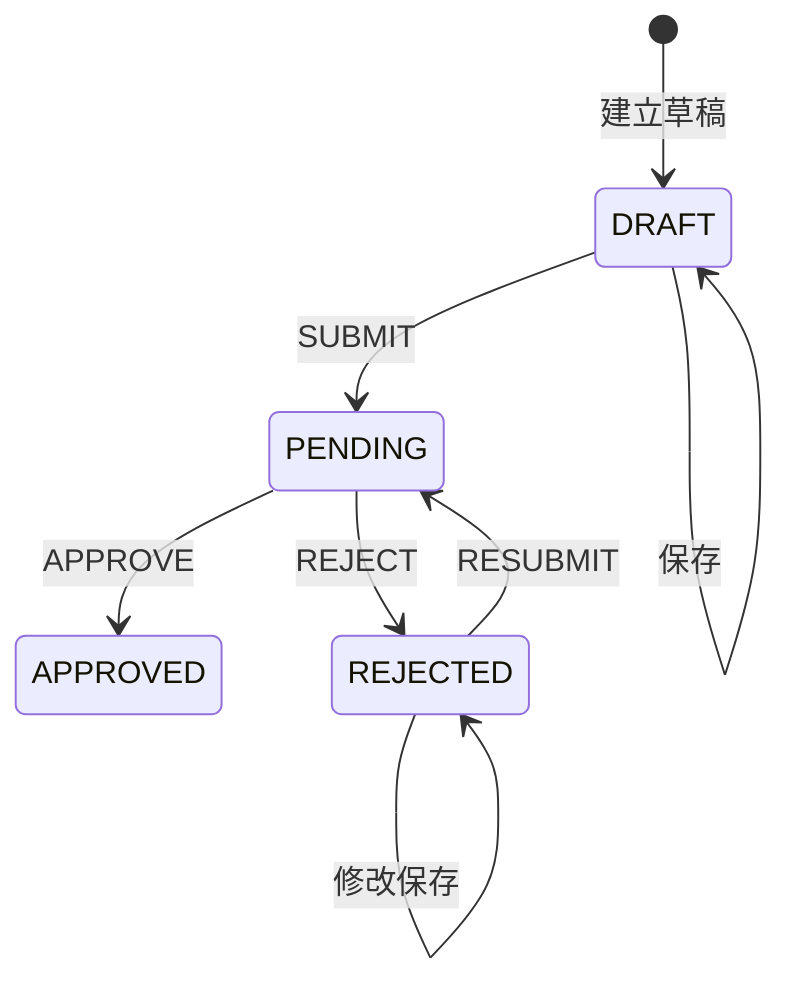

# 草稿、提交与审核状态机

更新日期：2026-11-11。沿用四张政策/用户核心表的状态约定，商品目录另有独立启停及同步状态；业务接口和事务尚未实现。

## 状态迁移

| 状态 | 含义 | 允许操作 |
| --- | --- | --- |
| `DRAFT` | 草稿，可不完整 | 保存；完整校验后提交 |
| `PENDING` | 当前轮次待审核 | 管理员通过或拒绝 |
| `REJECTED` | 已拒绝 | 本人基于原申请修改、保存、重提 |
| `APPROVED` | 已通过 | 首期不开放编辑或再次审核 |

被拒绝后沿用原申请 ID；保存保持 `REJECTED`，不复制成新申请。四状态不能遗漏 `APPROVED`。不自行开放待审撤回、通过后修改、删除或自动过期。通过不等于当前生效，须另查时间与覆盖结果。

## 权限与校验

- 本人只维护自己的 `DRAFT` / `REJECTED`；列表和详情限定本人及租户。
- 后端校验有效管理员、申请租户；跨人可见范围及自审规则待确认。
- 草稿可不完整，但非法枚举、跨渠道平台、负值、互斥冲突仍拒绝。
- 正式提交完整校验；重提重新生成快照，修改不清空旧审核记录。
- 拒绝原因是否必填待确认，每次意见独立保存。

## 版本与历史

| 字段 | 规则 |
| --- | --- |
| `submission_version` | 初始 0，每次提交/重提加 1 |
| `record_version` | 主表/明细业务修改、提交、审核均加 1 |
| 日志 `submission_version` | 指向该提交轮次 |
| `submission_snapshot` | 提交/重提保存完整主表与明细，不含凭证 |

快照含平台、机型 ID、RAM 和 ROM、品牌系列型号配置、colorScope、指定商品 ID/颜色名称、数量、补贴、时间、备注和附件链接，提交后不可改写。正式提交校验配置可选，指定颜色时还须确认商品属于该配置且为 ACTIVE。ALL_COLORS 的商品 ID 和颜色名称为空，范围由 colorScope 明确表示。待审、通过版本必须可追溯，不能只留最近主表字段。

动作沿用 SQL：`CREATE_DRAFT`、`UPDATE_DRAFT`、`SUBMIT`、`RESUBMIT`、`APPROVE`、`REJECT`。修改拒绝申请记录 `UPDATE_DRAFT`，前后状态均 `REJECTED`。

重提后清空主表最近审核人、时间、意见，旧记录保留在日志。拒绝后编辑保存期间仍显示上一轮意见，不随保存擦除。

## 事务与并发

1. 从会话取操作人，校验有效用户、归属、状态及客户端 `recordVersion`。
2. 按 `id + record_version + 允许状态 + is_deleted=0` 条件更新；审核额外校验 `submissionVersion`。影响行数非 1 返回 409 并回滚。
3. 主表、明细、版本和日志同事务；明细独立增删也参与主表版本保护。
4. 提交完整校验、保存快照、转 `PENDING`；审核针对当前轮次。通过时重新执行已确认口径的覆盖检查，不能依赖页面旧预览。
5. 重复提交/审核通过状态和版本拒绝，不能重复生效或写成功日志。创建草稿的幂等键、重放响应方案尚未定稿，不宣称精确一次创建。

仅有版本字段不自动产生并发保护，当前也未配置政策实体乐观锁。禁用前端按钮不能代替条件更新。覆盖规则确认前不得启用正式替换。

## 后续验收

验证不完整保存、完整提交、原 ID 修改重提、每轮快照和意见还原、待审及通过禁编辑、明细并发冲突、重复审核、跨人跨租户限制。这些是验收要求，不是已通过测试。
