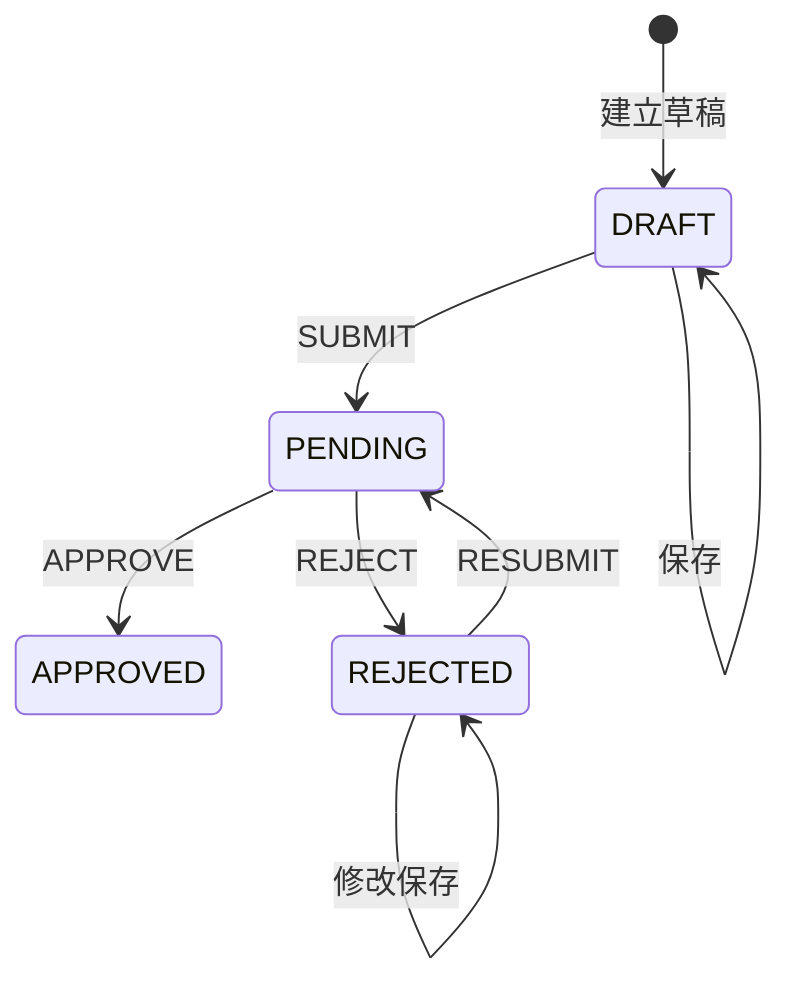

# 草稿、提交与审核状态机

更新日期：2026-11-14。已接入草稿保存、提交事务，以及本人的申请列表、详情、历轮审核和快照查询。管理员审核接口待实现。[政策三表](../sql/database-design.md#政策三表)

## 状态迁移

| 状态 | 含义 | 允许操作 |
| --- | --- | --- |
| `DRAFT` | 草稿，可不完整 | 保存；完整校验后提交 |
| `PENDING` | 当前轮次待审核 | 管理员通过或拒绝 |
| `REJECTED` | 已拒绝 | 本人基于原申请修改、保存、重提 |
| `APPROVED` | 已通过 | 首期不开放编辑或再次审核 |

被拒绝后沿用原申请 ID；保存保持 `REJECTED`，不复制成新申请。四状态不能遗漏 `APPROVED`。不自行开放待审撤回、通过后修改、删除或自动过期。通过不等于当前生效，须另查时间与覆盖结果。

## 权限与校验

- 本人只维护自己的 `DRAFT` / `REJECTED`。列表、详情和历史查询限定本人及租户，并过滤已删除申请。单轮查询还需验证日志属于所查申请。
- 后端校验有效管理员、申请租户；跨人可见范围及自审规则待确认。
- 草稿可不完整，但非法枚举、跨渠道平台、负值、互斥冲突仍拒绝。
- 正式提交完整校验；重提重新生成快照，修改不清空旧审核记录。
- 拒绝原因是否必填待确认，每次意见独立保存。

## 版本与历史

| 字段 | 规则 |
| --- | --- |
| `policy_apply.current_version` | 初始 0，每次提交/重提加 1 |
| `policy_apply.record_version` | 初始 1，每次草稿保存、提交和审核加 1 |
| `policy_audit_log.version`、`policy_goods_detail.version` | 关联同一正式提交轮次 |
| `policy_audit_log.snapshot_data` | 保存完整表单、商品快照和方案分配，过滤凭证 |

快照含平台、卡片类型及分配关系、两类卡选中的商品 ID、机型 ID、RAM、ROM、品牌系列型号配置及颜色名称、数量、补贴、时间、备注和附件链接。正式提交核验每个选中的商品存在、在售且属于对应配置。待审、通过和驳回的轮次均可回查。未提交的草稿历史为空。

草稿保存仅更新 `policy_apply`，驳回后编辑期间保持 `REJECTED`，最近意见从本轮审核记录读取。每次提交或重提新增一条 `SUBMITTED` 记录。审核通过或驳回时填入该轮结果、审核人、时间与意见，保留快照及商品明细。

## 事务与并发

1. 从会话取操作人，校验有效用户、归属、状态及客户端 `recordVersion`。
2. 按 `id + record_version + 允许状态 + is_deleted=0` 条件更新；审核额外校验 `submissionVersion`。影响行数非 1 返回 409 并回滚。
3. 提交在同一事务中更新主表、插入本轮待审快照及商品适用明细。提交后冻结该轮快照与明细。
4. 审核针对当前轮次，在同一事务中条件更新主表和该轮 `SUBMITTED` 审核记录。通过时重新执行已确认口径的覆盖检查，页面预览仅用于展示。
5. 重复提交/审核通过状态和版本拒绝，不能重复生效或写成功日志。首次保存通过申请人和 `Idempotency-Key` 防止相同创建请求重复建单，申请被后续修改时重放返回冲突。

仅有版本字段不自动产生并发保护，当前也未配置政策实体乐观锁。禁用前端按钮不能代替条件更新。覆盖规则确认前不得启用正式替换。

## 验收与联调

本地已验证草稿保存及提交、本人列表和权限边界、测试夹具构造的驳回记录、原单重提和首轮快照保留。具体范围见[我的提交验收记录](../architecture/frontend-development.md#2026-11-14-我的提交接口接入)。

目标 MySQL 与真实会话待联调。管理员审核接入后，验证真实通过及驳回、旧版本和重复审核冲突，以及驳回后原单重提的完整流程。
