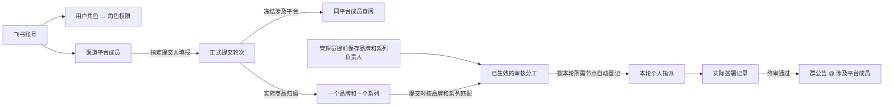

# 角色、平台共同负责与政策审核分工数据表设计

**29 表空库结构 · 2026-11-26。** 目标为 MySQL 8.0.16 及以上，单家飞书企业，新建 29 张表。管理员拥有全部功能，并在运营提交前，按品牌指定终审采购、按 OPPO 和一加各自的标准系列指定初审产品运营。运营按平台指定提交人填报，一张政策申报一个品牌下的一个标准系列。提交时系统自动读取已生效的分工，登记本轮所需岗位的负责人。[完整建表 SQL](schema.sql) 与前后端使用同一套分工和权限约束。

## 1. 表清单

| 与原 23 表基线的差异 | 数量 | 表 |
| --- | ---: | --- |
| 新增 | 7 | `sys_role`、`sys_user_role`、`sys_role_permission`、`platform_team`、`policy_round_platform`、`policy_review_brand_owner`、`policy_review_series_owner` |
| 调整字段、键或约束 | 6 | `user_info`、`user_platform_assignment`、`policy_apply`、`policy_audit_log`、`policy_goods_detail`、`policy_review_member` |
| 复用结构，调整读写规则或快照内容 | 4 | `policy_review_settings`、`policy_review_round`、`policy_review_decision`、`policy_review_delivery` |
| 保留结构，功能已停用 | 1 | `policy_review_reassignment` 保留在 29 表建库基线中，运行中的审核流程不读写该表 |
| 沿用结构 | 11 | `brand`、`series`、`spu`、`color_dict`、`goods`、`goods_sync_job`、`source_goods_item`、`catalog_clean_job`、`catalog_clean_job_item`、`catalog_operation_log`、`policy_time_change` |
| 新空库省去 | 1 | `policy_review_setting_member`。原表只表达全公司采购或初审名单，职责由品牌和系列两张负责人表承接 |

下文 ID 沿用现有有符号 `BIGINT`，轮次沿用 `INT UNSIGNED`，企业键沿用 `tenant_key VARCHAR(64)`。外键两端字段类型、字符集及排序规则一致。人员引用均关联 `user_info(id,tenant_key)`，目录仍为公司共用。新关系的外键以限制删除为原则。查询业务主表时沿用启用、逻辑删除和所属企业条件。[现行字段字典](database-design.md) · [MySQL 外键](https://dev.mysql.com/doc/refman/8.0/en/create-table-foreign-keys.html)

下图按一张政策的办理顺序表示业务关联。具体外键见各节。

## 2. 哪个人拥有哪些权限

| 表 | 主要字段和键 | 业务约束 |
| --- | --- | --- |
| `user_info` | 保留身份、资料、启停和原主键；移除 `role_type` 及其二值检查。新增 `auth_version INT UNSIGNED`，初始为 1 | 用户角色或启停变更后递增，管理页面带已读版本保存。飞书身份仍按企业和 open_id 唯一 |
| `sys_role` | `id` 主键、`tenant_key`、`role_code VARCHAR(64)`、`role_name VARCHAR(64)`、`is_builtin`、`is_enabled`、`version INT UNSIGNED`、创建及更新时间。唯一键 `(tenant_key,role_code)`、`(id,tenant_key)` | 角色编码稳定，支持管理员新增岗位、配置权限和分配人员。内置系统管理员的全权语义及启用状态受保护 |
| `sys_user_role` | `tenant_key,user_id,role_id` 联合主键，外键关联同企业账号、角色；反向索引 `(tenant_key,role_id,user_id)` | 一人可兼岗，同一角色只授一次。专岗员工仅分配实际岗位 |
| `sys_role_permission` | `tenant_key,role_id,permission_code` 联合主键；角色外键，权限编码为 `VARCHAR(80)` | 权限项由后端登记，管理员可用既有权限组合岗位。保存时校验有效编码，调整同角色的权限集时核对并递增角色版本 |

### 四个内置岗位

| 岗位 | 功能和可访问数据 |
| --- | --- |
| 系统管理员 `ADMIN` | 自动拥有全部已登记的功能，包括启停、角色创建与调整、平台分配、审核设置、全公司正式政策查询、商品管理及审核。本人办理提交或签署仍须满足对应平台、指派、阶段和人员分离条件。系统继续保护本人账号及最后一名有效系统管理员 |
| 采购 `PURCHASE` | 在商品中心查看所负责品牌的标准商品，按该品牌导入、清洗和处理异常。管理员保存分工时限定每位采购最多一个品牌。采购可查询当前负责品牌的机型补贴，终审提交时按品牌指派给本人的轮次。商品中心手工增删改、角色调整、审核设置分别授权 |
| 运营 `OPERATIONS` | 原申请人的草稿、提交、我的提交、退回重提、改期和负责平台补贴查询。另可查看本人负责平台最新正式提交的政策及其状态。指定提交人才可用该平台填报 |
| 产品运营 `PRODUCT_OPS` | 指派到本人时在飞书卡片办理初审；ERP 只查本人实际签署的初审记录，含通过及退回。签署记录关联相应轮次 |

权限编码应表达具体操作及其范围，例如 `policy.read.company_submitted`、`policy.read.platform_submitted`、`policy.purchase.decide_assigned`、`policy.product.read_own_decisions`、`catalog.import`、`catalog.clean`。兼岗合并对应权限；公司范围的补贴查询权只作用于补贴查询。后端每次按有效账号及当前角色权限授权，角色权限集变化即影响所有持有人，单靠用户版本或登录时的菜单快照不足以授权。

## 3. 同平台多人，只有一人能提交

平台按 **企业＋渠道＋平台** 标识，零售拼多多和百亿拼多多是两个团队。平台成员和唯一提交人同处一份成员表。

| 表 | 主要字段和键 | 用途 |
| --- | --- | --- |
| `platform_team` | 主键 `(tenant_key,perspective,platform_code)`；`version INT UNSIGNED`、`updated_by`、`updated_at`。渠道和平台使用现行允许的组合 | 每个受支持的平台有一行，即使尚未分配人员，也能按平台锁定和校验版本 |
| `user_platform_assignment` | 主键改为 `(tenant_key,perspective,platform_code,user_id)`；关联团队及同企业账号。新增 `member_kind`，取 `SUBMITTER` 或 `MEMBER`。反查索引 `(tenant_key,user_id,member_kind,perspective,platform_code)` | 指定提交人也是负责成员。普通成员可以多人，一个人也可以在多个平台担任不同职责 |

**唯一提交人分两步保证。** 成员表加可空生成列 `submitter_slot`，提交人取 1，普通成员取 NULL。唯一键为 `(tenant_key,perspective,platform_code,submitter_slot)`，阻止同平台出现第二名提交人。首次配置、换人和删除最后一人都锁定团队行，在同一事务提交整组变更。启用分工时须有且仅有一名启用且具备提交资格的成员担任提交人。空平台可待分配；撤权或停用使平台失去提交人时，允许保留其余成员查阅，标记为“待指定提交人”并阻止新提交。重新分配后恢复。两名管理员同时修改同平台，后保存者收到版本冲突。[MySQL 唯一索引与 NULL](https://dev.mysql.com/doc/refman/8.0/en/create-index.html)

**一人跨平台提交。** 零售京东由小王提交、零售拼多多由小李提交时，两人分别办理各自平台。只有同一运营是所有勾选平台的指定提交人，才能合在一张单申报。服务端在保存含平台的草稿、预览、首提和重提时均核验当前分工。更换提交人不转移原单归属；原申请人重提时仍需具有所选平台的提交资格。

**同事看正式轮次。** 新增 `policy_round_platform`，每个正式轮次的每个整单勾选平台一行。字段为 `policy_id,version,tenant_key,perspective,platform_code`。主键 `(policy_id,version,platform_code)`，外键关联该轮冻结的企业及渠道，并关联 `platform_team`。反查索引 `(tenant_key,perspective,platform_code,policy_id,version)`。提交时一次写入，草稿没有平台快照行。

运营共同查阅时，取当前有效成员分工，与 `policy_apply.current_version` 对应的正式平台相交即可读该单的已提交内容和状态。命中多个平台仍返回一张单。本稿按“命中一个涉及平台即可看整张正式单”设计。退回后，原运营修改草稿期间，同事仍看上次正式快照；重提成功后才切到新范围。调出团队后收回这条共享阅读权，其他独立授权另行判断。平台共同查阅入口只开放最新提交轮次；涉及附件时另核对该轮访问资格和快照中的具体文件引用。

## 4. 每张单如何锁定一个品牌和一个系列

标准商品已经有 `brand_id,series_id,spu_id`，机型和系列都有相应复合唯一键。普通机型和指定适用机型逐项取实际 `goods_id`，合并去重后由服务端回查目录。所有商品必须得到同一对 `(brand_id,series_id)`。Find 和 Reno 即使同由 Ivan 初审，也要分单。同一系列的多个机型、容量、颜色可以同单。[现有目录键](schema.sql)

| 调整的表 | 字段、约束及原因 |
| --- | --- |
| `policy_apply` | 增加当前表单 `brand_id,series_id`，两者同时为空或同时有值，`(series_id,brand_id)` 外键引用 `series(id,brand_id)`。空草稿和退回后的编辑稿允许尚未选品。保留唯一实际提交人 `applicant_id`、当前可编辑的渠道和平台及并发版本 |
| `policy_audit_log` | 每次首提或重提冻结非空 `brand_id,series_id,perspective`；新增 `(series_id,brand_id)` 字典外键，以及供下级外键引用的唯一键 `(policy_id,version,brand_id,series_id)` 和 `(policy_id,version,tenant_key,perspective)`。本轮名称、整单平台、条款、附件仍进 `snapshot_data`。空库统一走按轮工作流，省去旧路径开关 `workflow_version` |
| `policy_goods_detail` | 新增非空 `brand_id,series_id`。一端以 `(policy_id,version,brand_id,series_id)` 引用该轮，另一端以 `(spu_id,brand_id,series_id)` 引用现有机型唯一键，继续用既有商品外键核对 `goods_id,spu_id,ram,rom`。再以 `(policy_id,version,platform_code)` 引用本轮平台行。同系列和渠道平台范围均可在正式入库时校验 |

列表与共享详情从正式轮次读取，申请人编辑从主表读取。已引用的标准商品、机型、系列保留引用保护。其他候选政策、逐段叠加条款和改期目标各有自己的原单，不能把展示引用的商品计入本次申报商品集合。

## 5. 管理员在提交前指定审核人

管理员在「系统管理 → 政策审核设置」选定具体人员并保存，分工即生效。运营提交时只选商品和平台。系统根据实际商品的品牌、系列和本轮是否需要初审，自动读取先前指定的人员；符合条件的申请提交成功后即可进入对应审核节点。

| 表 | 主要字段和键 | 用途 |
| --- | --- | --- |
| `policy_review_settings` | 沿用企业主键、配置版本、最后修改人和时间 | 管理员提前保存品牌及系列分工，按版本防覆盖。首提和重提均自动读取当时已生效的完整配置版本 |
| `policy_review_brand_owner` | 主键 `(tenant_key,brand_id)`。字段 `purchase_user_id` 必填、`product_mode` 取 `BY_SERIES` 或 `BY_BRAND`、`brand_product_user_id` 可空。外键关联企业设置、标准品牌及同企业人员 | 一品牌一名采购。按品牌初审时必须填产品运营，按系列初审时此字段必须为空。可按负责人反查品牌 |
| `policy_review_series_owner` | 主键 `(tenant_key,series_id)`，另存 `brand_id,product_user_id`。外键 `(series_id,brand_id)` 对应标准系列，`(tenant_key,brand_id)` 对应已配置品牌，人员为同企业账号 | 每个按系列配置的标准系列只指定一名产品运营。保存时锁企业设置行，检查品牌模式。切换模式须在同一事务同步处理对应系列分工 |

| 品牌 | 采购终审 | 需要初审时的产品运营 |
| --- | --- | --- |
| OPPO手机 | 管理员指定的 OPPO 采购一人 | 使用 `BY_SERIES`。Find、Reno 各自指向 Ivan；K、A 各自指向 Layson。如果商品目录把 Find 细分成多个标准系列，管理员逐个绑定相应系列 ID |
| 一加手机 | 管理员指定的一加采购一人 | 使用 `BY_SERIES`。Ace、数字、Turbo 分别指定产品运营。当前都由 Barry 负责时可逐行选择 Barry，后续按系列更换 |

人员按飞书已核验的本地用户 ID 保存，姓名供管理员选择和显示。管理员选择负责人时校验同企业、账号启用、持有对应的有效审核岗位及该节点的决定权限。初审要求产品运营岗位，终审要求采购岗位，正式提交和实际办理时分别重新校验。两个品牌的采购姓名在系统设置时填写。新品牌须配置采购。OPPO 和一加新系列在需要初审且缺分工时提示管理员补配，直达采购轮次只要求合格采购。

### 提交时自动登记本轮负责人

1. 沿用现有分流。只有确认段确有多张政策同时采用，并且全部实际参与政策的整单商品 ID 集合完全一致时，才进产品运营初审；其余普通申请直达采购。每轮读取管理员为本品牌预设的采购，需要初审时再读取管理员为相应系列或品牌预设的产品运营。
2. 提交事务写 `policy_review_round.settings_version`、阶段和 `route_json`，记录分流依据、所用分工和预设负责人 ID。同时写 `policy_review_member`，将所需岗位的预设人员登记为本轮负责人。需要两关时，两位负责人均在本次提交中确定，初审通过后直接通知已登记的采购。所需岗位未预设合格人员，或出现停用、自审、两关同人时，提交失败并保留可编辑表单，由管理员先调整设置，运营再提交。
3. `policy_review_member` 对 `PRODUCT`、`PURCHASE` 增加可空生成列 `active_review_slot`，仅这两个组的 `ACTIVE` 行取 1。增加唯一键 `(policy_id,version,group_code,active_review_slot)`。同一轮每个审核节点最多一个有效签署人，已有结办或移除记录可追溯。原有退回修改指派 `REVISION` 继续关联实际申请人。
4. 管理员修改预设分工后，新分工从下一次首提或重提起生效。已经提交的单据继续由该轮登记的人办理。撤销岗位资格后，旧会话和旧卡立即失去办理权。
5. 飞书回调和 ERP 终审都重新核验有效身份、动作权限、当前阶段、指派和版本。`policy_review_decision` 按原键 `(policy_id,version,group_code)` 只接受一次成功签署。产品运营的“我的初审记录”由 `decision.member_id → member.id` 取实际签署人，限定产品初审组及本人用户 ID。采购查看和办理本人获指派的轮次；仅管理员具备公司正式政策全量查询权的默认配置。

## 6. 一张 Reno 政策如何走完

假设零售京东由小王提交，小李、小陈共同负责。以下人员仅用于说明数据如何关联。

| 时点 | 读取或写入 |
| --- | --- |
| 管理员事先设置 | 在小王提交之前，管理员已在政策审核设置中保存 OPPO 品牌的终审采购、Reno 系列的初审人 Ivan。京东平台另配一名提交人小王及两名共同成员小李、小陈 |
| 小王提交 | 系统核验小王的提交资格和 OPPO Reno 商品范围，读取已保存的分工。若需初审，自动登记 Ivan 和预设的 OPPO 采购；若直达采购，只登记该采购。正式快照、平台、商品和本轮负责人一次写入，小李、小陈此时能看内容和状态 |
| 审核 | 需要初审时先由 Ivan 在飞书卡签署，再由 OPPO 采购在 ERP 终审。直达采购时跳过 Ivan。小李、小陈只有平台查阅权 |
| 终审通过 | 在批准事务中，取**获批轮次的整单平台**，查询批准当时这些平台的全部有效成员，连同原申请人按本地 ID 去重。即使政策下周才生效，本轮也会 @ 小王、小李、小陈。其他平台若同样涉及，同一人只出现一次 |
| 群公告发送 | 使用已有 `policy_review_delivery` 一轮一条群公告的唯一键。登记时在 `payload_json` 冻结获批平台、去重后的点名用户 ID；按既有投递机制保存首次发送目标、内容与回执。重试复用同一事件和名单。平台成员无需各建一条群消息。临期私聊仍按原规则只给原申请人 |

## 7. 并发、空库启用与核验

- **事务一致性。** 编辑角色/分工、提交、审批和人员停用对涉及的配置与账号使用统一锁顺序。审核设置与提交共用企业设置行，账号按 ID 升序锁定。平台交接及审批在相关账号后锁渠道平台组，再办理政策和轮次变更。授权与分工按锁内的当前值复核。批量改期涉及多张原单也按稳定顺序。成员变动与批准抢同一平台锁，公告点名对应实际先后顺序。消息由事务内登记，提交成功后再投递。
- **空库启用。** 先建结构和受控的内置角色、权限、渠道平台配置，再由员工飞书登录建立本地身份。首登默认岗位沿用现有做法，改称运营。由用户在 Navicat 将已核对的本地账号关联到内置管理员角色；按岗位设置专岗或兼岗。商品目录形成后，管理员选择实际品牌、系列及其审核人员，并配置各平台的提交人与其他成员。此顺序无需旧数据、旧角色映射或迁移脚本。
- **独立验证。** 空库实施时验证三项数据库拒绝场景：同一平台两个提交人、同一轮两个有效采购指派、Reno 轮次写入 K 系列商品。再验证缺少提交人的平台仍可查阅、缺少其中一个平台的提交资格时不能跨平台合报、变更预设后在审轮负责人保持冻结、本人实际签署可追溯、退回编辑不外泄、重试只产生一次群公告。查询计划重点看“成员 → 本轮平台 → 正式政策”“本人指派 → 实际决定”和投递待发索引。目标 MySQL 的执行和核对按项目约定由用户在 Navicat 完成。

### 平台交接与改期范围

提前结束整张旧政策时，办理人须是该单至少一个实际平台的当前指定提交人。交接后的指定提交人可以接手前任提交的政策。延期只允许原申请人办理，并须仍是原单全部平台的指定提交人。平台其他成员可以查阅正式政策。

新申请随单调整的每张旧政策均须与本单属于同一品牌、同一标准系列。其他品牌或系列的原单从「我的提交 → 调整政策时间」独立办理，沿用上述平台和归属校验。
